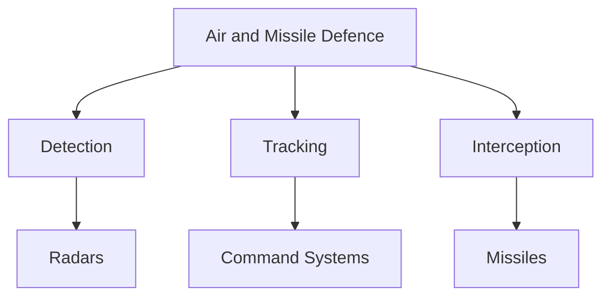

# Air and Missile Defence

## Strategic Importance

Air and Missile Defence (AMD) protects a country from hostile aircraft, drones, cruise missiles, ballistic missiles, and other airborne threats.

Modern warfare increasingly relies on long-range precision weapons, making air and missile defence a critical component of national security.

For India, AMD is essential because of nuclear-armed neighbours, expanding missile arsenals, drone threats, and the need to protect strategic assets.

---

## Learning Objectives

After completing this section, you should understand:

- Air defence fundamentals
- Ballistic missile defence concepts
- India's multi-layered air defence architecture
- Major Indian air defence systems
- Emerging drone and missile threats
- Future air defence modernization efforts

---

## Repository Structure

```text
air-and-missile-defence
├── README.md
├── akash.md
├── s400.md
└── ballistic-missile-defence.md
```

---

## Air Defence Ecosystem



---

## Major Threats

### Aircraft

Fighter aircraft, bombers, and airborne strike platforms.

### Drones and UAVs

Reconnaissance and attack drones are increasingly important in modern warfare.

### Cruise Missiles

Low-flying precision weapons designed to evade traditional defences.

### Ballistic Missiles

Long-range missiles that travel on a ballistic trajectory and can carry conventional or nuclear warheads.

---

## Key Topics

### Akash

India's indigenous surface-to-air missile system designed for air defence against aircraft and aerial threats.

### S-400

Advanced long-range air defence system capable of engaging multiple aerial targets.

### Ballistic Missile Defence

Multi-layered defensive architecture designed to intercept incoming ballistic missiles.

---

## India's Air Defence Architecture


---

## Challenges

- Hypersonic weapons
- Swarm drone attacks
- Saturation attacks
- Electronic warfare threats
- Rapidly evolving missile technologies

---

## Future Roadmap

- Indigenous missile defence technologies
- Counter-drone systems
- AI-assisted threat detection
- Improved radar networks
- Integrated multi-layered defence systems

---

## Quick Revision

- Air and Missile Defence protects against airborne threats.
- Air defence includes aircraft, drones, cruise missiles, and ballistic missile threats.
- Akash and S-400 are important defence systems.
- Ballistic Missile Defence protects against strategic missile attacks.
- Multi-layered defence improves survivability and deterrence.

---

## Key Concepts

### Easy

1. What is Air and Missile Defence?
2. What are the major airborne threats?
3. What is the Akash missile system?
4. What is Ballistic Missile Defence?

### Intermediate

1. Why is a multi-layered air defence system important?
2. How do radar systems support air defence?
3. What role does the S-400 play in India's defence architecture?
4. What challenges do modern missile threats create?

### Advanced

1. Analyse India's air and missile defence strategy.
2. Evaluate the impact of hypersonic weapons on air defence.
3. Explain the importance of integrated air defence networks.
