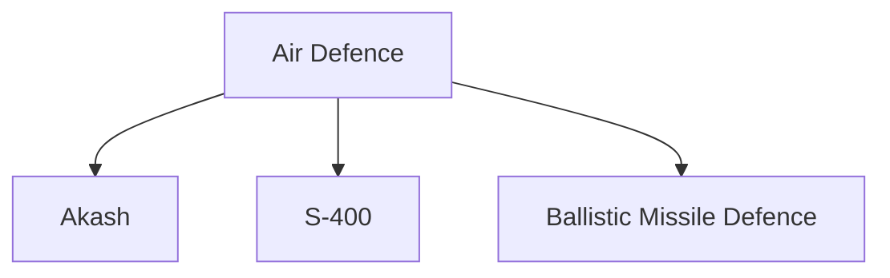
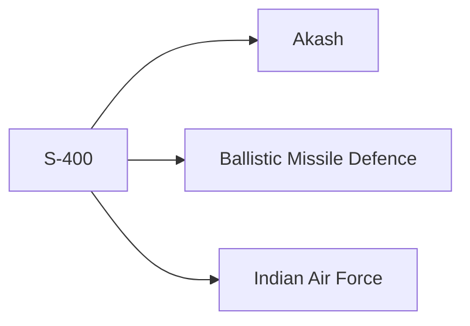

# S-400 Air Defence System

## Strategic Importance

The S-400 is one of the most advanced long-range air-defence systems operated by India.

It strengthens India's ability to detect, track and engage a wide range of aerial threats, including aircraft, drones and missile threats. The system significantly enhances India's layered air-defence architecture and contributes to national security.

---

## Quick Facts

| Item | Details |
|----------|----------|
| Name | S-400 Triumf |
| Type | Long-Range Air Defence System |
| Origin | Russia |
| Role | Air and Missile Defence |
| User | Indian Air Force |
| Importance | Strategic Air Defence |
| Domain | Missile and Space Defence |

---

## What Is the S-400?

The S-400 is an integrated air-defence system designed to detect, track and engage multiple aerial threats simultaneously.

It combines advanced radar systems, command-and-control networks and interceptor missiles to provide long-range protection.

---

## Why the S-400 Is Important

- Strengthens national air defence
- Improves protection of strategic assets
- Enhances missile-defence capability
- Supports layered defence architecture
- Improves situational awareness
- Increases deterrence capability

---

## How the System Works

---

## Major Components

### Radar Systems

Responsible for:

- Long-range detection
- Target tracking
- Threat identification

### Command and Control

Responsible for:

- Threat assessment
- Engagement decisions
- Air-defence coordination

### Missile Launchers

Responsible for:

- Interceptor deployment
- Target engagement
- Defensive operations

---

## Layered Air Defence

The S-400 operates as part of India's broader layered air-defence network.

---

## Threats Countered

- Fighter aircraft
- Bombers
- Drones and UAVs
- Cruise missile threats
- Certain missile threats

---

## Strategic Importance for India

The S-400 helps India:

- Protect strategic regions
- Strengthen air-space security
- Improve military readiness
- Enhance deterrence
- Support national-security objectives

---

## Relationship with Other Defence Systems

---

## Challenges

- Evolving aerial threats
- Hypersonic technologies
- Electronic warfare environments
- Integration with multiple defence networks

---

## Future Outlook

- Greater network integration
- Enhanced air-defence coordination
- Improved sensor fusion
- Stronger layered defence capability

---

## Quick Revision

- S-400 is a long-range air-defence system.
- It is operated by the Indian Air Force.
- It combines radar, command systems and interceptor missiles.
- It strengthens India's layered air-defence architecture.
- It improves protection against aerial threats.
- It contributes to strategic deterrence.

---

## Key Concepts

### What is the S-400?

A long-range integrated air-defence system.

### Why is the S-400 important?

It significantly strengthens India's air-defence capability.

### Which service operates the S-400?

The Indian Air Force.

### How does the S-400 support national security?

By detecting and engaging aerial threats before they reach critical targets.

### Where does the S-400 fit in India's defence architecture?

It forms an important layer within India's integrated air-defence network.
