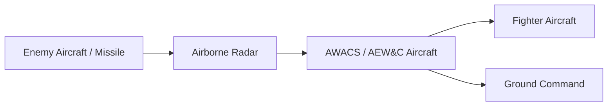
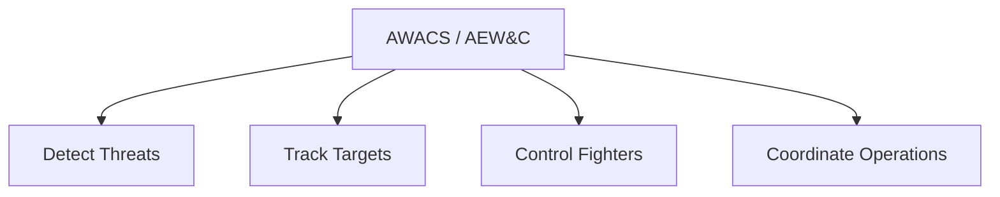

# Airborne Warning Systems (AWACS & AEW&C)

## Strategic Importance

Airborne Warning Systems are flying command-and-control platforms equipped with powerful radars and sensors that detect aircraft, missiles, drones, and other threats over very long distances.

They significantly extend battlefield awareness beyond ground-based radars and help the Indian Air Force monitor airspace, coordinate operations, and respond to threats quickly.

---

## Quick Facts

| Item | Details |
|----------|----------|
| Full Form (AWACS) | Airborne Warning and Control System |
| Full Form (AEW&C) | Airborne Early Warning and Control |
| Primary Operator | Indian Air Force |
| Main Purpose | Airspace Surveillance and Battle Management |
| Key Capability | Long-Range Detection |
| Strategic Value | Force Multiplier |

---

## How Airborne Warning Systems Work

---

## Why They Are Important

- Detect threats at long range
- Provide early warning
- Improve air defence capability
- Coordinate fighter aircraft
- Support network-centric warfare
- Monitor large areas of airspace

---

## Types of Airborne Warning Systems

### AWACS

Larger platforms with longer range and greater command capabilities.

### AEW&C

Smaller and lighter platforms focused on surveillance and battle management.

---

## Indian Air Force Airborne Warning Fleet

| Platform | Category |
|----------|----------|
| Netra AEW&C | Indigenous AEW&C System |
| Phalcon AWACS | Long-Range AWACS |

---

## Netra AEW&C

### Key Features

- Developed with DRDO participation
- Mounted on aircraft platform
- Provides airborne surveillance
- Supports tactical operations
- Improves indigenous capability

### Importance

Netra represents India's indigenous airborne surveillance capability.

---

## Phalcon AWACS

### Key Features

- Long-range airborne radar platform
- Advanced surveillance capability
- Air battle management functions
- Supports multiple aircraft simultaneously

### Importance

Phalcon significantly strengthens India's airspace monitoring capability.

---

## Role During Air Operations

---

## Advantages

- Extended radar coverage
- Early threat detection
- Better situational awareness
- Improved command and control
- Faster response times
- Force multiplication effect

---

## Limitations

- Expensive platforms
- Require fighter protection
- High maintenance requirements
- Dependence on airborne operations

---

## Future Roadmap

- Additional indigenous AEW&C systems
- Enhanced radar capabilities
- Better network integration
- Expanded surveillance coverage
- Next-generation airborne sensors

---

## Quick Revision

- AWACS and AEW&C are airborne surveillance platforms.
- Provide early warning and battle management.
- Extend radar coverage far beyond ground systems.
- Netra is India's indigenous AEW&C platform.
- Phalcon is India's major long-range AWACS platform.
- Considered force multipliers for modern air warfare.

---

## Key Concepts

### What is an AWACS?

A flying command-and-control aircraft equipped with long-range surveillance radar.

### What is AEW&C?

Airborne Early Warning and Control system used for surveillance and battle management.

### Why are airborne warning systems important?

They provide early detection of threats and improve battlefield awareness.

### Which service operates these systems in India?

The Indian Air Force.

### Why are AWACS called force multipliers?

Because they greatly improve the effectiveness of fighter aircraft and air-defence networks.
