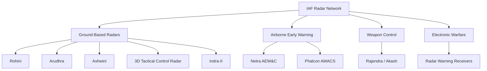

# Indian Air Force Radars

Radar systems supporting airspace surveillance, early warning, target tracking, identification, air-defence control and electronic warfare.

The Indian Air Force uses a combination of ground-based radars, airborne early-warning systems and aircraft-mounted radar and electronic-support systems.

---

## Major Systems

| System | Type | Primary Role | Status |
|---|---|---|---|
| Rohini | 3D medium-range surveillance radar | Airspace surveillance | Operational |
| Arudhra | 4D AESA surveillance radar | Long-range air surveillance | Operational / induction |
| 3D Tactical Control Radar | 3D surveillance radar | Tactical air surveillance | Operational |
| Ashwini | 4D low-level surveillance radar | Low-level air surveillance | Operational / induction |
| Indra-II | Low-level detection radar | Low-flying target detection | Operational |
| Netra AEW&C | Airborne AESA radar system | Airborne early warning and control | Operational |
| Phalcon AWACS | Airborne early warning system | Long-range airborne surveillance | Operational |
| Akash / Rajendra radar | Multifunction phased-array radar | Air-defence weapon control | Operational |
| Medium Power Radar | 4D surveillance radar family | Airspace surveillance | Operational / induction |

---

# Rohini

## System Profile

| Field | Details |
|---|---|
| Type | 3D medium-range surveillance radar |
| Developer | DRDO / LRDE |
| Manufacturer | BEL |
| Primary Role | Airspace surveillance and early warning |
| Status | Operational |
| Quantity | Current operational quantity not publicly disclosed |

## Major Work

Rohini provides ground-based three-dimensional surveillance and tracks airborne targets for air-defence operations.

DRDO describes it as a ground-based Pulse Doppler radar for airspace surveillance, including operation in hostile electronic-warfare environments. citeturn0search0

---

# Arudhra

## System Profile

| Field | Details |
|---|---|
| Type | 4D Active Electronically Scanned Array radar |
| Developer | DRDO / LRDE |
| Manufacturer | BEL |
| Primary Role | Airspace surveillance |
| Technology | Active Aperture Phased Array |
| Status | Operational / induction |
| Quantity | Contracted quantities are not treated as current operational fleet |

## Major Work

Arudhra is an indigenous modern surveillance radar designed to improve the Indian Air Force's airspace-surveillance capability.

BEL describes it as a 4D surveillance radar using active phased-array technology and solid-state transmit/receive modules. citeturn0search14

---

# Ashwini

## System Profile

| Field | Details |
|---|---|
| Type | 4D Low-Level Transportable Radar |
| Primary Role | Low-level air surveillance |
| Developer | DRDO / LRDE |
| Manufacturer | Indian defence industry |
| Status | Operational / induction |
| Quantity | Current operational quantity not publicly disclosed |

## Major Work

Ashwini is intended to strengthen detection and tracking of low-level aerial targets and improve coverage in the lower-altitude portion of the airspace.

---

# 3D Tactical Control Radar

## System Profile

| Field | Details |
|---|---|
| Type | 3D tactical surveillance radar |
| Developer | DRDO / LRDE |
| Primary Role | Tactical airspace surveillance |
| Functions | Detection, tracking and identification |
| Status | Operational |
| Quantity | Not publicly disclosed |

## Major Work

The radar provides tactical detection and tracking of aerial targets and supports air-defence command and control.

DRDO identifies the 3D Tactical Control Radar as an all-weather surveillance radar for detection and identification of aerial targets. citeturn0search9

---

# Indra-II

## System Profile

| Field | Details |
|---|---|
| Type | Low-level detection radar |
| Primary Role | Detection of low-flying targets |
| Status | Operational |
| Quantity | Not publicly disclosed |

## Major Work

Indra-II provides low-level surveillance and detection capability against targets flying close to the ground.

BEL lists Low Flying Detection Radar (Indra II) among its radar systems. citeturn0search11

---

# Netra AEW&C

## System Profile

| Field | Details |
|---|---|
| Type | Airborne Early Warning and Control system |
| Platform | Embraer-145 |
| Primary Radar | Indigenous AESA radar |
| Developer | DRDO / CABS / LRDE and partner organisations |
| Primary User | Indian Air Force |
| Primary Role | Airborne early warning and command and control |
| Coverage | Approximately 240° for the original system |
| Status | Operational |
| Aircraft Delivered | 3 |
| Current Operational Count | Public sources should be checked before treating delivered aircraft as continuously available |

## Major Work

Netra provides an airborne picture of aerial and selected surface targets and supports command and control of air operations.

DRDO states that the system includes sensors for early warning of airborne and sea-surface targets and hostile emissions, with information supplied to controllers onboard the aircraft and ground stations. citeturn0search1

DRDO documentation records three aircraft delivered in the initial configuration. citeturn0search1

---

# Phalcon AWACS

## System Profile

| Field | Details |
|---|---|
| Type | Airborne Early Warning and Control system |
| Platform | Ilyushin Il-76 |
| Radar | EL/W-2090 Phalcon |
| Primary Role | Long-range airborne surveillance and command support |
| User | Indian Air Force |
| Status | Operational |
| Fleet | 3 aircraft |

## Major Work

The Phalcon system provides long-range airborne surveillance and contributes to the creation of a wider air picture for command and control.

DRDO material records three Indian Phalcon aircraft in IAF service. citeturn0search26

---

# Akash / Rajendra Radar

## System Profile

| Field | Details |
|---|---|
| Type | Multifunction phased-array radar |
| Primary Role | Air-defence weapon control |
| Associated System | Akash |
| Developer | DRDO / LRDE |
| Users | Indian Army and Indian Air Force |
| Functions | Target detection, tracking and missile engagement support |
| Status | Operational |
| Quantity | Not publicly disclosed |

## Major Work

Rajendra performs target detection and tracking and provides the radar functions required for Akash missile engagement.

---

# Medium Power Radar

## System Profile

| Field | Details |
|---|---|
| Type | 4D surveillance radar |
| Primary Role | Airspace surveillance |
| User | Indian Air Force |
| Status | Operational / induction |
| Quantity | Contract quantities should not be treated as current operational fleet |

## Major Work

Medium Power Radar systems provide modern surveillance capability and contribute to India's layered air-defence sensor network.

---

## Air Force Radar Architecture

---

## From Detection to Engagement

---

## What Each Radar Does

| Mission | Example |
|---|---|
| Medium-range air surveillance | Rohini |
| Modern 4D surveillance | Arudhra |
| Low-level surveillance | Ashwini, Indra-II |
| Tactical surveillance | 3D Tactical Control Radar |
| Airborne early warning | Netra |
| Long-range airborne surveillance | Phalcon |
| Missile weapon control | Rajendra |
| Electronic support | Radar Warning Receiver systems |

---

## Radar Development and Induction

---

## Important Statistics Rule

Radar statistics must distinguish between:

- **Development started** — beginning of the programme
- **First prototype / first trial** — first major test milestone
- **Production started** — beginning of manufacturing
- **First induction** — first entry into military service
- **Ordered** — contracted quantity
- **Delivered** — supplied quantity
- **Inducted** — accepted into service
- **Total inventory** — current fleet
- **Operational** — currently available for missions
- **Retired** — removed from service

### Why this matters

A statement such as "India has 10 radars" can be misleading if the number refers only to an old procurement contract.

Where a reliable current figure is unavailable:

> **Not publicly disclosed**

---

## Quick Revision

- **Rohini** — 3D medium-range ground surveillance radar.
- **Arudhra** — modern 4D AESA surveillance radar.
- **Ashwini** — low-level air-surveillance radar.
- **3D Tactical Control Radar** — tactical aerial surveillance.
- **Indra-II** — low-level detection radar.
- **Netra** — indigenous airborne early-warning and control system.
- **Phalcon** — airborne early-warning system using the EL/W-2090 radar.
- **Rajendra** — Akash weapon-control radar.
- **Radar Warning Receivers** — detect and identify hostile radar emissions.

---

## Key Takeaways

The Indian Air Force does not depend on one radar type.

It uses a layered sensor architecture:

1. Ground-based surveillance radars detect and track aircraft.
2. Low-level radars improve coverage against low-altitude targets.
3. Airborne systems such as Netra and Phalcon extend the surveillance picture.
4. Weapon-control radars support missile engagement.
5. Electronic-warfare systems detect and analyse hostile radar emissions.
6. Networked command-and-control systems combine information from multiple sensors.

This layered approach is more important than any single radar's range or specification.
