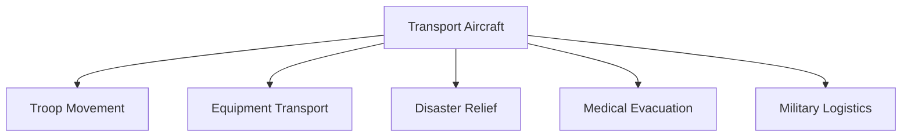

# Transport Aircraft

## Strategic Importance

Transport aircraft are the logistical backbone of the Indian Air Force. They move troops, military equipment, vehicles, humanitarian aid, medical supplies, and disaster-relief materials across the country and beyond.

Without transport aircraft, rapid military deployment and large-scale logistics operations would not be possible.

---

## Quick Facts

| Item | Details |
|----------|----------|
| Primary Operator | Indian Air Force |
| Main Purpose | Military Transport and Logistics |
| Strategic Role | Rapid Deployment and Airlift |
| Key Capability | Long-Range Transportation |
| Operational Areas | Domestic and International |
| Importance | Military Readiness and Mobility |

---

## What Is a Transport Aircraft?

A transport aircraft is a military aircraft designed to move personnel, equipment, vehicles, ammunition, supplies, and humanitarian assistance over short or long distances.

---

## Military Airlift Operations

---

## Why Transport Aircraft Are Important

- Rapid troop deployment
- Strategic mobility
- Military logistics support
- Disaster-relief operations
- Humanitarian assistance missions
- Support for remote military bases

---

## Strategic Airlift vs Tactical Airlift

| Type | Purpose |
|----------|----------|
| Strategic Airlift | Long-distance movement of troops and heavy equipment |
| Tactical Airlift | Short-range support near operational areas |

---

## Major Transport Aircraft of the Indian Air Force

| Aircraft | Origin | Primary Role |
|----------|----------|----------|
| C-17 Globemaster III | United States | Strategic Airlift |
| C-130J Super Hercules | United States | Tactical Airlift |
| IL-76 | Russia | Heavy Transport |
| An-32 | Ukraine/Soviet Origin | Tactical Transport |
| Dornier Do-228 | India/Germany Origin | Utility Transport |

---

## C-17 Globemaster III

### Key Features

- Heavy-lift transport aircraft
- Long-range operations
- Large cargo capacity
- Rapid deployment capability

### Importance

The C-17 is India's most capable strategic transport aircraft.

---

## C-130J Super Hercules

### Key Features

- Tactical transport aircraft
- Special operations support
- Short runway capability
- All-weather operations

### Importance

Widely used for special missions and rapid deployment.

---

## IL-76

### Key Features

- Heavy transport aircraft
- Large payload capacity
- Long operational history

### Importance

Played a major role in India's strategic airlift capability.

---

## An-32

### Key Features

- Medium transport aircraft
- High-altitude operations
- Reliable logistics platform

### Importance

Supports military logistics in mountainous regions.

---

## Dornier Do-228

### Key Features

- Light transport aircraft
- Maritime and utility missions
- Regional connectivity support

### Importance

Useful for surveillance and logistics missions.

---

## Support for Border Areas

Transport aircraft are critical for supplying remote areas such as Ladakh, Arunachal Pradesh and island territories.

---

## Humanitarian Assistance and Disaster Relief (HADR)

Transport aircraft assist during:

- Floods
- Earthquakes
- Cyclones
- Landslides
- Medical emergencies
- Evacuation missions

They are often among the first assets deployed during national emergencies.

---

## Medical Evacuation Operations

Transport aircraft can be configured to:

- Evacuate injured personnel
- Move medical teams
- Deliver emergency medical supplies
- Support large-scale relief operations

---

## Challenges

- High maintenance requirements
- Aging aircraft fleets
- Large operational costs
- Increasing logistics demands
- Need for modernization

---

## Future Roadmap

- Fleet modernization
- Greater indigenous capability
- Enhanced strategic airlift capacity
- Improved logistics integration
- Advanced mission-management systems

---

## Quick Revision

- Transport aircraft are the logistics backbone of the IAF.
- C-17 is India's primary strategic airlift platform.
- C-130J supports tactical and special operations.
- IL-76 provides heavy transport capability.
- An-32 supports high-altitude logistics.
- Transport aircraft play a major role in military and disaster-relief operations.

---

## Key Concepts

### Why are transport aircraft important?

They provide military mobility and logistics support.

### What is strategic airlift?

Long-range transportation of troops and equipment.

### Which aircraft is India's primary strategic airlifter?

The C-17 Globemaster III.

### What is the role of the C-130J?

Tactical transport and special operations support.

### Why are transport aircraft important in Ladakh?

They sustain troops and logistics in remote high-altitude regions.
