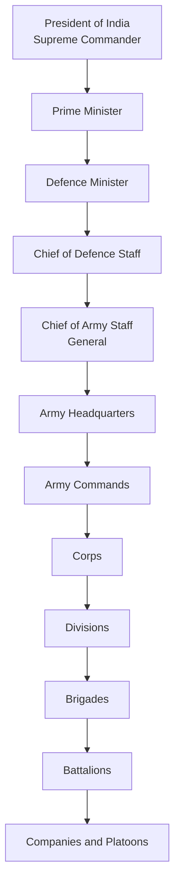
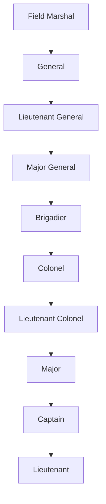
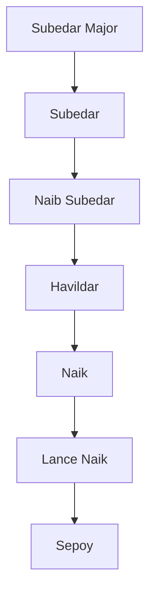

# Indian Army Rank Structure

## Why This Matters

Understanding Army ranks helps in:

- Defence and national security studies
- UPSC and competitive exam preparation
- Understanding military command hierarchy
- Comparing Army, Navy and Air Force structures

---

## Army Command Chain

---

## Commissioned Officer Ranks

| Rank | Responsibility |
|--------|--------|
| Field Marshal | Five-star ceremonial rank |
| General | Chief of Army Staff |
| Lieutenant General | Army Command / Corps leadership |
| Major General | Division command |
| Brigadier | Brigade command |
| Colonel | Battalion / Staff leadership |
| Lieutenant Colonel | Battalion-level leadership |
| Major | Company-level leadership |
| Captain | Junior officer command |
| Lieutenant | Entry-level commissioned officer |

### Officer Rank Hierarchy

---

## Junior Commissioned Officers and Other Ranks

| Rank | Category |
|--------|--------|
| Subedar Major | Senior JCO |
| Subedar | JCO |
| Naib Subedar | Junior JCO |
| Havildar | Senior Non-Commissioned Rank |
| Naik | Non-Commissioned Rank |
| Lance Naik | Junior Non-Commissioned Rank |
| Sepoy | Entry-Level Soldier |

### Soldier Rank Hierarchy

---

## Field Marshal

### Overview

- Five-star rank of the Indian Army
- Equivalent to Marshal of the Indian Air Force
- Equivalent to Admiral of the Fleet in the Navy
- Ceremonial and honorary rank
- Highest rank in the Indian Army

### Recipients

| Name |
|--------|
| Sam Manekshaw |
| K. M. Cariappa |

---

## Chief of Army Staff

The professional head of the Indian Army is the:

**Chief of Army Staff (COAS)**

Rank:

**General**

Responsibilities:

- Operational readiness
- National defence preparedness
- Army modernization
- Military planning
- Joint operations with Navy and Air Force

---

## Quick Comparison

| Army | Navy | Air Force |
|--------|--------|--------|
| General | Admiral | Air Chief Marshal |
| Lieutenant General | Vice Admiral | Air Marshal |
| Major General | Rear Admiral | Air Vice Marshal |
| Brigadier | Commodore | Air Commodore |
| Colonel | Captain | Group Captain |
| Lieutenant Colonel | Commander | Wing Commander |
| Major | Lieutenant Commander | Squadron Leader |
| Captain | Lieutenant | Flight Lieutenant |
| Lieutenant | Sub Lieutenant | Flying Officer |

---

## Important Topics and Answers

### Who is the Supreme Commander of the Indian Armed Forces?

President of India.

### Who leads the Indian Army?

Chief of Army Staff (COAS) with the rank of General.

### What is the highest rank in the Indian Army?

Field Marshal.

### Who are the Field Marshals of India?

Sam Manekshaw and K. M. Cariappa.

### Which rank commands a Brigade?

Brigadier.

### Which rank commands a Division?

Major General.

### Which rank commands a Corps?

Lieutenant General.

### Quick Revision

- President = Supreme Commander
- General = Head of Indian Army
- Brigadier commands Brigade
- Major General commands Division
- Lieutenant General commands Corps or Commands
- Highest rank = Field Marshal
- Field Marshals = Sam Manekshaw and K. M. Cariappa
- Indian Army motto = Service Before Self
