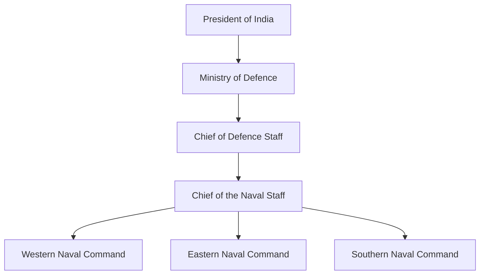
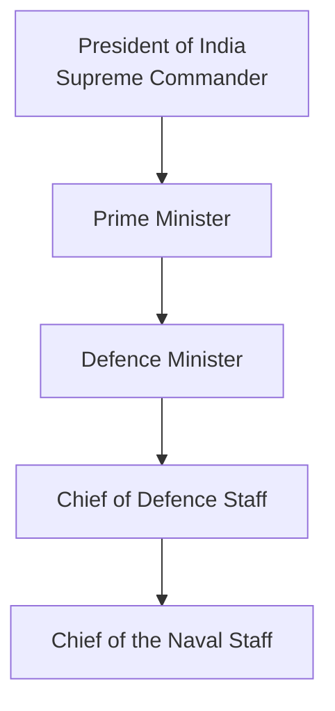
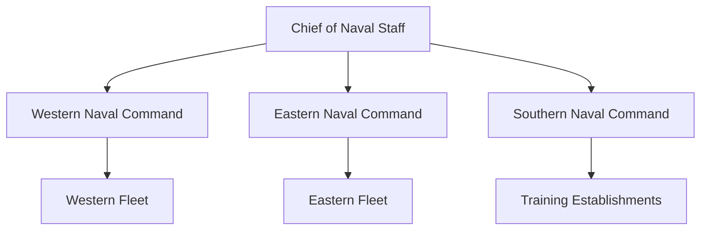
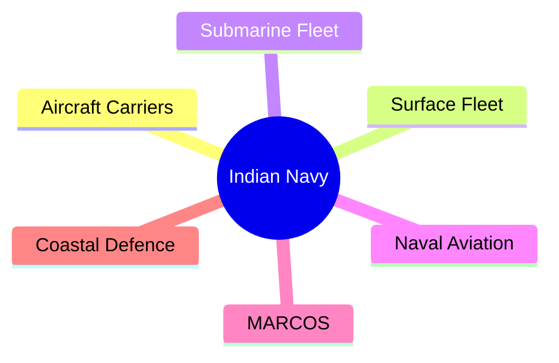

# Indian Navy

## Strategic Importance

The Indian Navy is the maritime warfare branch of the Indian Armed Forces. It safeguards India's maritime interests, protects sea lines of communication, secures the Indian Ocean Region, supports national security, and contributes to humanitarian assistance and disaster relief operations.

---

## Quick Facts

| Item | Details |
|----------|----------|
| Founded | 1612 (historical roots), modern Navy after Independence |
| Headquarters | New Delhi |
| Branch | Indian Armed Forces |
| Parent Ministry | Ministry of Defence |
| Supreme Commander | President of India |
| Professional Head | Chief of the Naval Staff (CNS) |
| Motto | Sham No Varunah (May the Lord of Oceans be Auspicious unto Us) |
| Primary Domain | Maritime Warfare |

---

## Position Within Defence Ecosystem

---

## Organisation Structure

---

## Command Structure

---

## Mission and Responsibilities

### Maritime Security

Protect India's maritime borders and strategic interests.

### Sea Control

Maintain dominance in critical maritime areas during conflict.

### Sea Denial

Prevent adversaries from using strategic maritime routes.

### Power Projection

Deploy naval forces beyond India's shores to support national interests.

### Humanitarian Assistance and Disaster Relief

Provide emergency assistance during disasters and evacuations.

---

## Naval Commands

| Command | Headquarters |
|----------|----------|
| Western Naval Command | Mumbai |
| Eastern Naval Command | Visakhapatnam |
| Southern Naval Command | Kochi |

### Western Naval Command

India's primary operational naval command facing the Arabian Sea.

### Eastern Naval Command

Responsible for operations in the Bay of Bengal and eastern waters.

### Southern Naval Command

Acts as the Navy's principal training command.

---

## Fleet Structure

| Fleet | Headquarters | Responsibility |
|----------|----------|----------|
| Western Fleet | Mumbai | Arabian Sea operations |
| Eastern Fleet | Visakhapatnam | Bay of Bengal and Indo-Pacific operations |
| Training Fleet | Kochi | Training and professional development |

### Western Fleet

- India's primary strike fleet
- Supports carrier battle group operations
- Focuses on western maritime front

### Eastern Fleet

- Covers Bay of Bengal and eastern maritime approaches
- Supports Indo-Pacific deployments
- Strategic presence in eastern waters

---

## Major Components

### Aircraft Carriers

| Carrier | Type |
|----------|----------|
| INS Vikramaditya | Aircraft Carrier |
| INS Vikrant | Indigenous Aircraft Carrier |

Aircraft carriers provide sea-based air power and strategic reach.

### Surface Fleet

- Destroyers
- Frigates
- Corvettes
- Patrol Vessels
- Amphibious Ships

### Submarine Fleet

- Conventional submarines
- Nuclear-powered submarines
- Ballistic missile submarines

### Naval Aviation

- MiG-29K fighters
- P-8I maritime patrol aircraft
- MH-60R helicopters
- ALH naval variants

### MARCOS

Marine Commandos are the Indian Navy's elite special operations force.

### Coastal Defence

Supports maritime surveillance, coastal security and port protection.

---

## Key Operational Areas

- Arabian Sea
- Bay of Bengal
- Indian Ocean Region (IOR)
- Strait of Malacca approaches
- Anti-piracy operations

---

## Major Operations

---

## Major Naval Assets

| Category | Examples |
|----------|----------|
| Aircraft Carriers | INS Vikramaditya, INS Vikrant |
| Destroyers | Kolkata Class, Visakhapatnam Class |
| Frigates | Shivalik Class, Talwar Class |
| Submarines | Arihant Class, Scorpene Class |
| Patrol Aircraft | P-8I Poseidon |
| Naval Helicopters | MH-60R, Sea King |

These assets form the backbone of India's maritime deterrence and operational capability.

### Indo-Pak War (1971)

### Operation Trident

### Operation Python

### Anti-Piracy Missions

### Operation Rahat

### Evacuation Operations

---

## Modernisation Initiatives

- Indigenous warship construction
- Nuclear submarine programme
- Aircraft carrier development
- Maritime surveillance enhancement
- Network-centric naval warfare

---

## Challenges

- Expanding maritime competition in the Indian Ocean
- Protection of long sea lines of communication
- Technological modernisation requirements
- Growing submarine threats
- Maritime domain awareness demands

---

## Future Roadmap

- Expansion of blue-water navy capability
- Additional indigenous aircraft carriers
- Larger submarine fleet including SSNs
- Unmanned maritime and underwater systems
- Stronger Indo-Pacific presence
- Greater integration with future theatre commands
- Indigenous naval aviation and weapon systems

---

## Quick Revision

| Topic | Key Point |
|----------|----------|
| Professional Head | Chief of the Naval Staff |
| Headquarters | New Delhi |
| Commands | Western, Eastern, Southern |
| Main Fleets | Western Fleet and Eastern Fleet |
| Aircraft Carriers | INS Vikramaditya, INS Vikrant |
| Elite Force | MARCOS |
| Maritime Region | Indian Ocean Region |

---

## Key Concepts

### What is the primary role of the Indian Navy?

To protect India's maritime interests, secure sea routes, defend coastal areas, and support national security in the Indian Ocean Region.

### Why is the Indian Ocean Region important for India?

A large portion of India's trade and energy imports pass through the Indian Ocean, making maritime security critical for the economy and national security.

### What are the three operational naval commands?

- Western Naval Command (Mumbai)
- Eastern Naval Command (Visakhapatnam)
- Southern Naval Command (Kochi)

### What is the difference between Sea Control and Sea Denial?

- Sea Control: Ability to use a maritime area freely.
- Sea Denial: Preventing an adversary from using a maritime area.

### What is MARCOS?

MARCOS (Marine Commandos) is the elite special operations force of the Indian Navy responsible for maritime special warfare, counter-terrorism, and hostage rescue missions.

### Why are aircraft carriers important?

Aircraft carriers provide mobile air power, extend operational reach, and allow force projection far from India's coastline.
