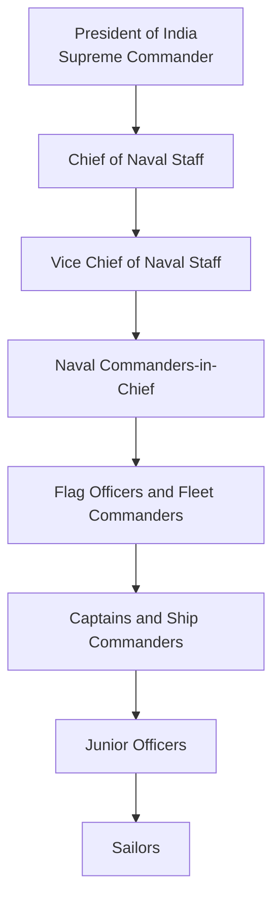
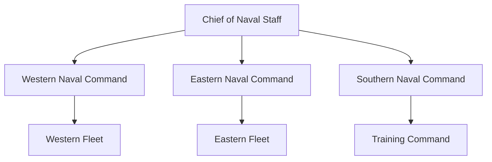

# Indian Navy Rank Structure

## Strategic Importance

The rank structure of the Indian Navy defines leadership responsibilities, command authority, operational control, and career progression. Naval ranks help maintain discipline, command ships and fleets, and conduct maritime operations across the Indian Ocean Region.

---

## Naval Command Hierarchy

---

## Commissioned Officer Ranks

| Rank | NATO Equivalent | Typical Responsibility |
|--------|--------|--------|
| Admiral of the Fleet* | Five-Star Rank | Wartime/Honorary rank |
| Admiral | Four-Star | Chief of Naval Staff |
| Vice Admiral | Three-Star | Command-level leadership |
| Rear Admiral | Two-Star | Fleet and regional command |
| Commodore | One-Star | Flotilla and major formation command |
| Captain | Colonel Equivalent | Command of major warships and establishments |
| Commander | Lieutenant Colonel Equivalent | Executive and operational command |
| Lieutenant Commander | Major Equivalent | Department leadership |
| Lieutenant | Captain Equivalent | Operational officer |
| Sub Lieutenant | Lieutenant Equivalent | Junior officer |
| Midshipman | Officer Trainee | Initial commissioned stage |

*Not currently held by any serving officer.

---

## Officer Rank Progression

---

## Sailor Rank Structure

| Rank | Role |
|--------|--------|
| Master Chief Petty Officer I | Senior-most sailor rank |
| Master Chief Petty Officer II | Senior supervisory role |
| Chief Petty Officer | Section leadership |
| Petty Officer | Technical and supervisory duties |
| Leading Seaman | Junior leadership role |
| Seaman I | Skilled sailor |
| Seaman II | Entry-level trained sailor |
| Agniveer (SSR/MR) | Initial entry under Agnipath Scheme |

---

## Flag Officers

Flag officers are senior naval leaders authorized to fly a command flag.

| Rank | Category |
|--------|--------|
| Commodore | One-Star Flag Rank |
| Rear Admiral | Two-Star Flag Rank |
| Vice Admiral | Three-Star Flag Rank |
| Admiral | Four-Star Flag Rank |

---

## Major Responsibilities by Rank

### Admiral

- Chief of Naval Staff (CNS)
- Overall leadership of the Indian Navy
- Naval strategy and force development
- Advises Government of India on maritime security

### Vice Admiral

- Naval commands and headquarters leadership
- Strategic planning and operations

### Rear Admiral

- Fleet and regional command responsibilities
- Maritime operational leadership

### Commodore

- Commands flotillas and naval formations
- Senior staff appointments

### Captain

- Commands major warships and naval establishments

### Commander and Below

- Ship operations
- Navigation
- Weapons systems
- Engineering
- Aviation support
- Logistics and administration

---

## Indian Navy Commands and Senior Leadership

---

## Rank Equivalence Across Services

| Navy | Army | Air Force |
|--------|--------|--------|
| Admiral | General | Air Chief Marshal |
| Vice Admiral | Lieutenant General | Air Marshal |
| Rear Admiral | Major General | Air Vice Marshal |
| Commodore | Brigadier | Air Commodore |
| Captain | Colonel | Group Captain |
| Commander | Lieutenant Colonel | Wing Commander |
| Lieutenant Commander | Major | Squadron Leader |
| Lieutenant | Captain | Flight Lieutenant |
| Sub Lieutenant | Lieutenant | Flying Officer |

---

## Quick Revision

- Admiral is the highest active rank in the Indian Navy.
- Chief of Naval Staff is an Admiral.
- Commodore is the first flag rank.
- Captain commands major warships and naval establishments.
- Midshipman is the entry-level officer rank.
- The Indian Navy has Western, Eastern and Southern Naval Commands.
- Admiral of the Fleet is a five-star rank and has never been awarded in India.

---

## Important Questions & Answers

### Who is the professional head of the Indian Navy?

Chief of Naval Staff (CNS).

### What is the highest active naval rank?

Admiral.

### Which rank commands major warships?

Captain.

### What is the first flag rank in the Navy?

Commodore.

### How many operational naval commands does India have?

Three major commands: Western, Eastern and Southern Naval Commands.
