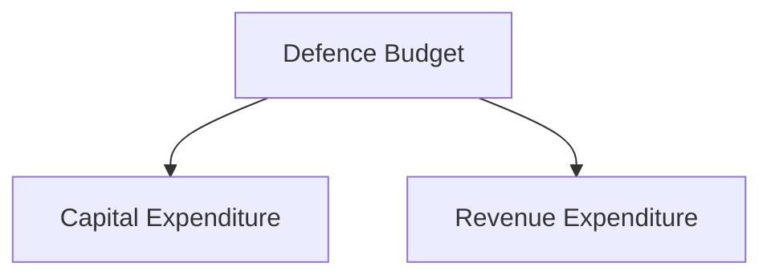
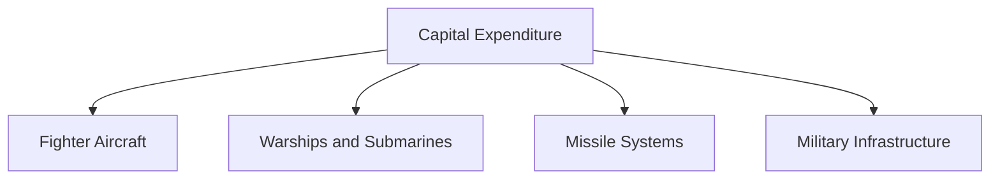
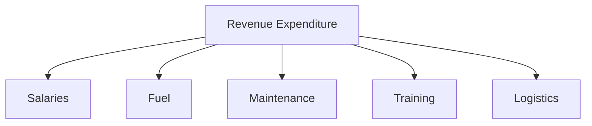
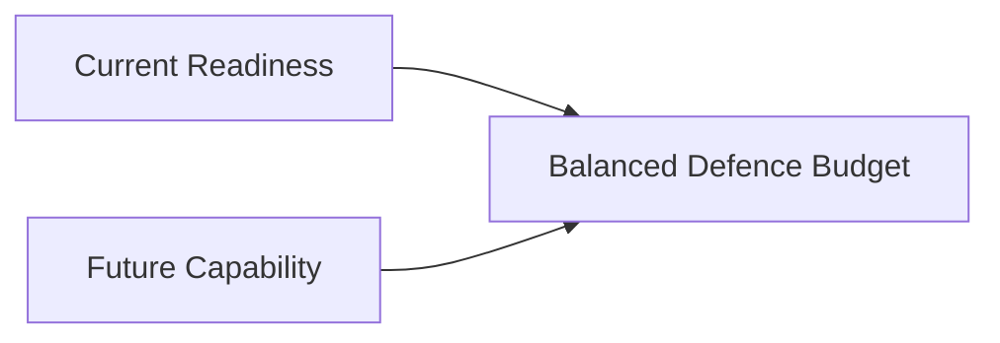

# Capital vs Revenue Expenditure in Defence

## Strategic Importance

Defence spending is broadly divided into Capital Expenditure and Revenue Expenditure.

Understanding the difference is essential because it explains how India balances current military readiness with future military modernization.

Capital expenditure focuses on creating future capabilities, while revenue expenditure focuses on sustaining existing capabilities.

---

## Quick Facts

| Item | Capital Expenditure | Revenue Expenditure |
|----------|----------|----------|
| Purpose | Asset Creation | Day-to-Day Operations |
| Time Horizon | Long-Term | Short-Term and Recurring |
| Examples | Aircraft, Warships, Missiles | Salaries, Fuel, Maintenance |
| Impact | Modernization | Operational Readiness |
| Nature | Investment | Operating Expense |

---

## What is Capital Expenditure?

Capital expenditure refers to spending on acquiring, upgrading or creating long-term military assets.

Examples include:

- Fighter aircraft
- Warships
- Submarines
- Tanks
- Missile systems
- Air-defence systems
- Military infrastructure
- Advanced communication networks

These expenditures contribute to future military capability.

---

## What is Revenue Expenditure?

Revenue expenditure refers to recurring spending required to operate and maintain the Armed Forces.

Examples include:

- Salaries and allowances
- Pensions
- Fuel and lubricants
- Ammunition consumption
- Equipment maintenance
- Training expenses
- Logistics support

These expenditures ensure day-to-day military readiness.

---

## Defence Budget Structure

---

## Capital Expenditure Components

---

## Revenue Expenditure Components

---

## Why Capital Expenditure is Important

Capital expenditure helps:

- Modernize the Armed Forces
- Replace obsolete equipment
- Improve military capability
- Strengthen deterrence
- Prepare for future warfare

Countries seeking military modernization often increase capital expenditure.

---

## Why Revenue Expenditure is Important

Revenue expenditure helps:

- Maintain readiness
- Sustain military operations
- Support personnel
- Keep equipment operational
- Ensure continuous force availability

Without revenue expenditure, military assets cannot be effectively utilized.

---

## Balancing the Two

An effective defence budget requires a balance between modernization and operational sustainability.

---

## Strategic Importance

The balance between capital and revenue expenditure influences:

- Military readiness
- Force modernization
- Long-term capability development
- National-security preparedness
- Strategic deterrence

---

## Challenges

- Rising personnel costs
- Expensive military technologies
- Modernization requirements
- Limited budget resources
- Competing defence priorities

---

## Future Roadmap

- Higher modernization spending
- Greater indigenous procurement
- Technology-focused investments
- Improved budget efficiency
- Better long-term capability planning

---

## Quick Revision

- Capital expenditure creates long-term military assets.
- Revenue expenditure supports daily military operations.
- Aircraft, ships and missiles are capital expenditures.
- Salaries, fuel and maintenance are revenue expenditures.
- Capital spending drives modernization.
- Revenue spending maintains readiness.

---

## Key Concepts

### What is capital expenditure?

Spending on long-term military assets and capability creation.

### What is revenue expenditure?

Recurring spending needed for military operations and maintenance.

### Which expenditure supports modernization?

Capital expenditure.

### Which expenditure supports daily operations?

Revenue expenditure.

### Why is balancing both important?

Because militaries need both current readiness and future capability development.
