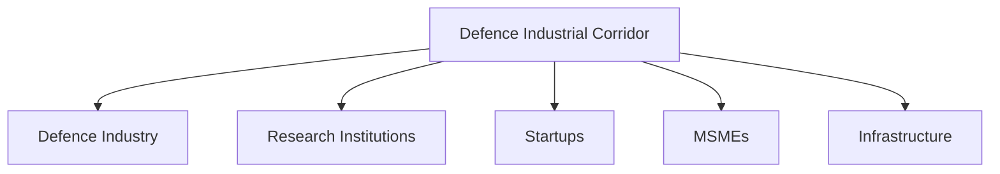

# Defence Industrial Corridors

## Strategic Importance

Defence Industrial Corridors are specialized industrial ecosystems created to strengthen India's indigenous defence-manufacturing capability.

They aim to bring together defence manufacturers, suppliers, research institutions, startups and supporting infrastructure within a coordinated framework.

These corridors play an important role in Atmanirbhar Bharat, Make in India and India's long-term defence-modernization strategy.

---

## Quick Facts

| Item | Details |
|----------|----------|
| Initiative | Defence Industrial Corridors |
| Objective | Defence Manufacturing and Self-Reliance |
| Major Corridors | Uttar Pradesh and Tamil Nadu |
| Lead Ministry | Ministry of Defence |
| Focus Areas | Manufacturing, R&D and Exports |
| Importance | Defence Industrial Ecosystem |

---

## What Are Defence Industrial Corridors?

Defence Industrial Corridors are regions where defence-related industries, infrastructure and research facilities are developed in a coordinated manner.

The goal is to create integrated manufacturing ecosystems that support the production of defence equipment and technologies.

---

## Why Were They Created?

The corridors were established to:

- Strengthen indigenous manufacturing
- Reduce defence imports
- Promote investment
- Support defence exports
- Encourage innovation
- Generate employment

---

## Defence Industrial Ecosystem

---

## Uttar Pradesh Defence Industrial Corridor

Major nodes include:

- Lucknow
- Kanpur
- Agra
- Aligarh
- Jhansi
- Chitrakoot

Objectives:

- Defence manufacturing growth
- Industrial development
- Investment attraction
- Employment generation

---

## Tamil Nadu Defence Industrial Corridor

Major nodes include:

- Chennai
- Coimbatore
- Hosur
- Salem
- Tiruchirappalli
- Tirunelveli

Objectives:

- Aerospace manufacturing
- Defence production
- Technology development
- Export-oriented growth

---

## Relationship with Atmanirbhar Bharat

The corridors are important instruments for achieving defence self-reliance.

---

## Role of Private Industry

Private-sector participation includes:

- Defence manufacturing
- Component production
- Technology development
- Innovation programmes
- Export-oriented production

Private industry is increasingly important to India's defence ecosystem.

---

## Role of MSMEs and Startups

MSMEs and startups contribute through:

- Component manufacturing
- Defence innovation
- Specialized technologies
- Supply-chain support
- Research partnerships

---

## Benefits of Defence Industrial Corridors

- Reduced import dependence
- Stronger domestic manufacturing
- Increased investment
- Employment generation
- Technology development
- Improved export capability
- Regional economic growth

---

## Strategic Importance

The corridors help India:

- Strengthen defence self-reliance
- Expand industrial capacity
- Improve supply-chain resilience
- Support military modernization
- Enhance strategic autonomy

---

## Challenges

- Technology gaps
- Supply-chain development
- Global competition
- Infrastructure requirements
- Long project timelines
- Skilled-workforce requirements

---

## Future Roadmap

- Greater industry participation
- Advanced defence manufacturing
- Increased exports
- Stronger R&D ecosystem
- Better startup integration
- Enhanced global competitiveness

---

## Quick Revision

- India has two Defence Industrial Corridors.
- Located in Uttar Pradesh and Tamil Nadu.
- Support Atmanirbhar Bharat and Make in India.
- Promote defence manufacturing and exports.
- Encourage investment, innovation and employment.
- Strengthen India's defence-industrial ecosystem.

---

## Key Concepts

### What are Defence Industrial Corridors?

Specialized industrial ecosystems for defence manufacturing and technology development.

### Why were they created?

To strengthen indigenous defence production and reduce import dependence.

### Which states host the corridors?

Uttar Pradesh and Tamil Nadu.

### How do they support Atmanirbhar Bharat?

By promoting domestic manufacturing, innovation and exports.

### Why are they strategically important?

They strengthen defence self-reliance and long-term military capability.
