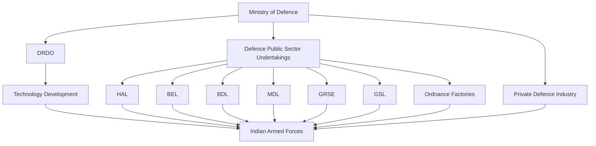

# Defence Industry

## Strategic Importance

A strong defence industry allows India to build, maintain, modernize, and export military equipment without excessive dependence on foreign countries.

India's defence industrial ecosystem supports national security, military readiness, technological innovation, employment generation, and strategic autonomy.

---

## Defence Industry Ecosystem



---

## Repository Structure

```text
18-defence/
└── defence-industry/
    ├── README.md
    ├── drdo.md
    ├── hindustan-aeronautics-limited.md
    ├── bharat-electronics-limited.md
    ├── bharat-dynamics-limited.md
    ├── mazagon-dock-shipbuilders.md
    ├── garden-reach-shipbuilders-and-engineers.md
    ├── goa-shipyard-limited.md
    ├── ordnance-factories.md
    ├── defence-exports.md
    ├── defence-corridors.md
    ├── defence-procurement-process.md
    └── atmanirbhar-defence.md
```

---

## Learning Flow


---

## Key Organisations

| Organisation | Primary Responsibility |
|----------|----------|
| DRDO | Defence Research and Development |
| HAL | Aircraft and Helicopter Manufacturing |
| BEL | Defence Electronics and Radars |
| BDL | Missile Manufacturing |
| MDL | Warship and Submarine Construction |
| GRSE | Naval Shipbuilding |
| GSL | Naval Shipbuilding |
| Ordnance Factories | Ammunition and Military Equipment |

---

## Why Defence Manufacturing Matters

- Reduces import dependence
- Strengthens national security
- Supports military modernization
- Creates high-skilled jobs
- Encourages technological innovation
- Increases defence exports
- Supports strategic autonomy

---

## Quick Revision

- DRDO develops technology.
- HAL manufactures aircraft and helicopters.
- BEL builds defence electronics.
- BDL manufactures missiles.
- MDL, GRSE and GSL build naval platforms.
- Ordnance factories produce ammunition and military equipment.
- Defence exports strengthen India's global defence presence.
- Defence manufacturing is a core pillar of Atmanirbhar Bharat.

---

## Key Concepts

### What is the defence industry?

The ecosystem that researches, develops, manufactures and supports military equipment and technologies.

### Why is indigenous defence manufacturing important?

It reduces dependence on foreign suppliers and improves strategic autonomy.

### Which organisation develops most defence technologies?

DRDO.

### Which organisation manufactures military aircraft?

HAL.

### What is the long-term goal of India's defence industry?

To achieve self-reliance while becoming a major global defence manufacturer and exporter.
