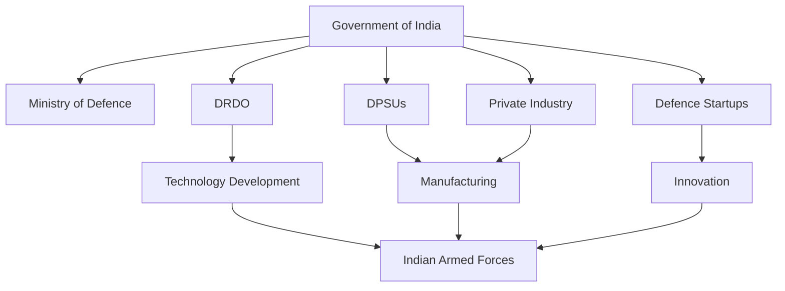

# Atmanirbhar Defence

## Strategic Importance

Atmanirbhar Defence is India's strategy to reduce dependence on foreign military imports and build a strong indigenous defence manufacturing ecosystem. The objective is to improve national security, strengthen domestic industry, create high-skilled jobs, increase exports, and achieve strategic autonomy.

---

## What is Atmanirbhar Defence?

Atmanirbhar Defence is the defence-sector component of the broader Atmanirbhar Bharat initiative.

It focuses on:

- Indigenous design and development
- Domestic manufacturing
- Defence technology innovation
- Reduction of import dependency
- Defence exports
- Private sector participation
- Military self-reliance

---

## Defence Self-Reliance Ecosystem

---

## Major Objectives

| Objective | Purpose |
|----------|----------|
| Reduce Imports | Lower foreign dependency |
| Indigenous Manufacturing | Build domestic capability |
| Strategic Autonomy | Independent defence decisions |
| Export Growth | Increase global defence presence |
| Technology Development | Create advanced military technologies |
| Employment Generation | Support skilled workforce growth |

---

## Key Pillars

### Indigenous Design

Development of weapons, platforms and military systems within India.

### Indigenous Manufacturing

Production of defence equipment by Indian companies and public-sector enterprises.

### Technology Development

Research and innovation led by DRDO, startups, academia and industry.

### Defence Exports

Expansion of India's global defence footprint through exports.

### Public-Private Partnership

Collaboration between government organizations and private industry.

---

## Major Initiatives

| Initiative | Purpose |
|----------|----------|
| Positive Indigenisation Lists | Restrict import of selected defence equipment |
| Make in India | Promote domestic manufacturing |
| iDEX | Defence innovation ecosystem |
| Defence Industrial Corridors | Manufacturing clusters |
| Strategic Partnership Model | Private sector participation |
| FDI Reforms | Increase investment in defence sector |
| Corporatisation of Ordnance Factories | Improve efficiency and competitiveness |

---

## Defence Industrial Corridors

### Uttar Pradesh Defence Corridor

Nodes include:

- Lucknow
- Kanpur
- Agra
- Aligarh
- Jhansi
- Chitrakoot

### Tamil Nadu Defence Corridor

Nodes include:

- Chennai
- Coimbatore
- Hosur
- Salem
- Tiruchirappalli
- Tirunelveli

These corridors aim to create integrated defence manufacturing ecosystems.

---

## Major Indigenous Defence Programmes

| Programme | Category |
|----------|----------|
| Tejas | Fighter Aircraft |
| Arjun | Main Battle Tank |
| Akash | Surface-to-Air Missile |
| Pinaka | Rocket Artillery |
| BrahMos | Supersonic Cruise Missile |
| INS Vikrant | Aircraft Carrier |
| Arihant Class | Nuclear Submarine |
| Dhanush | Artillery System |

---

## Defence Export Growth

Key export categories:

- Missiles
- Naval platforms
- Radars
- Artillery systems
- Aircraft components
- Electronic warfare systems

---

## Benefits

- Reduced import dependence
- Better supply-chain security
- Economic growth
- Technology development
- Employment generation
- Stronger defence preparedness
- Improved strategic autonomy

---

## Challenges

- Technology gaps in advanced systems
- Dependence on imported components
- Long development timelines
- Limited domestic engine development capability
- Global competition in defence exports
- High research and development costs

---

## Future Roadmap

- Indigenous fighter aircraft programmes
- Advanced combat drones
- Next-generation submarines
- Indigenous aero-engines
- Artificial intelligence in defence systems
- Space and cyber defence capabilities
- Increased defence exports
- Greater private-sector participation

---

## Quick Revision

| Topic | Key Point |
|----------|----------|
| Goal | Defence self-reliance |
| Parent Initiative | Atmanirbhar Bharat |
| Key Agency | Ministry of Defence |
| Technology Development | DRDO |
| Innovation Programme | iDEX |
| Major Corridors | Uttar Pradesh and Tamil Nadu |
| Focus | Indigenous design and manufacturing |

---

## Key Concepts

### Strategic Autonomy

The ability of a country to make defence and security decisions without excessive dependence on foreign powers.

### Indigenisation

Replacing imported defence equipment, systems, or components with domestically developed alternatives.

### Defence Industrial Base

The ecosystem of government organizations, public-sector enterprises, private companies, startups and research institutions involved in defence production.

### Positive Indigenisation List

A list of defence items that must be procured from domestic sources instead of being imported.

### Defence Export

Military equipment and defence-related technology sold by India to foreign countries.
