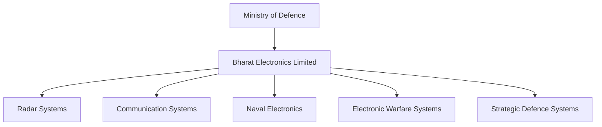
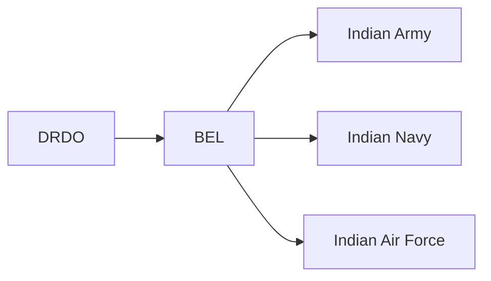

# Bharat Electronics Limited (BEL)

## Strategic Importance

Bharat Electronics Limited (BEL) is India's leading defence electronics company. It develops and manufactures radar systems, communication equipment, electronic warfare systems, command-and-control platforms, naval electronics, and advanced defence technologies used by the Indian Armed Forces.

BEL is often called the electronics backbone of India's defence sector.

---

## Quick Facts

| Item | Details |
|----------|----------|
| Full Name | Bharat Electronics Limited |
| Established | 1954 |
| Headquarters | Bengaluru, Karnataka |
| Ministry | Ministry of Defence |
| Ownership | Government of India Defence PSU |
| Category | Defence Electronics Company |
| Listed On | NSE and BSE |
| Core Area | Defence Electronics and Strategic Systems |

---

## Organisation Structure

---

## Why BEL Was Created

India needed indigenous capability in defence electronics after independence.

BEL was established to:

- Reduce dependence on imported defence electronics
- Support military modernization
- Develop strategic electronic systems
- Strengthen national security infrastructure
- Support DRDO and armed forces programmes

---

## Major Responsibilities

- Defence electronics manufacturing
- Radar development and production
- Military communication systems
- Electronic warfare systems
- Naval combat electronics
- Air-defence electronics
- Border surveillance systems
- Cyber and homeland security solutions

---

## Major Products

| System | Purpose |
|----------|----------|
| Radar Systems | Air and ground surveillance |
| Communication Networks | Secure military communications |
| Electronic Warfare Systems | Detection and jamming |
| Sonar Electronics | Naval operations |
| Command and Control Systems | Battlefield management |
| Weapon Control Systems | Fire-control and targeting |
| Border Surveillance Systems | Security monitoring |
| Satellite Communication Equipment | Strategic communications |

---

## BEL in Defence Ecosystem

BEL acts as a major production partner for numerous DRDO-developed systems.

---

## Manufacturing Facilities

Major facilities are located in:

- Bengaluru
- Ghaziabad
- Pune
- Hyderabad
- Chennai
- Machilipatnam
- Navi Mumbai
- Kotdwara

These facilities support manufacturing, integration, testing, and research activities.

---

## Role in Atmanirbhar Bharat

BEL contributes by:

- Producing indigenous defence electronics
- Supporting military modernization
- Reducing foreign technology dependence
- Increasing defence exports
- Supporting strategic national programmes

---

## Key Areas of Strategic Importance

- Air-defence radar networks
- Integrated battlefield systems
- Naval combat management systems
- Electronic warfare capability
- Border security technologies
- Strategic communication networks

---

## Challenges

- Rapid evolution of military technology
- Competition from global defence companies
- Semiconductor and component dependency
- Need for advanced indigenous R&D
- Cybersecurity threats

---

## Future Roadmap

- AI-enabled defence systems
- Advanced radar technologies
- Network-centric warfare solutions
- Space and satellite defence electronics
- Cyber-defence capabilities
- Expansion of defence exports

---

## Quick Revision

- Established in 1954.
- Headquarters in Bengaluru.
- India's leading defence electronics company.
- Defence PSU under Ministry of Defence.
- Produces radars, communication systems, and electronic warfare systems.
- Major technology partner of the Indian Armed Forces.
- Key contributor to Atmanirbhar Bharat.

---

## Key Concepts

### What is BEL?

India's premier defence electronics public sector company.

### Why is BEL important?

It provides critical electronic systems required by the Army, Navy, and Air Force.

### Which ministry controls BEL?

The Ministry of Defence.

### What is BEL best known for?

Radar systems, defence communications, and electronic warfare equipment.

### How does BEL support national security?

By developing and manufacturing strategic defence electronics used across India's military and security infrastructure.
