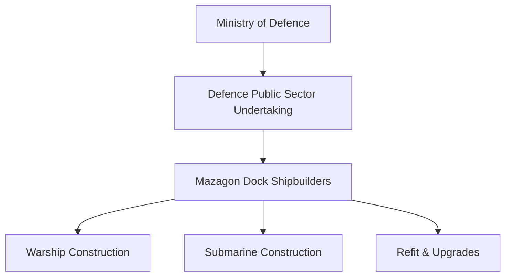
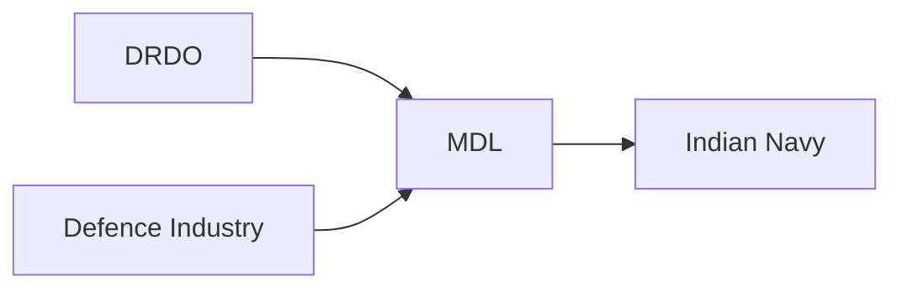
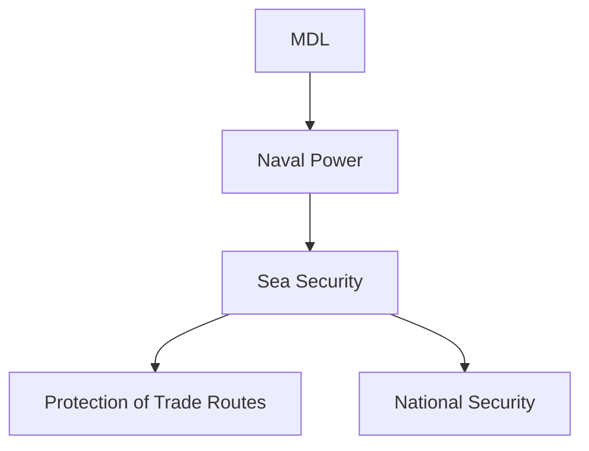

# Mazagon Dock Shipbuilders Limited (MDL)

## Strategic Importance

Mazagon Dock Shipbuilders Limited (MDL) is India's premier warship and submarine construction company. It is one of the most strategically important Defence Public Sector Undertakings (DPSUs) because it builds frontline naval platforms that strengthen India's maritime security and naval power.

MDL plays a critical role in supporting the Indian Navy's modernization and indigenous shipbuilding programmes.

---

## Quick Facts

| Item | Details |
|----------|----------|
| Full Name | Mazagon Dock Shipbuilders Limited |
| Headquarters | Mumbai, Maharashtra |
| Ministry | Ministry of Defence |
| Type | Defence Public Sector Undertaking |
| Primary Role | Warship and Submarine Construction |
| Primary Customer | Indian Navy |
| Strategic Importance | Maritime Defence Capability |

---

## Organisation Structure

---

## Why MDL Is Important

India has a long coastline and major maritime interests in the Indian Ocean Region.

MDL supports India by:

- Building advanced warships
- Constructing submarines
- Supporting naval modernization
- Strengthening indigenous shipbuilding
- Reducing dependence on foreign suppliers

---

## Major Responsibilities

- Warship construction
- Submarine construction
- Ship modernization
- Naval platform integration
- Maintenance and refits
- Support for indigenous naval programmes

---

## MDL in India's Naval Ecosystem

MDL converts naval designs and technologies into operational warships and submarines.

---

## Major Warship Programmes

| Programme | Category |
|----------|----------|
| Project 15 Delhi Class | Destroyers |
| Project 15A Kolkata Class | Guided Missile Destroyers |
| Project 15B Visakhapatnam Class | Advanced Destroyers |
| Project 17A | Stealth Frigates |

---

## Major Submarine Programmes

| Programme | Category |
|----------|----------|
| Scorpene Class (Kalvari Class) | Conventional Submarines |
| Project 75 | Submarine Programme |

These programmes significantly strengthened India's underwater warfare capability.

---

## Types of Platforms Built by MDL

### Destroyers

- Air defence missions
- Anti-submarine warfare
- Surface warfare operations

### Frigates

- Multi-role naval operations
- Escort and fleet protection

### Submarines

- Underwater surveillance
- Strategic deterrence
- Sea denial operations

---

## Strategic Importance

India's maritime security depends heavily on indigenous naval construction capabilities.

---

## Contribution to Atmanirbhar Bharat

MDL contributes through:

- Indigenous warship construction
- Indigenous submarine programmes
- Domestic supply-chain development
- Technology absorption
- Naval self-reliance

---

## Challenges

- Complex naval technologies
- Long construction timelines
- Advanced propulsion requirements
- Growing maritime competition
- Integration of next-generation systems

---

## Future Roadmap

- Next-generation destroyers
- Advanced frigates
- Future submarine programmes
- Greater indigenous content
- Smart naval technologies
- Expanded export opportunities

---

## Quick Revision

- MDL is India's leading warship and submarine builder.
- Located in Mumbai.
- Functions under the Ministry of Defence.
- Supports the Indian Navy.
- Builds destroyers, frigates and submarines.
- Critical for maritime security and naval modernization.

---

## Key Concepts

### What is MDL?

India's premier warship and submarine construction company.

### Which ministry controls MDL?

The Ministry of Defence.

### What does MDL build?

Destroyers, frigates, submarines and other naval platforms.

### Why is MDL important?

It provides indigenous naval construction capability.

### Which armed service benefits most from MDL?

The Indian Navy.
