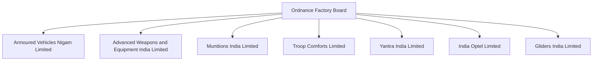
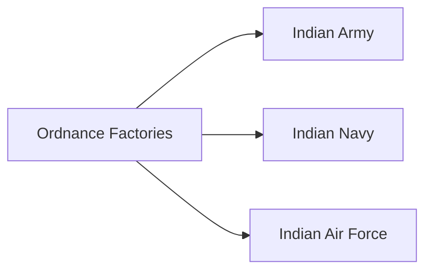

# Ordnance Factories

## Strategic Importance

Ordnance Factories have historically been the backbone of India's military production system. They were responsible for manufacturing ammunition, weapons, armoured systems, explosives, military equipment, and logistics support items required by the armed forces.

The former Ordnance Factory Board (OFB) played a major role in supporting India's defence preparedness for decades before being restructured into multiple Defence Public Sector Undertakings (DPSUs).

---

## Quick Facts

| Item | Details |
|----------|----------|
| Original Organisation | Ordnance Factory Board (OFB) |
| Parent Ministry | Ministry of Defence |
| Primary Role | Defence Manufacturing |
| Main Products | Ammunition, Weapons, Vehicles, Equipment |
| Major Reform | Corporatisation in 2021 |
| Current Structure | Seven Defence Public Sector Companies |

---

## Evolution of the Ordnance Factory System

---

## Why Corporatisation Happened

The Government of India restructured OFB in 2021 to:

- Improve efficiency
- Increase accountability
- Enhance competitiveness
- Modernize defence manufacturing
- Increase exports
- Strengthen self-reliance

---

## Major Responsibilities

- Ammunition production
- Small arms manufacturing
- Artillery support systems
- Armoured vehicle manufacturing
- Military logistics equipment
- Optical and surveillance systems
- Soldier support equipment

---

## Major Products

| Category | Examples |
|----------|----------|
| Ammunition | Artillery shells, tank ammunition, small-arms ammunition |
| Weapons | Rifles, machine guns, support weapons |
| Vehicles | Armoured platforms and support vehicles |
| Optics | Night vision and targeting systems |
| Equipment | Military clothing and field equipment |
| Components | Mechanical and industrial systems |

---

## Support to the Armed Forces

The Indian Army remains the largest user of products manufactured by the former ordnance factory ecosystem.

---

## Seven Successor DPSUs

### Armoured Vehicles Nigam Limited (AVNL)

Responsible for:

- Armoured vehicles
- Tanks
- Combat vehicle support

### Advanced Weapons and Equipment India Limited (AWEIL)

Responsible for:

- Small arms
- Artillery systems
- Military equipment

### Munitions India Limited (MIL)

Responsible for:

- Ammunition production
- Explosives and munitions

### India Optel Limited

Responsible for:

- Optical systems
- Fire-control equipment
- Surveillance technologies

### Yantra India Limited

Responsible for:

- Industrial components
- Precision engineering systems

### Troop Comforts Limited

Responsible for:

- Soldier equipment
- Clothing and field gear

### Gliders India Limited

Responsible for:

- Parachutes
- Aerial delivery systems

---

## Importance for National Security

- Supports wartime readiness
- Ensures ammunition availability
- Strengthens indigenous manufacturing
- Reduces import dependence
- Supports long-term military logistics

---

## Challenges

- Technology modernization
- Production efficiency
- Global competition
- Supply-chain integration
- Advanced manufacturing requirements

---

## Future Roadmap

- Smart ammunition systems
- Modern production facilities
- Greater private-sector collaboration
- Higher export capability
- Advanced manufacturing technologies
- Increased indigenous content

---

## Quick Revision

- Ordnance Factories were India's traditional defence manufacturing network.
- Formerly operated under the Ordnance Factory Board (OFB).
- Reorganized into seven DPSUs in 2021.
- Manufacture ammunition, weapons, equipment and military support systems.
- Critical for military logistics and readiness.
- Important pillar of Atmanirbhar Bharat.

---

## Key Concepts

### What was the Ordnance Factory Board (OFB)?

The government organisation that managed India's defence production factories.

### Why was OFB restructured?

To improve efficiency, competitiveness and modernization.

### What do ordnance factories manufacture?

Ammunition, weapons, military equipment and support systems.

### Which armed service depends most on ordnance factories?

The Indian Army.

### Why are ordnance factories important?

They provide indigenous military production capability and strategic logistics support.
