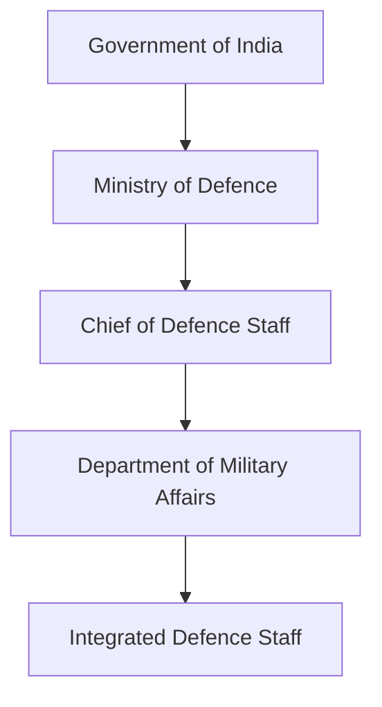
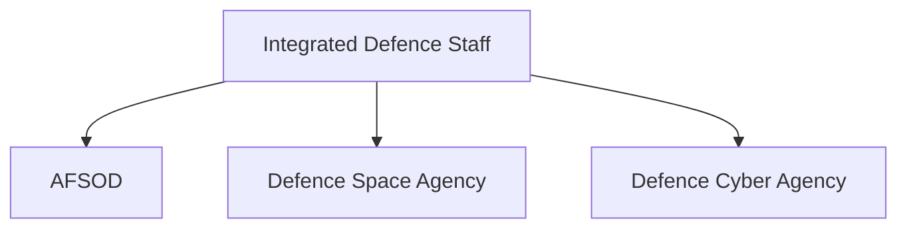
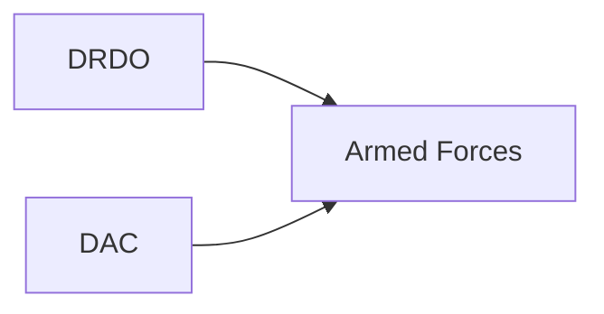
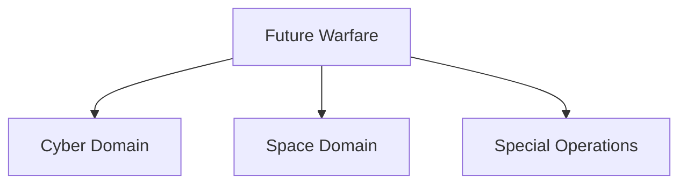
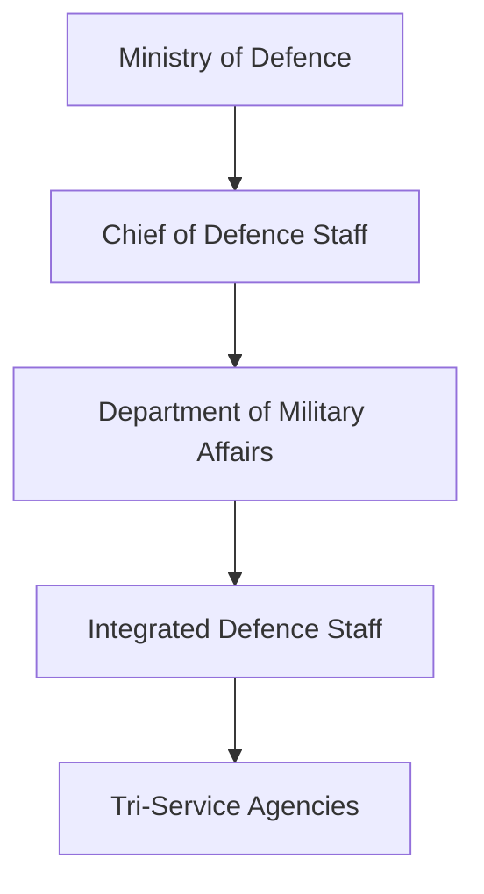

# Defence Organisations and Agencies

## Strategic Importance

India's defence ecosystem is supported by a network of organizations, departments and agencies responsible for military administration, strategic planning, defence modernization, procurement, cyber security, space security and joint military operations.

Understanding these organizations is essential for understanding how India's national-security system functions beyond the Army, Navy and Air Force.

---

## Quick Facts

| Item | Details |
|----------|----------|
| Domain | Defence Administration and Military Integration |
| Primary Ministry | Ministry of Defence |
| Focus Areas | Jointness, Modernization, Procurement and Strategic Planning |
| Importance | National Security Architecture |
| Operational Scope | Tri-Service and Defence-Wide |

---

## Repository Structure

```text
 defence-organisations-and-agencies/
 ├── README.md
 ├── ministry-of-defence.md
 ├── chief-of-defence-staff.md
 ├── department-of-military-affairs.md
 ├── integrated-defence-staff.md
 ├── drdo.md
 ├── defence-acquisition-council.md
 ├── defence-space-agency.md
 ├── defence-cyber-agency.md
 └── armed-forces-special-operations-division.md
```

---

## Defence Governance Structure



---

## Military Integration Architecture



These organizations strengthen joint military operations and future-war capabilities.

---

## Major Organisations

| Organisation | Primary Role |
|----------|----------|
| Ministry of Defence | Defence Governance |
| Chief of Defence Staff | Principal Military Adviser |
| Department of Military Affairs | Military Administration and Jointness |
| Integrated Defence Staff | Tri-Service Coordination |
| DRDO | Defence Research and Development |
| Defence Acquisition Council | Defence Procurement |
| Defence Space Agency | Military Space Operations |
| Defence Cyber Agency | Military Cyber Security |
| AFSOD | Joint Special Operations |

---

## Defence Modernisation Ecosystem



Modernization depends on research, procurement and capability development.

---

## Future Warfare Domains



India has established dedicated organizations to address emerging warfare domains.

---

## Learning Roadmap



---

## Quick Revision

- Ministry of Defence manages India's defence administration.
- CDS is the principal military adviser.
- DMA promotes military jointness.
- IDS coordinates tri-service structures.
- DRDO develops defence technologies.
- DAC manages defence acquisitions.
- DSA handles military space activities.
- DCA focuses on military cyber security.
- AFSOD supports joint special operations.

---

## Key Concepts

### Why are defence organisations important?

They support planning, administration, modernization and military integration.

### What is military jointness?

The ability of the Army, Navy and Air Force to operate together effectively.

### Which organisation supports defence research?

DRDO.

### Which organisation handles military cyber security?

Defence Cyber Agency.

### Which organisation supports military space operations?

Defence Space Agency.
