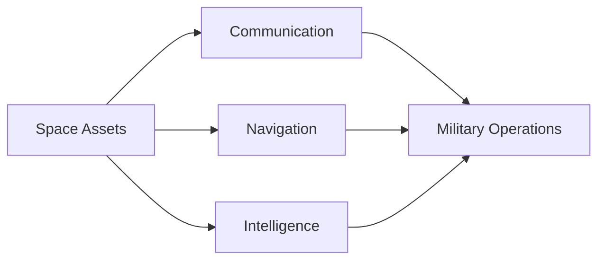
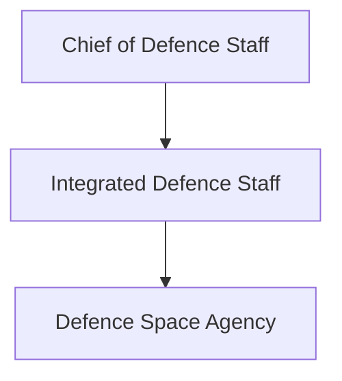
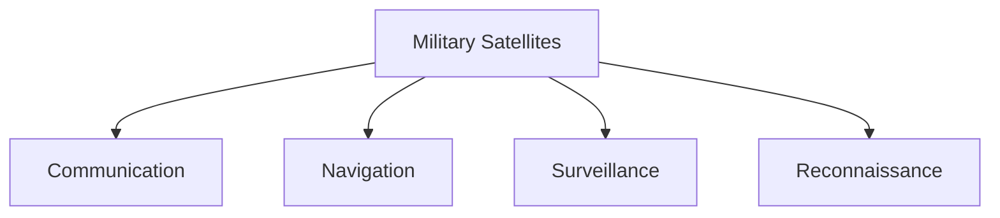

# Defence Space Agency (DSA)

## Strategic Importance

The Defence Space Agency (DSA) is India's tri-service military organization responsible for coordinating space-related defence capabilities.

Modern military operations depend heavily on satellites for communication, navigation, intelligence, surveillance, reconnaissance and precision operations. The DSA helps ensure that India's military can effectively utilize and protect space-based assets.

The agency represents India's growing focus on space as a strategic domain of warfare.

---

## Quick Facts

| Item | Details |
|----------|----------|
| Name | Defence Space Agency (DSA) |
| Type | Tri-Service Defence Agency |
| Established | 2019 |
| Parent Organisation | Integrated Defence Staff |
| Domain | Military Space Operations |
| Services Involved | Army, Navy and Air Force |
| Importance | Space Security and Military Space Capability |

---

## What Is the Defence Space Agency?

The Defence Space Agency is a joint military organization responsible for coordinating military space activities across the Armed Forces.

It supports space-based communications, navigation, surveillance and strategic awareness while helping strengthen India's space-security architecture.

---

## Why Space Matters in Modern Warfare

Modern military forces rely extensively on satellites and space-based systems.

---

## Formation and Background

The Defence Space Agency was established as part of broader defence reforms aimed at improving military jointness and preparing India for future warfare domains.

Its creation reflected the growing importance of space in national security.

---

## Position in Defence Structure

---

## Primary Responsibilities

- Military space coordination
- Space situational awareness
- Satellite support for military operations
- Protection of space-based capabilities
- Joint space capability development
- Support for defence planning

---

## Military Satellite Support

Space assets support operations across all military services.

---

## Space Situational Awareness

The DSA contributes to:

- Monitoring space activities
- Tracking objects in space
- Assessing potential threats
- Supporting space-security planning

Space situational awareness is increasingly important in modern defence planning.

---

## Relationship with ISRO

The Defence Space Agency works alongside India's broader space ecosystem.

While ISRO focuses primarily on civilian and national space programmes, the DSA focuses on military applications and defence requirements.

---

## Relationship with Mission Shakti

Mission Shakti demonstrated India's anti-satellite capability and highlighted the growing importance of space security.

---

## Relationship with Other Defence Agencies

The DSA works alongside:

- Integrated Defence Staff
- Defence Cyber Agency
- Armed Forces Special Operations Division
- Service space organizations

Together, these agencies support integrated military capability.

---

## Strategic Importance

The Defence Space Agency helps India:

- Strengthen military space capability
- Improve operational effectiveness
- Enhance strategic awareness
- Protect space-based assets
- Support future warfare requirements

---

## Challenges

- Increasing competition in space
- Dependence on satellite systems
- Space-security threats
- Rapid technological changes
- Growing complexity of space operations

---

## Future Roadmap

- Improved space situational awareness
- Greater military-space integration
- Enhanced satellite support capabilities
- Stronger space-security architecture
- Advanced space-domain capabilities

---

## Quick Revision

- DSA was established in 2019.
- It is a tri-service defence agency.
- Operates under the Integrated Defence Staff.
- Supports military space operations.
- Enhances space situational awareness.
- Strengthens India's space-security capability.

---

## Key Concepts

### What is the Defence Space Agency?

India's tri-service military organization responsible for space-related defence activities.

### Why was DSA created?

To coordinate military space capabilities and strengthen space security.

### Which services are involved in DSA?

The Army, Navy and Air Force.

### Why is space important in modern warfare?

Military operations depend heavily on satellites for communication, navigation and intelligence.

### How does DSA support national security?

By helping protect and utilize space-based capabilities for military operations.
