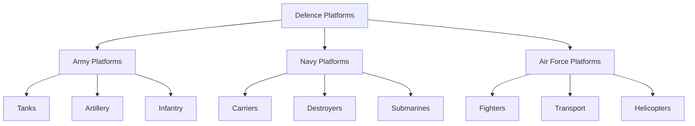
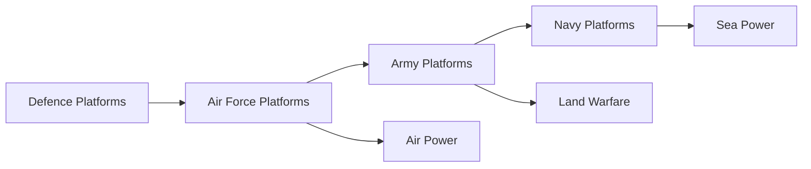
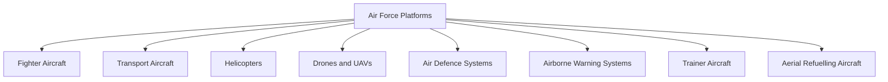
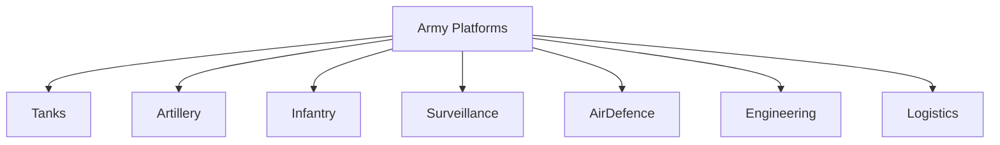
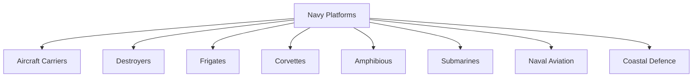
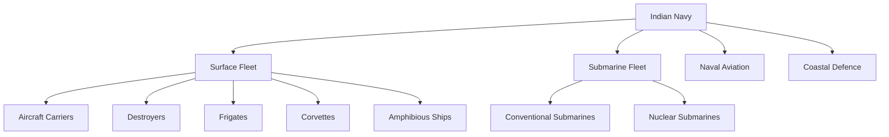

# Defence Platforms

## Strategic Importance

Military power is not determined by the number of soldiers alone. Modern armed forces depend on a wide range of platforms operating across land, sea, air, space and cyberspace.

Defence platforms provide mobility, firepower, protection, surveillance, deterrence and force projection. Together they form the operational backbone of India's defence capability.

This section covers the major military platforms operated by the Indian Armed Forces and related security organizations.

---

## Repository Structure

```text
defence-platforms
├── README.md
├── air-force-platforms
│   ├── README.md
│   ├── fighter-aircraft.md
│   ├── transport-aircraft.md
│   ├── helicopters.md
│   ├── drones.md
│   ├── airborne-warning-systems.md
│   └── trainers.md
├── army-platforms
│   ├── README.md
│   ├── tanks.md
│   ├── artillery.md
│   ├── armoured-vehicles.md
│   ├── infantry-weapons.md
│   ├── air-defence-systems.md
│   └── logistics-vehicles.md
└── navy-platforms
    ├── README.md
    ├── aircraft-carriers.md
    ├── destroyers.md
    ├── frigates.md
    ├── corvettes.md
    ├── submarines.md
    ├── amphibious-ships.md
    └── naval-aviation.md
```

---

## Defence Platform Ecosystem



---

## Learning Roadmap



---

## Platform Categories

| Service | Primary Platform Categories |
| -------- | -------- |
| Indian Air Force | Fighters, Transport Aircraft, Helicopters, Drones, AWACS, Trainers |
| Indian Army | Tanks, Artillery, Armoured Vehicles, Infantry Weapons, Air Defence Systems |
| Indian Navy | Aircraft Carriers, Destroyers, Frigates, Corvettes, Submarines, Naval Aviation |

---

# Air Force Platforms

## Overview

The Indian Air Force provides air superiority, strategic mobility, surveillance, precision strike capability and rapid response during war and peace.

### Learning Flow



### Air Force Platform Summary

| Platform | Primary Role |
|-----------|-----------|
| Fighter Aircraft | Air Superiority and Strike Missions |
| Transport Aircraft | Logistics and Strategic Mobility |
| Helicopters | Tactical Mobility and Support |
| Drones and UAVs | Surveillance and Reconnaissance |
| Air Defence Systems | Airspace Protection |
| Airborne Warning Systems | Early Warning and Command |
| Trainer Aircraft | Pilot Training |
| Aerial Refuelling Aircraft | Extended Operational Reach |

---

# Army Platforms

## Overview

The Indian Army protects India's land borders and conducts ground operations across diverse terrains ranging from deserts and plains to mountains and high-altitude regions.

### Learning Flow



### Army Platform Summary

| Platform | Primary Role |
|-----------|-----------|
| Tanks | Armoured Warfare |
| Artillery | Long-Range Fire Support |
| Infantry Weapons | Ground Combat |
| Surveillance Systems | Battlefield Awareness |
| Air Defence Systems | Protection Against Air Threats |
| Engineering Vehicles | Mobility and Battlefield Support |
| Logistics Vehicles | Sustainment and Supply |

---

# Navy Platforms

## Overview

The Indian Navy protects maritime interests, secures sea lanes, safeguards island territories and supports India's strategic presence in the Indian Ocean Region.

### Learning Flow



### Navy Platform Summary

| Platform | Primary Role |
|-----------|-----------|
| Aircraft Carriers | Sea-Based Air Power |
| Destroyers | Fleet Protection |
| Frigates | Multi-Role Escort |
| Corvettes | Coastal Warfare |
| Amphibious Ships | Troop and Equipment Landing Operations |
| Submarines | Underwater Warfare and Deterrence |
| Naval Aviation | Maritime Air Operations |
| Coastal Defence | Maritime Security |

---

## Platform Domains



---

## Quick Revision

- Defence platforms are the operational backbone of military power.
- Air Force platforms provide air superiority, surveillance and strategic mobility.
- Army platforms provide ground combat capability and territorial defence.
- Navy platforms protect maritime interests and support power projection.
- Modern warfare depends on the integration of land, sea and air platforms.
- Technology, mobility, firepower and situational awareness determine military effectiveness.
- Each service branch operates specialized platforms optimized for its operational environment.

---

## Key Concepts

### What are defence platforms?

Military systems used to conduct operations across land, sea and air domains.

### Why are defence platforms important?

They provide combat capability, deterrence and operational effectiveness.

### Which service operates aircraft carriers?

The Indian Navy.

### Which service operates tanks?

The Indian Army.

### Which service operates fighter aircraft?

The Indian Air Force.

### Why is platform integration important?

Modern military operations require coordinated action across multiple domains.
