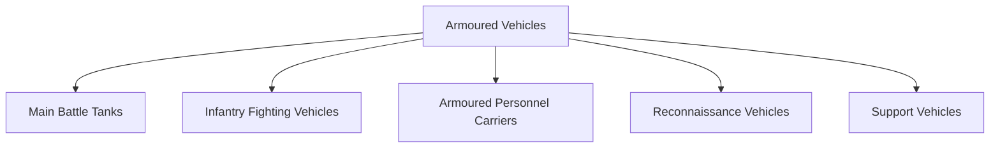
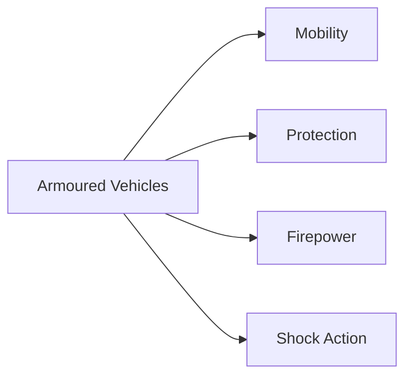

# Armoured Vehicles

## Strategic Importance

Armoured vehicles provide the Indian Army with mobility, protection and firepower on the battlefield. They enable forces to operate in hostile environments while protecting soldiers from enemy fire, artillery fragments and battlefield threats.

Modern armoured vehicles are critical for offensive operations, defensive operations, rapid manoeuvre warfare and mechanized combat.

---

## Quick Facts

| Item | Details |
|----------|----------|
| Primary Operator | Indian Army |
| Main Purpose | Protected Mobility and Firepower |
| Key Advantage | Armour Protection |
| Battlefield Role | Mechanized Warfare |
| Major Categories | Tanks, Infantry Fighting Vehicles, APCs |
| Strategic Importance | Land Combat Power |

---

## What Is an Armoured Vehicle?

An armoured vehicle is a military vehicle protected by armour and designed to transport troops, engage enemy forces or support battlefield operations.

---

## Types of Armoured Vehicles

---

## Main Battle Tanks (MBTs)

Main Battle Tanks combine:

- Heavy armour
- Powerful guns
- Battlefield mobility
- Offensive capability

### Major Indian Tanks

| Platform | Origin | Category |
|----------|----------|----------|
| Arjun | India | Main Battle Tank |
| T-90 Bhishma | Russia/India | Main Battle Tank |
| T-72 Ajeya | Soviet Origin | Main Battle Tank |

---

## Arjun Main Battle Tank

### Key Features

- Indigenous tank programme
- Advanced fire-control system
- Heavy armour protection
- High battlefield survivability

### Importance

Represents India's indigenous armoured warfare capability.

---

## T-90 Bhishma

### Key Features

- Modern combat tank
- High mobility
- Advanced weapon systems
- Night-fighting capability

### Importance

Forms a major part of India's armoured strike capability.

---

## Infantry Fighting Vehicles (IFVs)

IFVs transport infantry while providing fire support.

### Major Platform

| Platform | Role |
|----------|----------|
| BMP-2 Sarath | Infantry Fighting Vehicle |

### Advantages

- Protected troop transport
- Direct fire support
- Mechanized warfare capability

---

## Armoured Personnel Carriers (APCs)

APCs are designed primarily for:

- Troop movement
- Battlefield protection
- Logistics support
- Operational mobility

---

## Role in Modern Warfare

---

## Importance Along India's Borders

Armoured formations play major roles in:

- Western border operations
- Desert warfare
- Plains warfare
- Rapid-response operations
- Strategic deterrence

---

## Challenges

- Anti-tank guided missiles
- Drone threats
- High maintenance requirements
- Difficult terrain
- Rapid technological evolution

---

## Future Roadmap

- Future Ready Combat Vehicle (FRCV)
- Future Infantry Combat Vehicle (FICV)
- Improved protection systems
- Drone integration
- Network-centric battlefield capability
- Greater indigenous production

---

## Quick Revision

- Armoured vehicles provide mobility, protection and firepower.
- Main categories are tanks, IFVs and APCs.
- Arjun is India's indigenous main battle tank.
- T-90 Bhishma is a major frontline tank.
- BMP-2 Sarath is the primary infantry fighting vehicle.
- Armoured forces are essential for mechanized warfare.

---

## Key Concepts

### What is an armoured vehicle?

A protected military vehicle used for combat or troop transport.

### What is a Main Battle Tank?

A heavily armed and armoured combat vehicle designed for frontline warfare.

### What is India's indigenous tank?

The Arjun Main Battle Tank.

### What is an Infantry Fighting Vehicle?

A vehicle that transports infantry while providing combat support.

### Why are armoured vehicles important?

They combine mobility, protection and firepower on the battlefield.
