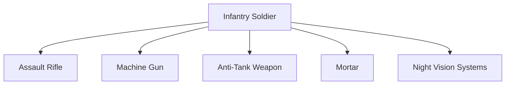
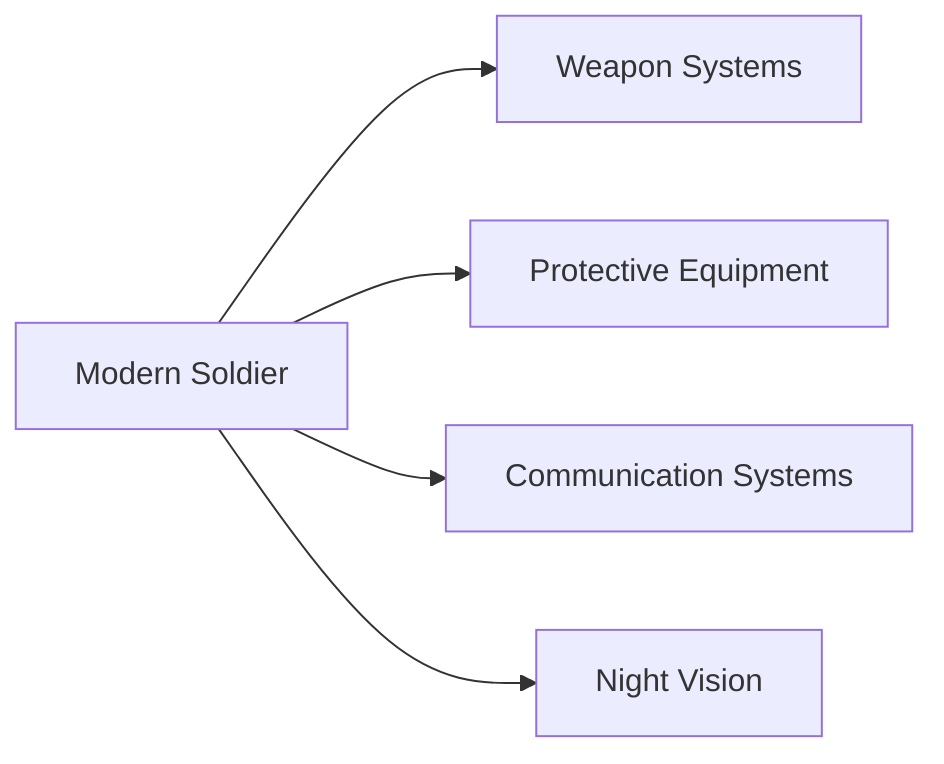

# Infantry Weapons

## Strategic Importance

Infantry soldiers form the foundation of every army. Regardless of technological advancements, territory is ultimately secured and controlled by soldiers on the ground.

Infantry weapons provide soldiers with the firepower, protection and battlefield capability needed to engage enemy forces, defend positions and conduct military operations.

---

## Quick Facts

| Item | Details |
|----------|----------|
| Primary Operator | Indian Army |
| Main Purpose | Individual and Squad-Level Combat |
| Key Advantage | Mobility and Flexibility |
| Battlefield Role | Frontline Combat |
| Categories | Rifles, Machine Guns, ATGMs, Mortars |
| Strategic Importance | Ground Combat Capability |

---

## What Are Infantry Weapons?

Infantry weapons are weapons carried and operated by individual soldiers or small military units during combat operations.

---

## Types of Infantry Weapons

---

## Why Infantry Weapons Are Important

- Enable frontline combat
- Defend captured territory
- Support offensive operations
- Provide anti-armour capability
- Improve battlefield survivability
- Increase operational flexibility

---

## Major Infantry Weapons Used by India

| Weapon | Category |
|----------|----------|
| AK-203 | Assault Rifle |
| SIG716 | Battle Rifle |
| INSAS | Assault Rifle |
| Negev NG7 | Light Machine Gun |
| Carl Gustaf | Anti-Tank Weapon |
| ATGM Systems | Anti-Tank Missile |

---

## Assault Rifles

Assault rifles are the primary weapons of infantry soldiers.

### Major Assault Rifles

| Rifle | Origin |
|----------|----------|
| AK-203 | India/Russia |
| INSAS | India |
| SIG716 | United States |

### Role

- Standard infantry combat
- Patrol operations
- Border security
- Counter-insurgency operations

---

## AK-203

### Key Features

- Modern assault rifle
- High reliability
- Improved ergonomics
- Suitable for varied combat environments

### Importance

Expected to become a major infantry rifle of the Indian Army.

---

## SIG716

### Key Features

- High accuracy
- Enhanced range
- Powerful ammunition
- Suitable for frontline operations

### Importance

Widely used in operational deployments.

---

## Machine Guns

Machine guns provide sustained fire support for infantry units.

### Major Platform

| Weapon | Category |
|----------|----------|
| Negev NG7 | Light Machine Gun |

### Role

- Suppressive fire
- Squad support
- Defensive positions
- Area domination

---

## Anti-Tank Weapons

Anti-tank weapons help infantry engage armoured vehicles and tanks.

### Major Systems

| Weapon | Category |
|----------|----------|
| Carl Gustaf | Recoilless Weapon |
| ATGM Systems | Guided Missile Systems |

### Role

- Tank destruction
- Bunker engagement
- Anti-armour operations

---

## Mortars

Mortars provide indirect fire support to infantry units.

### Advantages

- Rapid deployment
- High-angle fire
- Battlefield support
- Lightweight operation

---

## Night Vision Systems

Modern infantry increasingly relies on:

- Night vision devices
- Thermal imaging systems
- Battlefield surveillance equipment
- Target acquisition systems

These systems improve effectiveness during low-visibility operations.

---

## Modern Infantry Soldier

---

## Challenges

- Rapid technological changes
- Modern battlefield threats
- Urban warfare requirements
- Equipment modernization
- Drone-related threats

---

## Future Roadmap

- Modern assault rifles
- Smart optics
- Advanced night-vision systems
- Soldier modernization programmes
- Improved battlefield connectivity
- Greater indigenous production

---

## Quick Revision

- Infantry remains the foundation of land warfare.
- AK-203 is becoming a major infantry rifle.
- SIG716 provides enhanced combat capability.
- Negev NG7 supports squad-level firepower.
- Carl Gustaf provides anti-armour capability.
- Night-vision systems are increasingly important in modern warfare.

---

## Key Concepts

### Why is infantry important?

Infantry secures and controls territory during military operations.

### What is the primary weapon of an infantry soldier?

An assault rifle.

### What is AK-203?

A modern assault rifle being inducted into the Indian Army.

### What is the role of machine guns?

To provide sustained fire support.

### Why are anti-tank weapons important?

They allow infantry to engage armoured vehicles and tanks.
