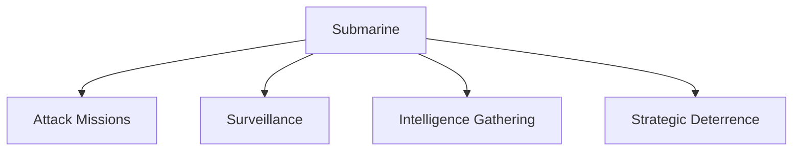
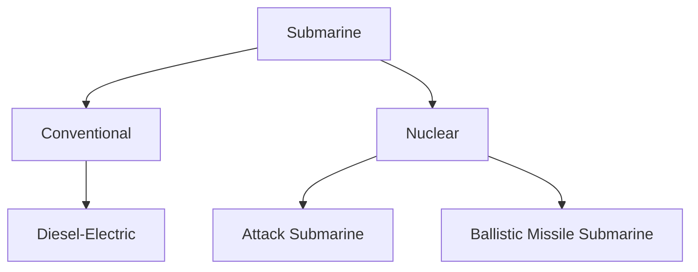

# Submarines

## Strategic Importance

Submarines are among the most powerful and strategic military platforms in modern warfare. Their ability to operate underwater with stealth makes them difficult to detect and highly effective for surveillance, intelligence gathering, deterrence and combat operations.

For India, submarines are critical for protecting maritime interests, maintaining sea control, supporting strategic deterrence and ensuring a credible nuclear second-strike capability.

---

## Quick Facts

| Item | Details |
|----------|----------|
| Primary Operator | Indian Navy |
| Main Purpose | Underwater Warfare |
| Key Advantage | Stealth |
| Strategic Role | Deterrence and Sea Denial |
| Operational Area | Indian Ocean Region and Beyond |
| Strategic Importance | National Security |

---

## What Is a Submarine?

A submarine is a naval vessel capable of operating underwater for extended periods while conducting surveillance, intelligence gathering, attack missions and strategic deterrence patrols.

Unlike surface ships, submarines can remain hidden for long durations, making them one of the most effective military assets in modern warfare.

---

## Roles of Submarines

---

## Why Submarines Are Important

- Difficult to detect
- Monitor adversary activities
- Conduct covert operations
- Protect sea lanes
- Support naval operations
- Strengthen nuclear deterrence
- Provide sea-denial capability

---

## Types of Submarines

---

## Conventional Submarines

### Characteristics

- Diesel-electric propulsion
- Lower operating costs
- High stealth capability
- Effective regional operations
- Suitable for coastal and ocean patrols

### Major Indian Classes

| Class | Type |
|----------|----------|
| Kalvari Class (Scorpene) | Conventional Submarine |
| Sindhughosh Class | Kilo-Class Submarine |
| Shishumar Class | Conventional Submarine |

---

## Nuclear Submarines

### Characteristics

- Nuclear-powered propulsion
- Long endurance operations
- High operational range
- Greater strategic capability
- Can remain submerged for extended periods

### Types

| Type | Full Form | Role |
|----------|----------|----------|
| SSN | Ship Submersible Nuclear | Attack Submarine |
| SSBN | Ship Submersible Ballistic Nuclear | Strategic Deterrence |

---

## Arihant Class (SSBN)

### Key Features

- Indigenous nuclear-powered submarine
- Ballistic missile capability
- Strategic deterrence platform
- Supports second-strike capability

### Importance

The Arihant Class forms the sea-based component of India's nuclear triad and is one of the most important strategic assets in the country.

---

## Arighaat Class

### Key Features

- Follow-on vessel of the Arihant programme
- Improved operational capability
- Enhanced strategic deterrence role

### Importance

Strengthens India's long-term sea-based nuclear deterrent.

---

## Kalvari Class (Scorpene)

### Key Features

- Advanced conventional submarine
- Modern stealth technology
- Torpedo capability
- Anti-ship missile capability

### Importance

Forms the backbone of India's modern conventional submarine fleet.

---

## INS Chakra Programme

### Key Features

- Nuclear-powered attack submarine experience
