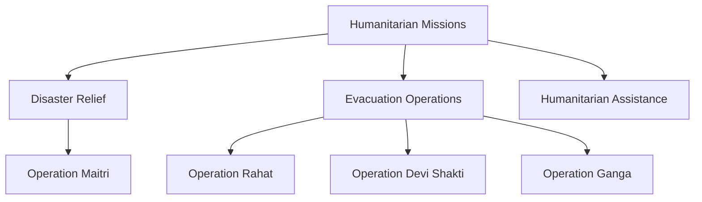

# Humanitarian and Evacuation Missions

## Strategic Importance

Humanitarian and evacuation missions demonstrate the ability of India to protect its citizens, assist friendly countries, and provide rapid relief during crises.

These missions often involve military forces, diplomatic coordination, civil administration, international organizations, and partner countries.

Studying these missions helps understand:

- Humanitarian assistance and disaster relief (HADR)
- Non-combatant evacuation operations (NEO)
- Civil-military coordination
- International crisis response
- India's role as a responsible regional power

---

## Quick Facts

| Item | Details |
|--------|---------|
| Coverage | Humanitarian and evacuation missions |
| Time Period | 2015–Present |
| Mission Types | Disaster Relief, Evacuation, Humanitarian Assistance |
| Key Participants | Armed Forces, MEA, Civil Agencies |
| Learning Goal | Understand crisis response operations |

---

## Covered Missions

| Mission | Year | Purpose |
|----------|------|---------|
| Operation Maitri | 2015 | Earthquake relief in Nepal |
| Operation Rahat | 2015 | Evacuation from Yemen |
| Operation Devi Shakti | 2021 | Evacuation from Afghanistan |
| Operation Ganga | 2022 | Evacuation from Ukraine |

---

## Timeline


---

## Repository Structure

```text
humanitarian-evacuation-missions
├── operation-maitri.md
├── operation-rahat.md
├── operation-devi-shakti.md
└── operation-ganga.md
```

---

## Types of Missions



---

## Key Themes

### Disaster Relief

Military resources are often used to provide emergency assistance, medical support, engineering capabilities, and logistics during natural disasters.

### Non-Combatant Evacuation Operations

India regularly evacuates citizens and foreign nationals from conflict zones and unstable regions.

### International Cooperation

Many missions require coordination with foreign governments, international agencies, and diplomatic missions.

### Rapid Deployment

Success depends on the ability to mobilize personnel, aircraft, ships, and logistics resources quickly.

---

## Learning Path

Recommended study order:

1. Operation Maitri
2. Operation Rahat
3. Operation Devi Shakti
4. Operation Ganga

---

## Quick Revision

- Operation Maitri supported Nepal after the 2015 earthquake.
- Operation Rahat evacuated people from Yemen.
- Operation Devi Shakti evacuated people from Afghanistan.
- Operation Ganga evacuated Indian citizens from Ukraine.
- These missions demonstrate India's humanitarian and crisis-response capabilities.

---

## Key Concepts

### Easy

1. What was Operation Maitri?
2. Which mission was conducted in Yemen?
3. Why was Operation Devi Shakti launched?
4. What was the objective of Operation Ganga?

### Intermediate

1. How do evacuation operations differ from combat operations?
2. Why is civil-military coordination important during humanitarian missions?
3. What challenges arise during large-scale evacuations?
4. How do such missions improve India's global image?

### Advanced

1. Analyse the role of the Armed Forces in humanitarian assistance and disaster relief.
2. Evaluate India's evacuation capabilities using recent missions.
3. Explain how humanitarian missions contribute to foreign policy and strategic influence.
