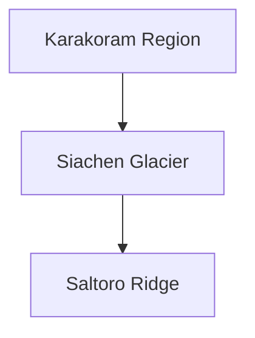
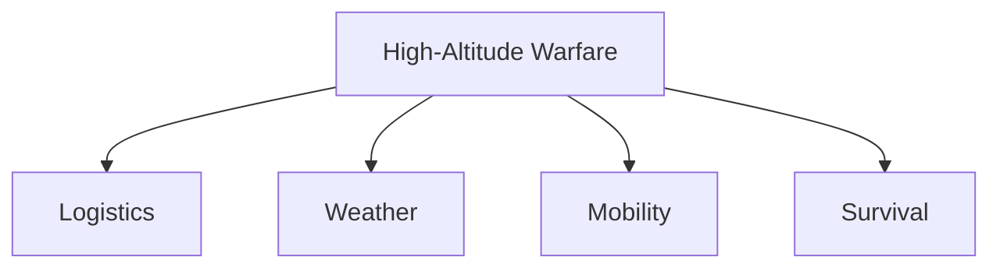

# Operation Meghdoot

## Strategic Importance

Operation Meghdoot was one of the most significant military operations in India's post-independence history. Conducted in 1984, it enabled India to secure key positions on the Saltoro Ridge overlooking the Siachen Glacier.

The operation established India's control over strategically important high-altitude terrain and created what is often described as the world's highest battlefield.

Understanding Operation Meghdoot is essential for understanding Siachen, India-Pakistan military competition in the northern sector and the evolution of high-altitude warfare.

---

## Quick Facts

| Item | Details |
|----------|----------|
| Operation Name | Operation Meghdoot |
| Year | 1984 |
| Location | Siachen Glacier |
| Type | High-Altitude Military Operation |
| Lead Force | Indian Army |
| Objective | Secure Saltoro Ridge and Siachen Region |
| Outcome | Successful |

---

## Background

Following differing interpretations of the ceasefire line beyond NJ9842, both India and Pakistan began increasing interest in the Siachen region.

The Saltoro Ridge overlooking the glacier held immense strategic importance because control of the heights would determine control of the surrounding area.

India launched Operation Meghdoot to secure these critical positions before Pakistan could occupy them.

---

## Strategic Geography

---

## Objectives

- Secure key passes and heights
- Establish control over the Saltoro Ridge
- Prevent hostile occupation of strategic terrain
- Strengthen India's northern defence posture
- Protect long-term national security interests

---

## Why Saltoro Ridge Matters

The Saltoro Ridge dominates the Siachen Glacier.

Military forces occupying the higher ground gain significant advantages in:

- Observation
- Surveillance
- Defence
- Operational control

Control of the ridge became more important than control of the glacier itself.

---

## Operational Overview

---

## Challenges Faced

### Extreme Altitude

The operation was conducted in one of the most difficult environments on Earth.

### Weather Conditions

Forces faced:

- Severe cold
- Snowstorms
- Avalanches
- Thin air

### Logistics

Supplying troops at extreme altitudes required continuous logistical support.

---

## High-Altitude Warfare

Operation Meghdoot became a major example of high-altitude military operations.

---

## Strategic Importance

Operation Meghdoot:

- Secured key strategic terrain
- Strengthened India's northern defence posture
- Demonstrated military preparedness
- Enhanced high-altitude warfare capability
- Influenced future military planning

---

## Connection with Kargil

The experience gained in Siachen contributed significantly to India's understanding of mountain and high-altitude warfare.

---

## Long-Term Impact

Operation Meghdoot influenced:

- Mountain warfare doctrine
- Logistics planning
- Surveillance capability
- Infrastructure development
- Strategic deployment practices

---

## Key Lessons

- Importance of strategic geography
- Importance of preparedness
- Need for rapid deployment
- Importance of logistics
- Value of intelligence and planning

---

## Legacy

Operation Meghdoot remains one of India's most successful strategic military operations and continues to shape military thinking related to high-altitude warfare.

---

## Quick Revision

- Operation Meghdoot was launched in 1984.
- It secured key positions in the Siachen region.
- The operation focused on the Saltoro Ridge.
- It created the world's highest battlefield.
- It demonstrated India's high-altitude warfare capability.
- Its lessons influenced future military operations.

---

## Key Concepts

### What was Operation Meghdoot?

A military operation launched in 1984 to secure strategic positions in the Siachen region.

### Why was Saltoro Ridge important?

Control of the ridge provided control over strategically important high ground.

### Why is Operation Meghdoot significant?

It established India's position in Siachen and strengthened long-term strategic security.

### What was the biggest challenge?

Operating in an extreme high-altitude environment.

### Why is the operation still studied today?

It remains one of the most important examples of high-altitude military warfare.
