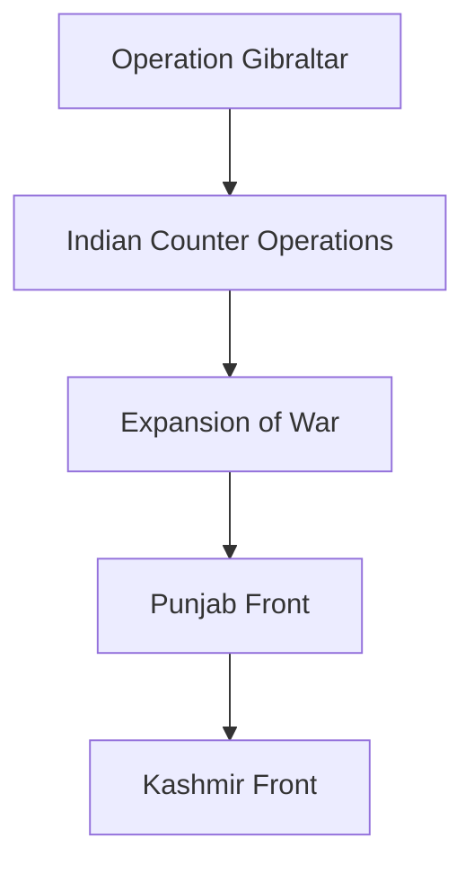
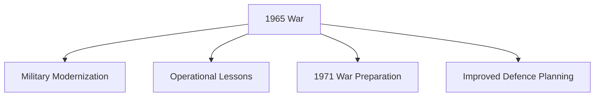

# Indo-Pak War of 1965

## Strategic Importance

The Indo-Pak War of 1965 was the second major war between India and Pakistan after independence.

The conflict demonstrated India's military recovery after the 1962 Sino-Indian War and established the Indian Armed Forces as a credible conventional military force in South Asia.

The war is important because:

- It tested India's military reforms after 1962.
- It involved large-scale tank and air battles.
- It prevented Pakistan from altering the status of Jammu and Kashmir through military action.
- It influenced future military planning in both countries.
- It laid the foundation for lessons applied during the 1971 war.

---

## Quick Facts

| Item | Details |
|--------|---------|
| Conflict | Indo-Pak War of 1965 |
| Duration | August–September 1965 |
| Countries | India and Pakistan |
| Main Theatre | Jammu and Kashmir, Punjab, Rajasthan |
| Indian Prime Minister | Lal Bahadur Shastri |
| Pakistani President | Ayub Khan |
| Ceasefire | 23 September 1965 |
| Peace Agreement | Tashkent Agreement (1966) |
| Result | Military stalemate with Indian strategic advantage |

---

## Timeline

| Year/Date | Event |
|------------|--------|
| April 1965 | Rann of Kutch clashes |
| August 1965 | Operation Gibraltar launched |
| September 1965 | Full-scale war begins |
| 6 September 1965 | India crosses international border near Lahore |
| 23 September 1965 | UN-sponsored ceasefire |
| January 1966 | Tashkent Agreement signed |

---

## Background

### Kashmir Dispute

The primary source of tension remained Jammu and Kashmir.

Pakistan believed that India was weakened after the 1962 war with China and could be pressured militarily.

### Rann of Kutch Clashes

Before the main war, Indian and Pakistani forces clashed in the Rann of Kutch region.

The dispute was later resolved through international arbitration.

---

## Pakistani Strategy

### Operation Gibraltar

Pakistan infiltrated armed personnel into Jammu and Kashmir.

Objectives:

- Encourage local uprising
- Destabilize Indian administration
- Internationalize the Kashmir issue

### Operation Grand Slam

After Gibraltar failed, Pakistan launched Operation Grand Slam targeting Akhnoor.

Pakistan hoped to disrupt Indian military communications and logistics.

---

## Indian Response

India responded by expanding military operations beyond Jammu and Kashmir.

This forced Pakistan to fight on multiple fronts.

---

## Major Fronts

### Jammu and Kashmir

- Haji Pir Pass
- Akhnoor Sector
- Uri Sector

### Punjab Front

- Lahore Sector
- Sialkot Sector

### Rajasthan Front

- Desert operations

---

## Major Battles

| Battle | Significance |
|----------|-------------|
| Haji Pir | Important Indian success |
| Asal Uttar | Major defensive victory |
| Chawinda | One of the largest tank battles after World War II |
| Phillora | Significant armoured engagement |
| Dograi | Strategic Indian advance |

---

## Battle of Asal Uttar

### Location

Punjab

### Importance

One of the most important battles of the war.

Indian forces successfully halted Pakistan's armoured offensive.

### Outcome

Large numbers of Pakistani tanks were destroyed or captured.

---

## Abdul Hamid

### Unit

4 Grenadiers

### Gallantry

Destroyed multiple enemy tanks during the Battle of Asal Uttar.

### Award

Param Vir Chakra (Posthumous)

---

## Battle of Haji Pir

### Objective

Capture a key infiltration route used by Pakistani forces.

### Result

Indian forces successfully captured Haji Pir Pass.

---

## Air War

The conflict saw significant use of air power by both countries.

### Indian Air Force Roles

- Ground attack missions
- Air defence operations
- Tactical support
- Interdiction missions

### Pakistani Air Force Roles

- Air support operations
- Strategic strikes
- Air defence missions

---

## Naval Operations

Naval operations remained limited compared to later wars.

The conflict was primarily fought on land and in the air.

---

## Why Pakistan's Plan Failed

### Incorrect Assumptions

- Expected large-scale uprising in Kashmir
- Underestimated Indian response

### Strategic Miscalculations

- Failure of Operation Gibraltar
- Expansion of conflict beyond Kashmir

### Indian Military Resistance

- Effective ground operations
- Successful defensive actions

---

## Ceasefire

### United Nations Intervention

The United Nations called for an immediate ceasefire.

### 23 September 1965

Both countries accepted the ceasefire.

---

## Tashkent Agreement (1966)

### Location

Tashkent, Uzbekistan (then Soviet Union)

### Key Provisions

- Withdrawal to pre-war positions
- Restoration of diplomatic relations
- Commitment to peaceful dispute resolution

---

## Impact on India

### Military Lessons

- Validation of post-1962 military reforms
- Importance of armour and air power
- Need for better coordination among services

### Political Impact

Prime Minister Lal Bahadur Shastri emerged as a respected wartime leader.

---

## Impact on Pakistan

### Strategic Outcome

Failure to achieve objectives in Kashmir.

### Military Assessment

Need for reassessment of military planning and assumptions.

---

## Long-Term Consequences

---

## Current Relevance

The 1965 war remains important for understanding:

- India-Pakistan military rivalry
- Armoured warfare in South Asia
- Evolution of Indian military doctrine
- Strategic lessons before the 1971 war

---

## Quick Revision

- Second major India-Pakistan war.
- Triggered by Operation Gibraltar.
- Major battles included Asal Uttar, Haji Pir, Dograi, and Chawinda.
- Abdul Hamid received the Param Vir Chakra.
- Ceasefire took effect on 23 September 1965.
- Tashkent Agreement signed in 1966.
- Demonstrated India's military recovery after 1962.

---

## Key Concepts

### Easy

1. When was the Indo-Pak War of 1965 fought?
2. What was Operation Gibraltar?
3. Who was India's Prime Minister during the war?
4. What is the Tashkent Agreement?

### Intermediate

1. Why did Pakistan launch Operation Gibraltar?
2. What happened at the Battle of Asal Uttar?
3. Why was Haji Pir strategically important?
4. What role did the Indian Air Force play?

### Advanced

1. Analyse the causes of the 1965 war.
2. Why did Pakistan's strategy fail?
3. Evaluate the military lessons learned from the conflict.
4. Compare the outcomes of the 1965 and 1971 wars.
