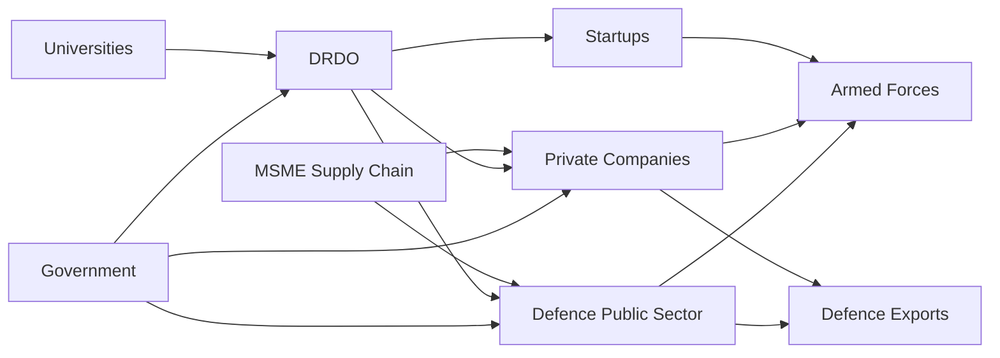

# India Defence Industry Journey

> A chronological story of how India's defence industry evolved from colonial-era ordnance production into a large domestic ecosystem involving DRDO, defence public sector companies, shipyards, private companies, startups and defence exports.

---

## 1. Before Independence — Ordnance Manufacturing

India had military manufacturing facilities before independence.

The British developed ordnance factories to support the colonial military.

Their primary purpose was to produce and maintain:

- Small arms
- Ammunition
- Artillery equipment
- Explosives
- Military stores

The system was mainly designed to support the British Indian armed forces rather than create a fully independent Indian defence industry.

---

## 2. 1947 — Independence

When India became independent, the country inherited an existing but limited defence manufacturing base.

The new government faced a major challenge:

**How can India remain militarily secure without depending completely on foreign suppliers?**

This became a long-term strategic objective.

---

## 3. 1948 — Atomic Energy and Strategic Technology

India began building strategic technology institutions soon after independence.

The nuclear programme created expertise in:

- Advanced materials
- Electronics
- Metallurgy
- Nuclear engineering
- High precision manufacturing

Although the nuclear programme was separate from conventional defence production, it helped build India's broader strategic technology base.

---

## 4. 1950s — State Led Defence Industry

India adopted a largely state controlled approach to defence production.

The government believed that critical defence capability should remain under national control.

Major areas included:

- Aircraft
- Weapons
- Ammunition
- Electronics
- Vehicles
- Shipbuilding
- Research and development

The public sector became the central pillar of India's defence industrial strategy.

---

## 5. 1950 — Hindustan Aeronautics

Hindustan Aircraft Limited became an important part of India's aviation industry.

It later evolved into Hindustan Aeronautics Limited (HAL).

HAL became the country's principal aerospace production organisation.

Its activities expanded into:

- Aircraft manufacturing
- Aircraft repair
- Helicopters
- Engines
- Avionics
- Aerospace structures

See `../industry/hal.md`.

---

## 6. 1954 — Department of Atomic Energy

The Department of Atomic Energy was established under the direct responsibility of the Prime Minister.

The organisation developed advanced scientific and engineering capability.

This broader national technology ecosystem later supported strategic defence programmes.

---

## 7. 1958 — DRDO Established

The Defence Research and Development Organisation (DRDO) was established in 1958 through the merger of existing defence science organisations.

Its objective was to develop indigenous defence technologies.

DRDO eventually expanded into areas including:

- Missiles
- Radar
- Electronic warfare
- Aircraft systems
- Naval systems
- Armaments
- Life support systems
- Strategic technologies

See `../industry/drdo.md`.

---

## 8. 1950s–1960s — Building Defence Public Sector Capability

India established and expanded several defence public sector organisations.

Important organisations included:

- HAL
- Bharat Electronics Limited
- Bharat Dynamics Limited
- Mazagon Dock
- Garden Reach Shipbuilders
- Hindustan Shipyard

These organisations gradually created domestic manufacturing capability across:

- Aerospace
- Electronics
- Missiles
- Naval platforms
- Weapons
- Communications

---

## 9. 1962 — India China War

The 1962 war exposed major weaknesses in India's military preparedness.

One important lesson was the vulnerability created by dependence on foreign equipment and emergency imports.

India responded by increasing:

- Defence spending
- Indigenous production
- Research programmes
- Industrial capacity
- Military infrastructure

The war accelerated the push for defence self reliance.

---

## 10. 1960s — Licence Production

India used foreign technology partnerships to build domestic manufacturing capability.

Instead of importing every finished weapon, India increasingly pursued:

**Foreign design or technology → Indian production**

This approach helped build:

- Manufacturing skills
- Maintenance capability
- Supply chains
- Engineering expertise
- Production infrastructure

However, licence production also meant continued dependence on foreign designs and technologies.

---

## 11. 1960s–1970s — Expansion of Aerospace Capability

HAL expanded aircraft manufacturing and maintenance capabilities.

India produced aircraft under licence while also beginning indigenous aircraft development.

The experience created a large aerospace engineering workforce.

It also helped develop capability in:

- Airframe manufacturing
- Engine maintenance
- Avionics
- Aircraft overhaul
- Aerospace materials

---

## 12. 1970s — Indigenous Defence Research Expands

India increasingly focused on indigenous technology.

Research areas included:

- Missiles
- Radar
- Electronics
- Armoured vehicles
- Artillery
- Naval systems
- Communication systems

The objective was gradually changing from:

**Import equipment**

to:

**Develop technology and manufacture equipment in India**

---

## 13. 1974 — Pokhran-I and Strategic Technology

India conducted its first nuclear explosive test in 1974.

The programme demonstrated the importance of indigenous strategic technology.

International restrictions following the test also strengthened India's motivation to develop domestic capabilities.

India increasingly invested in technologies that could not easily be imported.

---

## 14. 1980s — Major Indigenous Programmes

The 1980s saw several major indigenous defence programmes.

These included:

- Integrated Guided Missile Development Programme
- Light Combat Aircraft programme
- Indigenous naval shipbuilding
- Radar development
- Electronic warfare
- Armoured vehicle development

These programmes created long term engineering capability even when development timelines were long.

---

## 15. 1983 — Integrated Guided Missile Development Programme

The Integrated Guided Missile Development Programme became a major milestone.

The programme developed:

- Prithvi
- Agni
- Akash
- Trishul
- Nag

The programme created expertise in:

- Propulsion
- Guidance
- Control
- Radars
- Warhead integration
- Launch systems

See `../strategic/india-missile-journey.md`.

---

## 16. 1980s — Indigenous Aircraft Programme

India began developing the Light Combat Aircraft programme.

The programme eventually produced the Tejas fighter.

The project developed Indian capability in:

- Aerodynamics
- Flight controls
- Composite materials
- Avionics
- Systems integration

The programme was a major long term investment in indigenous aerospace capability.

---

## 17. 1990s — Economic Liberalisation

India's economic reforms gradually changed the defence industrial environment.

The broader economy became more open to:

- Private investment
- Foreign technology
- Joint ventures
- Competition
- Global supply chains

However, defence production remained heavily dominated by the public sector.

---

## 18. 1998 — Pokhran-II and Technology Restrictions

India conducted Pokhran-II in May 1998.

The tests resulted in international sanctions and technology restrictions.

The experience reinforced the strategic value of domestic capability.

India increasingly focused on technologies that were difficult to obtain internationally.

---

## 19. 1990s–2000s — Private Sector Begins Entering

Private companies gradually became more involved in defence production.

Their participation expanded through:

- Components
- Engineering services
- Manufacturing
- Electronics
- Aerospace structures
- Shipbuilding

The private sector initially played a supporting role but gradually became more important.

---

## 20. 2001 — Private Sector Defence Production

India opened defence production to the private sector in a more formal manner.

This represented an important change from the earlier state dominated model.

The objective was to introduce:

- Competition
- Private investment
- Innovation
- Additional manufacturing capacity

---

## 21. 2000s — Defence Offset Policy

India introduced defence offset requirements to encourage foreign defence purchases to generate economic and industrial benefits within India.

The broader objective was to encourage:

- Local manufacturing
- Technology transfer
- Component production
- Aerospace supply chains
- Industrial partnerships

Offsets became one mechanism for developing domestic capability.

---

## 22. 2000s — Indigenous Naval Shipbuilding

Indian shipyards increasingly built major naval platforms domestically.

Capability expanded across:

- Frigates
- Destroyers
- Corvettes
- Submarines
- Aircraft carriers
- Support vessels

India developed a significant domestic naval construction ecosystem.

See `../navy/`.

---

## 23. 2000s–2010s — Electronics and Radar Industry

Defence electronics became increasingly important.

Bharat Electronics Limited developed capabilities in:

- Radars
- Communication systems
- Electronic warfare
- Identification systems
- Missile electronics
- Command and control

Private companies also increasingly entered defence electronics.

See `../industry/bel.md`.

---

## 24. 2000s–2010s — Missile Production Ecosystem

Bharat Dynamics Limited became a major production partner for Indian missile programmes.

The ecosystem increasingly connected:

**DRDO research → Indian production → Armed Forces induction**

This model became important for systems such as:

- Akash
- Anti-tank missiles
- Strategic missile programmes
- Air-defence systems

See `../industry/bdl.md`.

---

## 25. 2010s — Make in India

The Make in India initiative was launched in 2014.

Defence manufacturing became an important area of focus.

The objective was to increase:

- Domestic manufacturing
- Foreign investment
- Technology transfer
- Industrial capacity
- Employment
- Exports

---

## 26. 2010s — Defence Procurement Reforms

India progressively modified defence procurement policies.

The policy direction increasingly favoured:

- Indian designed systems
- Indian manufactured systems
- Indigenous content
- Domestic production

The objective was to reduce long term dependence on imported equipment.

---

## 27. 2010s — Private Defence Companies Expand

Large Indian private companies increased their defence activities.

Areas included:

- Aerospace
- Artillery
- Electronics
- Missiles
- Vehicles
- Shipbuilding
- Communications

A wider private industrial base began emerging around traditional public sector organisations.

---

## 28. 2014–2019 — Growing Startup Ecosystem

India's technology startup ecosystem increasingly entered defence.

Startups began working on:

- Drones
- Artificial intelligence
- Robotics
- Sensors
- Cybersecurity
- Communications
- Electronic warfare

This introduced new technology and business models into the defence sector.

---

## 29. 2016 — Defence Procurement Emphasis on Indigenous Capability

Procurement reforms increasingly gave preference to systems designed and manufactured in India.

This created stronger demand for domestic defence companies.

The long term objective became:

**Requirement → Indian design → Indian production → Indian service**

---

## 30. 2019 — Strategic Partnership Model

India introduced the Strategic Partnership model to encourage private sector participation in major defence platforms.

The model aimed to connect Indian private companies with global original equipment manufacturers.

Priority areas included:

- Fighter aircraft
- Helicopters
- Submarines
- Armoured vehicles

The objective was to create long term industrial capability rather than simply purchase finished equipment.

---

## 31. 2020 — Atmanirbhar Bharat

The Atmanirbhar Bharat initiative significantly increased emphasis on defence self reliance.

The policy direction focused on:

- Indigenous design
- Indigenous manufacturing
- Local supply chains
- Defence exports
- Private sector participation
- Reduced import dependence

See `../industry/atmanirbhar-defence.md`.

---

## 32. 2020 — Positive Indigenisation Lists

The Ministry of Defence introduced lists of equipment that would increasingly be procured from domestic sources.

The lists covered numerous systems across:

- Missiles
- Artillery
- Radars
- Aircraft
- Naval systems
- Armoured vehicles
- Electronic warfare

The objective was to create predictable domestic demand.

---

## 33. 2020s — Defence Industrial Corridors

India established defence industrial corridors to create concentrated defence manufacturing ecosystems.

Two major corridors were established:

- Uttar Pradesh Defence Industrial Corridor
- Tamil Nadu Defence Industrial Corridor

The objective was to develop:

- Manufacturing clusters
- Supplier networks
- Testing infrastructure
- Research facilities
- Investment
- Employment

See `../budget/defence-industrial-corridors.md`.

---

## 34. 2020s — Ordnance Factories Reorganisation

India reorganised the Ordnance Factory Board in 2021.

The earlier system was converted into seven defence public sector companies.

The objective was to improve:

- Efficiency
- Accountability
- Specialisation
- Commercial competitiveness
- Production performance

This represented a major structural change in India's traditional defence manufacturing system.

---

## 35. 2020s — Indigenous Aircraft Production

The Tejas programme became one of the most visible examples of India's indigenous aerospace effort.

HAL moved from development toward larger scale production.

The programme created an ecosystem involving:

- HAL
- DRDO
- Aeronautical Development Agency
- Indian private companies
- Electronics suppliers
- Aerospace component manufacturers

---

## 36. 2020s — Indigenous Helicopter Capability

India expanded domestic helicopter development and production.

Important programmes include:

- Light Combat Helicopter
- Light Utility Helicopter
- Advanced Light Helicopter

These programmes increased domestic capability in:

- Rotary wing design
- Engines and systems
- Avionics
- Weapons integration
- Aerospace manufacturing

---

## 37. 2020s — Naval Industrial Capability

Indian shipyards continued producing increasingly advanced warships.

Major programmes include:

- Destroyers
- Frigates
- Corvettes
- Aircraft carriers
- Submarines

The Indian Navy became an important driver of domestic defence manufacturing.

---

## 38. 2020s — Missile and Air Defence Production

India increasingly moved from development toward large scale production of indigenous missile systems.

Examples include:

- Akash
- BrahMos
- Astra
- Rudram
- QRSAM
- Ballistic missile defence systems

This demonstrated the growing connection between:

**DRDO + Public Sector + Private Industry + Armed Forces**

---

## 39. 2020s — Defence Electronics and Sensors

Modern warfare increasingly depends on electronics.

Indian industry expanded capabilities in:

- Radars
- Electronic warfare
- Communications
- Electro-optics
- Data links
- Command and control
- Unmanned systems

Private companies and startups became increasingly important alongside established public sector organisations.

---

## 40. Defence Exports

India increasingly began exporting defence equipment.

Export categories have included:

- Missiles
- Artillery
- Radar
- Patrol vessels
- Protective equipment
- Electronic systems
- Aircraft components

The long term objective is to transform India from primarily a defence importer into a significant defence producer and exporter.

---

## 41. Defence Production Ecosystem

The modern ecosystem can be represented as:

---

## 42. From Importer to Producer

India's defence industry has gradually moved through several stages.

The transition is not complete, but the direction has increasingly been toward greater domestic capability.

---

## 43. Current Defence Industry Structure

India's defence industrial ecosystem now includes:

### Government and Policy

- Ministry of Defence
- Department of Defence Production
- Department of Military Affairs

### Research and Development

- DRDO
- Defence laboratories
- Academic institutions

### Public Sector

- HAL
- BEL
- BDL
- MDL
- Other defence public sector companies

### Private Sector

Large Indian companies and specialised defence manufacturers.

### Startups and MSMEs

Increasingly important in:

- Drones
- AI
- Electronics
- Robotics
- Cyber
- Sensors
- Advanced manufacturing

---

## 44. Major Challenges

Despite major progress, India continues to face challenges.

### Technology

Some advanced technologies remain difficult to develop domestically.

### Engines

Aircraft and other high performance propulsion systems remain a major challenge.

### Scale

Development success does not automatically translate into large scale production.

### Supply Chains

Complex defence systems require thousands of specialised components.

### R&D Timelines

Indigenous programmes can take many years to mature.

### Import Dependence

India still depends on foreign suppliers for some critical technologies and systems.

---

## 45. Future Direction

India's defence industry is increasingly focused on:

- Indigenous design
- Advanced materials
- Artificial intelligence
- Autonomous systems
- Drones
- Space technology
- Cybersecurity
- Electronic warfare
- Advanced propulsion
- Semiconductors
- Precision manufacturing
- Defence exports

The long term objective is not simply to manufacture foreign designs in India.

It is to create an ecosystem capable of:

**Design → Develop → Test → Manufacture → Maintain → Upgrade → Export**

---

# Chronological Timeline

| Year / Period | Major Development | Strategic Importance |
|---|---|---|
| Pre-1947 | Ordnance factories | Initial military manufacturing base |
| 1947 | Independence | Need for defence self reliance |
| 1950s | State defence industry expands | Domestic production capability |
| 1954 | Department of Atomic Energy | Strategic technology foundation |
| 1958 | DRDO established | Indigenous defence R&D |
| 1962 | India China War | Self reliance becomes more important |
| 1960s–70s | Licence production | Manufacturing and maintenance capability |
| 1974 | Pokhran-I | Strategic technology capability |
| 1983 | IGMDP | Indigenous missile ecosystem |
| 1980s | LCA and naval programmes | Advanced indigenous development |
| 1990s | Economic liberalisation | Private sector opportunity increases |
| 1998 | Pokhran-II | Technology restrictions reinforce self reliance |
| 2001 | Private defence production | Private sector formally expands |
| 2000s | Offset policy | Industrial participation increases |
| 2014 | Make in India | Domestic manufacturing priority |
| 2019 | Strategic Partnership model | Private sector major platform participation |
| 2020 | Atmanirbhar Bharat | Defence self reliance becomes major policy |
| 2020 | Positive Indigenisation Lists | Domestic procurement preference |
| 2020s | Defence Industrial Corridors | Manufacturing clusters |
| 2021 | Ordnance Factory Board corporatisation | Public sector restructuring |
| 2020s | Tejas and indigenous platforms | Indigenous production expands |
| 2020s | Defence exports increase | India moves toward exporter role |

---

# Evolution in One Flow

---

# How the Story Connects to Other Files

This file is the **chronological master story** for India's defence industry.

Detailed subjects remain in their dedicated files:

| Subject | Detailed File |
|---|---|
| DRDO | `../industry/drdo.md` |
| HAL | `../industry/hal.md` |
| BEL | `../industry/bel.md` |
| BDL | `../industry/bdl.md` |
| Mazagon Dock | `../industry/mdl.md` |
| Defence PSUs | `../industry/defence-public-sector-undertakings.md` |
| Defence production ecosystem | `../industry/defence-production-ecosystem.md` |
| Atmanirbhar Defence | `../industry/atmanirbhar-defence.md` |
| Defence budget | `../budget/defence-budget.md` |
| Industrial corridors | `../budget/defence-industrial-corridors.md` |
| Procurement | `../budget/defence-procurement-process.md` |
| Missile journey | `../strategic/india-missile-journey.md` |

---

# Quick Revision

- **Pre-1947** — Ordnance factories provide the initial manufacturing base.
- **1947** — India inherits a limited defence industrial system.
- **1950s** — State controlled defence industry expands.
- **1958** — DRDO established.
- **1962** — War exposes dependence and accelerates self reliance.
- **1960s–70s** — Licence production builds manufacturing capability.
- **1974** — Pokhran-I strengthens strategic technology development.
- **1983** — IGMDP accelerates indigenous missile development.
- **1980s** — Indigenous aircraft and naval programmes expand.
- **1990s** — Economic liberalisation creates greater private sector opportunity.
- **2001** — Private sector defence production expands.
- **2000s** — Offset policy encourages industrial participation.
- **2014** — Make in India increases manufacturing focus.
- **2019** — Strategic Partnership model expands private participation.
- **2020** — Atmanirbhar Bharat becomes a major defence policy direction.
- **2020s** — Industrial corridors, startups, indigenous platforms and exports expand.
- **2021** — Ordnance Factory Board is corporatised into seven defence PSUs.

---

# Key Takeaway

India's defence industry has evolved through a long transition:

**Ordnance Production → State Manufacturing → DRDO R&D → Licence Production → Indigenous Development → Private Sector → Startups and MSMEs → Integrated Ecosystem → Defence Exports**

The strategic goal is increasingly:

**Design in India → Develop in India → Manufacture in India → Maintain in India → Upgrade in India → Export from India**
