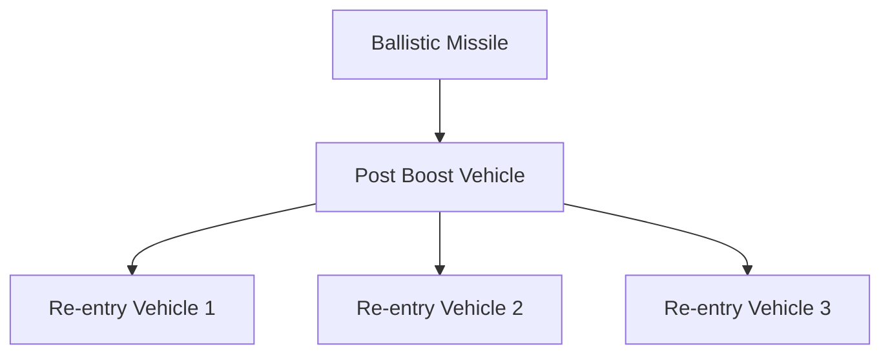
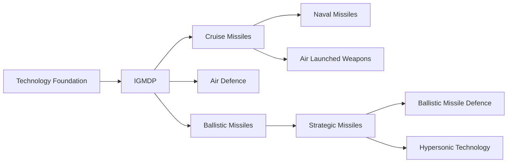

# India's Missile Journey

> A chronological story of India's missile development, from the early indigenous programmes to modern strategic, cruise, air-defence and hypersonic systems.

---

## 1. 1960s — Beginning of Indigenous Missile Development

India recognised that modern military capability required indigenous missile technology.

The early focus was on developing domestic expertise in:

- Propulsion
- Guidance
- Control systems
- Warhead integration
- Radar and tracking
- Systems engineering

The objective was to reduce dependence on foreign missile technology.

---

## 2. 1963 — First Rocket Launches

India began developing its space and rocket capabilities at Thumba.

Although the early programme was primarily associated with space research, it helped create expertise in:

- Solid propulsion
- Rocket structures
- Guidance
- Telemetry
- Tracking
- Systems integration

These technologies later contributed to India's wider missile and strategic technology base.

---

## 3. 1970s — Indigenous Missile Capability Expands

India continued developing missile related technologies.

The country built expertise in:

- Propulsion
- Guidance
- Radar
- Electronics
- Warhead technology
- Launch systems

The 1974 Pokhran nuclear test also increased the strategic importance of reliable delivery systems.

---

## 4. 1983 — Integrated Guided Missile Development Programme

India launched the Integrated Guided Missile Development Programme (IGMDP) under DRDO.

Dr APJ Abdul Kalam played a major leadership role in the programme.

The original programme covered five major missile families:

- Prithvi
- Agni
- Akash
- Trishul
- Nag

This became the foundation of India's modern indigenous missile ecosystem.

---

## 5. Prithvi — First Major Indigenous Ballistic Missile Family

The Prithvi programme focused on short range ballistic missile capability.

The system provided India with experience in:

- Liquid propulsion
- Guidance
- Mobile launchers
- Ballistic missile operations

Different variants were developed for different services and roles.

See `prithvi-series.md`.

---

## 6. 1989 — First Agni Test

The first Agni technology demonstrator was tested in 1989.

Agni became India's principal family of strategic ballistic missiles.

The programme progressively moved toward:

- Greater range
- Solid fuel propulsion
- Road mobility
- Improved accuracy
- Faster deployment
- Better survivability

See `agni-series.md`.

---

## 7. 1990s — Missile Development Accelerates

During the 1990s, India continued developing indigenous missile systems.

Major areas included:

- Ballistic missiles
- Air-defence missiles
- Anti-tank missiles
- Cruise missile technology
- Anti-ship missiles

The missile ecosystem increasingly supported all three armed services.

---

## 8. Akash — Indigenous Surface-to-Air Missile

The Akash programme developed an indigenous medium range surface-to-air missile system.

The system was designed to provide air-defence capability against hostile aircraft and other aerial targets.

Akash became an important example of indigenous air-defence development.

See `../land/air-defence-systems.md` and `akash.md` where applicable.

---

## 9. Nag — Anti-Tank Guided Missile

Nag was developed as an indigenous anti-tank guided missile.

The programme focused on:

- Fire-and-forget capability
- Imaging infrared guidance
- Armoured target engagement

It eventually contributed to India's family of anti-armour systems.

---

## 10. 1998 — Pokhran-II

India conducted nuclear tests at Pokhran in May 1998.

The tests transformed the strategic importance of India's missile programme.

Reliable delivery systems became central to credible nuclear deterrence.

This created a strategic relationship:

**Nuclear capability + reliable delivery systems = credible deterrence**

---

## 11. 1990s–2000s — Agni Family Evolves

The Agni family developed into multiple generations.

Major systems included:

- Agni-I
- Agni-II
- Agni-III
- Agni-IV
- Agni-V

The evolution increased India's strategic reach and survivability.

---

## 12. 1998–2000s — BrahMos Development

India and Russia jointly developed BrahMos.

BrahMos became one of India's most important supersonic cruise missile systems.

Its major characteristics include:

- Supersonic speed
- Precision strike capability
- Land, sea and air launch variants
- Anti-ship and land-attack roles

See `brahmos.md`.

---

## 13. 2000s — Cruise Missile Capability Expands

India expanded its cruise missile capabilities beyond BrahMos.

The Nirbhay programme aimed to develop a long range subsonic cruise missile.

The programme contributed to India's experience in:

- Terrain following
- Long range navigation
- Cruise missile propulsion
- Precision strike

See `nirbhay.md`.

---

## 14. 2000s–2010s — Missile Defence Development

India began developing a Ballistic Missile Defence programme.

The system architecture includes:

- Long range tracking radars
- Battle management systems
- Interceptors
- Communication networks

The programme developed both exo-atmospheric and endo-atmospheric interception capabilities.

See `ballistic-missile-defence.md`.

---

## 15. 2000s–2010s — Submarine Launched Missiles

India developed the K-series of submarine launched ballistic missiles.

Important systems include:

- K-15
- K-4

These missiles support the sea based component of India's nuclear triad.

See `k-series-missiles.md`.

---

## 16. 2010s — Long Range Strategic Capability

Agni-IV and Agni-V represented major advances in India's long range ballistic missile capability.

Important improvements included:

- Solid fuel propulsion
- Road mobility
- Advanced guidance
- Greater range
- Reduced launch preparation requirements

These developments strengthened India's strategic deterrent.

---

## 17. 2012 — Agni-V First Test

Agni-V was first tested in April 2012.

The system represented a major milestone in India's long range ballistic missile programme.

It uses a road mobile launcher and solid fuel propulsion.

Its development strengthened India's strategic reach and survivability.

---

## 18. 2010s — Air-Launched Missile Capability

India expanded missile capability for combat aircraft.

Major areas included:

- Air-to-air missiles
- Air-to-surface missiles
- Anti-radiation missiles
- Stand-off weapons
- Cruise missiles

These systems increased the strike capability of the Indian Air Force.

---

## 19. Astra — Indigenous Air-to-Air Missile

Astra is India's indigenous air-to-air missile family.

The programme developed beyond visual range air combat capability.

It represents an important transition from dependence on imported air-to-air missiles toward greater indigenous capability.

---

## 20. 2019 — Anti-Satellite Capability

India conducted Mission Shakti in March 2019.

An Indian interceptor destroyed an Indian satellite in low Earth orbit.

The test demonstrated India's anti-satellite interception capability.

See `space-and-asat.md`.

---

## 21. 2020s — New Generation Ballistic Missiles

India continued developing newer generations of ballistic missiles.

Agni-P represents a newer-generation strategic ballistic missile design.

Important objectives include:

- Greater mobility
- Faster deployment
- Improved accuracy
- Modern guidance
- Better survivability

---

## 22. MIRV Technology

India has also demonstrated multiple independently targetable re-entry vehicle technology.

MIRV allows a ballistic missile to potentially carry multiple re-entry vehicles.

This technology can increase the capability of a single missile and complicate missile defence.

---

## 23. Hypersonic Technology

India is developing hypersonic weapon technologies.

Major objectives include:

- Very high speed
- Manoeuvrability
- Reduced reaction time
- Improved survivability
- Long range precision strike

See `hypersonic-programmes.md`.

---

## 24. Modern Indian Missile Ecosystem

India now maintains missile programmes across several categories.

| Category | Examples |
|---|---|
| Ballistic missiles | Prithvi, Agni |
| Cruise missiles | BrahMos, Nirbhay |
| Air-to-air | Astra |
| Surface-to-air | Akash, QRSAM |
| Anti-tank | Nag |
| Anti-ship | BrahMos and other naval systems |
| Ballistic missile defence | AAD, PDV and newer interceptors |
| Submarine launched | K-series |
| Anti-radiation | Rudram |
| Hypersonic | Emerging programmes |
| Anti-satellite | Mission Shakti capability |

---

## 25. Missile Development Pattern

---

# Chronological Timeline

| Year / Period | Major Development | Importance |
|---|---|---|
| 1960s | Rocket and propulsion foundations | Indigenous technology base |
| 1970s | Missile technology development | Domestic capability expands |
| 1983 | IGMDP launched | Major indigenous missile programme |
| 1989 | First Agni test | Strategic ballistic missile capability |
| 1990s | Prithvi and other systems mature | Operational missile capability |
| 1990s–2000s | BrahMos development | Supersonic cruise missile capability |
| 1998 | Pokhran-II | Strategic delivery requirement increases |
| 2000s | Akash and Nag development | Air-defence and anti-armour capability |
| 2000s–2010s | BMD development | Missile interception capability |
| 2000s–2010s | K-series development | Sea based nuclear deterrence |
| 2012 | Agni-V first test | Long range strategic capability |
| 2010s | Astra and air launched weapons | Indigenous air combat capability |
| 2019 | Mission Shakti | Anti-satellite capability demonstrated |
| 2020s | Agni-P and MIRV development | Next generation strategic capability |
| 2020s | Hypersonic programmes | Future high speed strike capability |

---

# How the Missile Story Connects

The development can be understood as a progression:

**Rocket Technology → IGMDP → Ballistic Missiles → Air Defence → Cruise Missiles → Naval Missiles → Air Launched Weapons → Strategic Missiles → Missile Defence → MIRV → Hypersonic Technology**

Each generation built on expertise developed in earlier programmes.

---

# Quick Revision

- **1983** — IGMDP becomes the foundation of modern indigenous missile development.
- **1989** — First Agni test.
- **1990s** — Prithvi and other missile systems mature.
- **1990s–2000s** — BrahMos develops into a major supersonic cruise missile.
- **1998** — Pokhran-II increases the importance of reliable strategic delivery systems.
- **2000s** — Akash, Nag and other indigenous systems mature.
- **2000s–2010s** — Ballistic Missile Defence and K-series programmes expand.
- **2012** — Agni-V first test.
- **2010s** — Indigenous air-launched missile capability expands.
- **2019** — Mission Shakti demonstrates anti-satellite capability.
- **2020s** — Agni-P, MIRV and hypersonic technologies represent the next generation.

---

# Key Takeaway

India's missile capability evolved from basic rocket and propulsion expertise into a broad indigenous ecosystem covering:

**Ballistic Missiles + Cruise Missiles + Air Defence + Air-to-Air Weapons + Naval Missiles + Anti-Tank Missiles + Missile Defence + Strategic Missiles + Anti-Satellite Capability + Hypersonic Technology**

The long term objective has been to develop reliable indigenous missile capability across tactical, operational and strategic levels.
