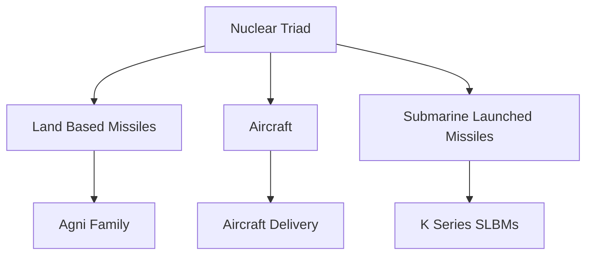
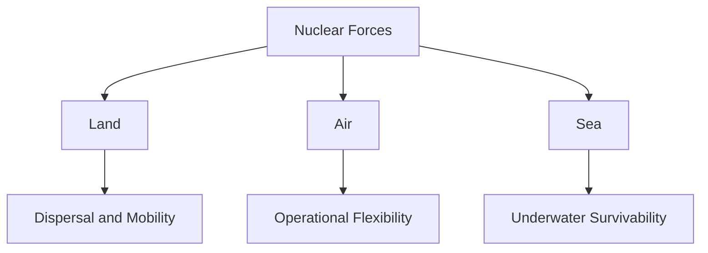
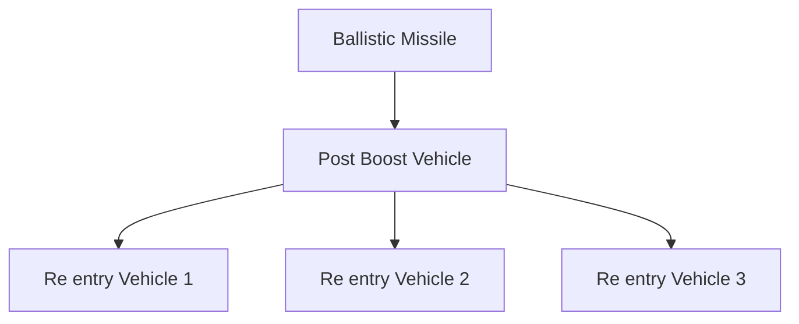
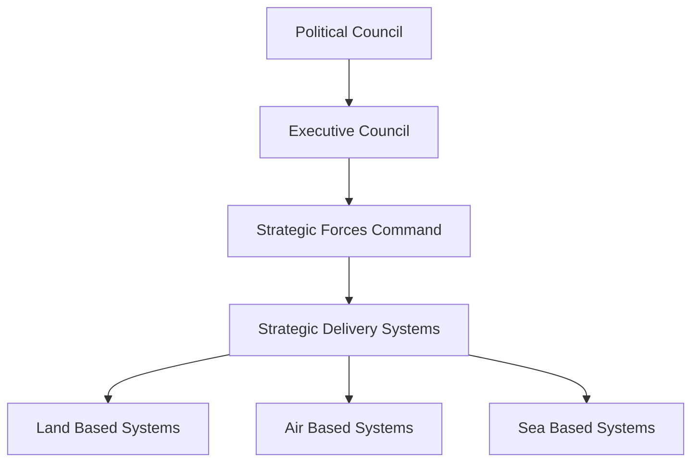
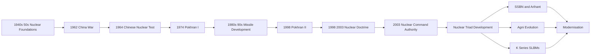

# India Nuclear Journey

> A chronological story of Indias nuclear programme, from the foundations of atomic research to the development of a credible nuclear deterrent and nuclear triad.

---

## 1. 1940s–1950s — Nuclear Foundations

### 1945 — Tata Institute of Fundamental Research

The Tata Institute of Fundamental Research (TIFR) was established in Mumbai with Homi J. Bhabha as its first director.

It became an important foundation for Indias nuclear science capability.

### 1948 — Atomic Energy Commission

India established the Atomic Energy Commission (AEC).

The objective was to place atomic energy development under coordinated national direction.

### 1954 — Department of Atomic Energy

The Department of Atomic Energy (DAE) was established under the direct responsibility of the Prime Minister.

This created the institutional foundation for Indias long term nuclear programme.

---

## 2. 1950s–1960s — Peaceful Nuclear Development

During the 1950s and early 1960s, India publicly emphasised peaceful uses of nuclear technology.

Major areas included:

- Nuclear research
- Nuclear power
- Nuclear fuel cycle capability
- Nuclear reactors
- Nuclear science and engineering
- Indigenous technical expertise

India gradually developed the ability to produce and handle nuclear materials domestically.

---

## 3. 1962 — India China War

The 1962 India China War became an important turning point in Indias security thinking.

India faced a major military setback against China.

The conflict increased awareness of the importance of strategic capability and national security preparedness.

---

## 4. 1964 — China Conducts a Nuclear Test

On 16 October 1964, China conducted its first nuclear weapons test.

This fundamentally changed Indias strategic environment.

India now faced a neighbouring nuclear armed state.

The combination of:

- The 1962 war
- Chinas nuclear test
- Wider regional security concerns

strengthened the debate over Indias own nuclear option.

---

## 5. 1960s–1970s — Moving Toward Nuclear Capability

India continued developing nuclear technology while maintaining strategic ambiguity about weapons.

The country built expertise across:

- Nuclear reactors
- Uranium processing
- Plutonium production
- Nuclear chemistry
- Metallurgy
- Nuclear engineering

This indigenous capability eventually made a nuclear explosive test possible.

---

## 6. 1974 — Pokhran I

On 18 May 1974, India conducted its first nuclear explosive test at Pokhran in Rajasthan.

The test was officially described by India as a peaceful nuclear explosion.

The event demonstrated that India had acquired the technological capability to conduct a nuclear explosion.

### Why It Was Important

Pokhran I:

- Demonstrated Indias nuclear capability
- Established technological credibility
- Changed Indias position in global nuclear politics
- Triggered international technology and export restrictions

It became a major milestone in Indias nuclear history.

---

## 7. 1974–1990s — Strategic Ambiguity

After Pokhran I, India did not immediately declare itself a nuclear weapons state.

Instead, India maintained strategic ambiguity.

During this period India continued developing:

- Nuclear technology
- Nuclear fuel cycle capability
- Missile technology
- Strategic research
- Nuclear delivery systems

The missile programme became increasingly important because a nuclear capability requires reliable delivery systems.

---

## 8. 1983 — Integrated Guided Missile Development Programme

India launched the Integrated Guided Missile Development Programme (IGMDP) under DRDO.

The programme developed several indigenous missile families.

Important systems included:

- Prithvi
- Agni
- Akash
- Trishul
- Nag

The programme significantly strengthened Indias missile development ecosystem.

See:

- `agni-series.md`
- `prithvi-series.md`
- `strategic-missiles.md`

---

## 9. 1989 — First Agni Test

The first Agni technology demonstrator was tested in 1989.

Agni subsequently evolved into a family of increasingly capable ballistic missiles.

Major systems later included:

- Agni I
- Agni II
- Agni III
- Agni IV
- Agni V
- Agni P

See `agni-series.md` for the detailed evolution.

---

## 10. 1980s–1990s — Sea Based Deterrent Concept

India also recognised the importance of a survivable sea based nuclear capability.

The objective was to ensure that a nuclear retaliatory capability could survive even if land based assets were attacked.

This eventually led to:

- Nuclear powered ballistic missile submarines
- Submarine launched ballistic missiles
- A sea based nuclear deterrent

This became the third component of the nuclear triad.

---

## 11. 1990s — Changing Strategic Environment

During the 1990s, Indias security environment continued to evolve.

Important factors included:

- Chinas established nuclear capability
- Pakistans developing nuclear capability
- Missile proliferation in the region
- Indias growing missile capability
- Continuing international pressure

India continued to maintain strategic ambiguity.

---

## 12. 1998 — Pokhran II

India conducted a series of nuclear tests at Pokhran in May 1998.

The tests were conducted on:

- 11 May 1998
- 13 May 1998

India subsequently declared itself a nuclear weapons state.

### Why Pokhran II Was Different

Unlike 1974, the 1998 tests were followed by an explicit declaration of Indias nuclear weapons capability.

This marked a major transition:

**Strategic ambiguity → Declared nuclear deterrence**

---

## 13. 1998–2003 — Nuclear Doctrine

After Pokhran II, India established principles governing its nuclear posture.

Important concepts included:

- Credible Minimum Deterrence
- No First Use
- Massive retaliation
- Civilian political control
- Survivable nuclear forces

India aimed to make nuclear weapons instruments of deterrence rather than conventional warfighting.

---

## 14. 1999 — Draft Nuclear Doctrine

The National Security Advisory Board released a Draft Nuclear Doctrine in 1999.

It articulated principles including:

- Credible Minimum Nuclear Deterrence
- No First Use
- Retaliation
- Survivability
- Effective command and control

The draft became an important reference for Indias nuclear policy.

---

## 15. 2003 — Nuclear Command Authority

India formally established the Nuclear Command Authority (NCA) in 2003.

The NCA created the institutional framework for political control over Indias nuclear arsenal.

It has two principal bodies:

### Political Council

The Political Council is headed by the Prime Minister.

It is the body with authority to take decisions regarding nuclear weapons.

### Executive Council

The Executive Council advises the Political Council and supports implementation.

---

## 16. 2003 — Nuclear Doctrine Clarification

In January 2003, the Cabinet Committee on National Security announced a formal statement on Indias nuclear doctrine.

Important elements included:

- Credible Minimum Deterrence
- No First Use
- Nuclear retaliation
- Civilian political control
- Strong command and control

The doctrine became an important foundation of Indias nuclear posture.

---

## 17. Nuclear Triad

A credible nuclear deterrent requires survivable delivery options.

India therefore developed a nuclear triad consisting of:

1. Land based missiles
2. Aircraft
3. Submarine launched ballistic missiles

See `nuclear-triad.md` for the detailed triad architecture.

---

## 18. Land Based Nuclear Deterrent

The land based component primarily depends on ballistic missiles.

The Agni family became the central element of Indias land based strategic missile capability.

The evolution moved toward:

- Greater range
- Improved mobility
- Better accuracy
- Faster deployment
- More modern guidance
- Greater survivability

---

## 19. Air Based Nuclear Deterrent

Aircraft provide another nuclear delivery option.

The Indian Air Force has operated aircraft capable of delivering strategic weapons.

The air component provides flexibility and an additional delivery option beyond land based missiles.

Major advantages include:

- Flexibility
- Recall capability
- Visible signalling
- Multiple basing possibilities

---

## 20. Sea Based Nuclear Deterrent

The sea based component is designed to provide a survivable second strike capability.

The central platform is the nuclear powered ballistic missile submarine (SSBN).

India developed the Arihant class SSBN programme to establish this capability.

---

## 21. INS Arihant

INS Arihant became the first Indian built nuclear powered ballistic missile submarine.

Its importance was strategic:

- Nuclear powered propulsion
- Ballistic missile capability
- Underwater survivability
- Sea based nuclear deterrence

This represented a major milestone in Indias nuclear triad.

---

## 22. K Series Missiles

The K series was developed to provide submarine launched ballistic missile capability.

Important systems include:

- K 15
- K 4
- Further advanced K series development

K 15 provides shorter range submarine launched capability.

K 4 provides greater range and supports Indias longer range sea based deterrence requirement.

See `k-series-missiles.md`.

---

## 23. Nuclear Triad Matures

With land based missiles, aircraft and SSBN based missiles, India established the basic architecture of a nuclear triad.

The strategic logic is:

The sea component is particularly important for assured retaliation because a hidden SSBN is harder to locate and destroy.

---

## 24. 2000s–2010s — Strategic Modernisation

India continued modernising its nuclear delivery systems.

Major areas included:

- Longer range ballistic missiles
- Mobile launchers
- MIRV related technology
- Submarine launched missiles
- SSBN development
- Secure communications
- Early warning systems
- Command and control

The objective was not simply to increase the number of weapons, but to improve the credibility and survivability of the deterrent.

---

## 25. Agni V and Long Range Capability

The Agni V programme represented a major step in Indias long range ballistic missile capability.

The system uses a road mobile launcher and solid fuel propulsion.

Its development strengthened Indias land based strategic deterrent.

---

## 26. MIRV Technology

India has demonstrated technology associated with multiple independently targetable re entry vehicles (MIRVs).

A MIRV system can carry multiple re entry vehicles that can potentially be directed toward different targets.

MIRV technology is strategically significant because it can increase the capability of a single missile against multiple targets and complicate missile defence.

---

## 27. Ballistic Missile Defence

India has also developed a Ballistic Missile Defence programme.

The programme combines:

- Long range tracking radars
- Battle management systems
- Exo atmospheric interceptors
- Endo atmospheric interceptors

Major interceptor families include:

- Prithvi Defence Vehicle
- Advanced Air Defence
- AD series interceptors

See `ballistic-missile-defence.md`.

---

## 28. 2010s — Expansion of the Sea Based Component

The Arihant programme continued to mature.

India progressively developed:

- SSBN operational capability
- K series missiles
- Submarine infrastructure
- Secure communications
- Crew and operational expertise

The sea based component became an increasingly important part of Indias strategic deterrent.

---

## 29. 2018 — INS Arihant Deterrence Patrol

India publicly confirmed that INS Arihant had completed its first deterrence patrol in 2018.

This was a major milestone because it demonstrated the practical operation of Indias sea based nuclear deterrent.

It represented an important step toward a survivable second strike capability.

---

## 30. 2020s — Continued Modernisation

India continues to modernise its nuclear deterrent.

Major areas include:

- Newer ballistic missiles
- More capable SSBNs
- Improved SLBMs
- MIRV technologies
- Secure command and control
- Early warning systems
- Nuclear survivability
- Mobile launch platforms
- Improved communications

---

## 31. Strategic Forces Structure

Indias nuclear weapons are controlled through a centralised command structure.

The Strategic Forces Command (SFC) is responsible for the operational management of Indias nuclear delivery systems.

It operates under the broader nuclear command framework.

---

## 32. Command and Control

Nuclear deterrence requires extremely secure command and control.

Key requirements include:

- Authorisation
- Secure communications
- Authentication
- Survivable command systems
- Protection against accidental use
- Reliable transmission of orders

The goal is to ensure that nuclear weapons remain under political control.

---

## 33. Nuclear Safety and Security

A nuclear deterrent requires more than delivery systems.

It also requires:

- Physical security
- Personnel reliability
- Secure storage
- Permissive controls
- Safety procedures
- Accident prevention
- Command authentication

Nuclear weapons must remain secure during peacetime and crisis conditions.

---

## 34. Credible Minimum Deterrence

India describes its nuclear posture around the principle of **credible minimum deterrence**.

The basic idea is to maintain sufficient nuclear capability to deter nuclear coercion and ensure retaliation, without pursuing an unlimited arsenal.

This is different from maintaining the largest possible nuclear stockpile.

---

## 35. No First Use

India has historically maintained a No First Use policy, with the 2003 doctrine statement specifying that nuclear weapons would not be used first.

The doctrine also states that India would retaliate massively if subjected to a nuclear attack.

The precise interpretation and future evolution of doctrine remain matters of strategic debate.

---

## 36. Second Strike Capability

Second strike capability means retaining the ability to respond after absorbing an adversarys first strike.

Survivability is therefore central to nuclear deterrence.

India improves survivability through:

- Mobile missiles
- Dispersal
- Hardened infrastructure
- Multiple delivery systems
- SSBNs
- Secure communications

---

## 37. Why SSBNs Matter

An SSBN can remain hidden underwater for extended periods.

This makes it much harder for an adversary to eliminate the entire sea based nuclear force in a first strike.

Therefore:

**SSBN survivability → assured retaliation → stronger deterrence**

This is one of the principal strategic reasons for Indias investment in nuclear powered ballistic missile submarines.

---

## 38. India Nuclear Journey in One Flow

---

# Chronological Timeline

| Year / Period | Major Event | Strategic Significance |
|---|---|---|
| 1945 | TIFR established | Nuclear science foundation |
| 1948 | Atomic Energy Commission | National nuclear programme begins |
| 1954 | Department of Atomic Energy | Centralised nuclear development |
| 1962 | India China War | Major security reassessment |
| 1964 | China conducts nuclear test | New nuclear threat environment |
| 1974 | Pokhran I | First Indian nuclear explosive test |
| 1983 | IGMDP | Indigenous missile capability accelerated |
| 1989 | First Agni test | Strategic missile capability demonstrated |
| 1998 | Pokhran II | India openly declares nuclear capability |
| 1999 | Draft Nuclear Doctrine | Formal deterrence principles articulated |
| 2003 | Nuclear Command Authority | Nuclear command structure established |
| 2000s | SSBN and SLBM development | Sea based deterrence takes shape |
| 2012 | Agni V first test | Long range strategic capability |
| 2010s | Arihant development | Nuclear triad approaches operational maturity |
| 2018 | Arihant deterrence patrol | Sea based deterrent milestone |
| 2020s | MIRV, Agni P and SSBN modernisation | Next generation strategic capability |

---

# Detailed Files

The chronological journey is the master story. Detailed subjects remain in their dedicated files.

| Story Topic | Detailed File |
|---|---|
| Agni evolution | `agni-series.md` |
| Prithvi evolution | `prithvi-series.md` |
| K series | `k-series-missiles.md` |
| Nuclear triad | `nuclear-triad.md` |
| Ballistic missile defence | `ballistic-missile-defence.md` |
| Strategic missile ecosystem | `strategic-missiles.md` |
| Space and ASAT | `space-and-asat.md` |

This avoids unnecessary duplication while keeping the chronological narrative easy to follow.

---

# Quick Revision

- **1940s–50s** — Nuclear science foundations.
- **1962** — India China War changes security thinking.
- **1964** — China conducts its first nuclear test.
- **1974** — Pokhran I demonstrates Indias nuclear explosive capability.
- **1980s** — Indigenous missile development accelerates.
- **1989** — First Agni test.
- **1998** — Pokhran II and declaration of nuclear weapons capability.
- **1999** — Draft Nuclear Doctrine.
- **2003** — Nuclear Command Authority established.
- **2000s–2010s** — Nuclear triad develops.
- **2018** — INS Arihant deterrence patrol milestone.
- **2020s** — Continued missile, submarine, MIRV and command and control modernisation.

---

# Key Takeaway

Indias nuclear capability did not appear suddenly in 1998.

It developed through a long sequence:

**Nuclear Science → Institutional Foundation → Indigenous Technology → 1962 Security Shock → Chinas 1964 Nuclear Test → Pokhran I → Missile Development → Pokhran II → Nuclear Doctrine → Command and Control → Nuclear Triad → SSBNs → Strategic Modernisation**

The central objective has been to build a **credible, survivable and politically controlled nuclear deterrent**.
