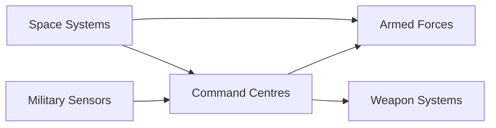
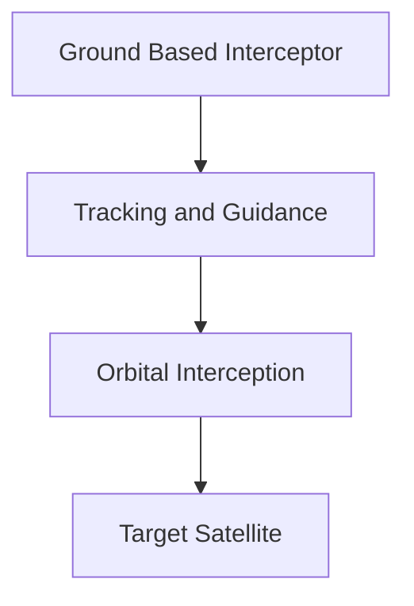
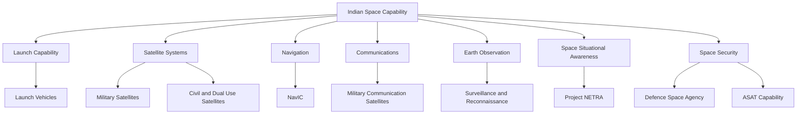

# India Space and ASAT Journey

> A chronological story of India's space capability and its evolution into an important part of national security, military support and strategic deterrence.

---

## 1. 1960s — Foundations of India's Space Programme

India began its organised space programme in the 1960s.

The early focus was primarily peaceful:

- Scientific research
- Weather observation
- Communications
- Remote sensing
- Education
- National development

However, the technologies developed for civilian space activity later became important for national security.

---

## 2. 1962 — INCOSPAR

The Indian National Committee for Space Research (INCOSPAR) was established in 1962.

Dr Vikram Sarabhai played a central role in building India's early space programme.

The programme focused on using space technology for national development.

---

## 3. 1963 — Thumba Launching Station

India conducted its early sounding rocket launches from Thumba in Kerala.

The programme helped India develop expertise in:

- Rocket systems
- Telemetry
- Tracking
- Communications
- Atmospheric research
- Launch operations

These capabilities became the foundation for the later Indian space programme.

---

## 4. 1969 — ISRO Established

The Indian Space Research Organisation (ISRO) was established in 1969.

The organisation gradually expanded India's capabilities in:

- Launch vehicles
- Satellites
- Remote sensing
- Communications
- Navigation
- Space science

The development of these capabilities later created significant national security advantages.

---

## 5. 1970s — Satellite Capability Begins

India began developing and launching its own satellites.

Important areas included:

- Earth observation
- Communications
- Meteorology
- Scientific research

Satellite technology created a new way to observe India's territory and surrounding regions.

---

## 6. 1975 — Aryabhata

Aryabhata was India's first satellite.

It was launched on 19 April 1975.

The satellite was primarily a scientific mission, but it represented an important milestone in India's ability to design and operate spacecraft.

---

## 7. 1970s–1980s — Remote Sensing and Communications

India progressively developed satellite applications for:

- Mapping
- Agriculture
- Weather monitoring
- Disaster management
- Communications
- Resource monitoring

The resulting infrastructure later became useful for defence and security applications.

---

## 8. 1980 — First Indigenous Satellite Launch Vehicle Success

The SLV-3 programme successfully placed the Rohini satellite into orbit in 1980.

This demonstrated India's ability to launch a satellite using an indigenous launch vehicle.

Launch capability became an important component of long term strategic autonomy.

---

## 9. 1980s–1990s — Expanding Satellite Infrastructure

India developed increasingly capable satellite systems.

Major areas included:

- Communication satellites
- Remote sensing satellites
- Meteorological satellites
- Launch vehicles
- Ground stations

The growing satellite network improved India's ability to collect information and communicate over large distances.

---

## 10. 1990s — Strategic Importance of Space Increases

As military operations became increasingly dependent on information, space systems became strategically important.

Satellites could support:

- Communications
- Navigation
- Intelligence
- Surveillance
- Reconnaissance
- Weather information

India therefore increasingly recognised space as an important national security domain.

---

## 11. 1999 — Kargil War

The Kargil War demonstrated the importance of accurate information, surveillance and communications.

The conflict reinforced the need for better:

- Earth observation
- Intelligence
- Communications
- Navigation
- Battlefield awareness

Space based systems increasingly became part of India's wider defence information architecture.

---

## 12. 2000s — Military Space Requirements Expand

India continued developing satellite capabilities that could support military operations.

Major requirements included:

- Secure communications
- High resolution imagery
- Navigation
- Surveillance
- Battlefield communications
- Network connectivity

Space began shifting from being viewed only as a civilian development domain toward being recognised as a strategic security domain.

---

## 13. 2001 — Establishment of Integrated Space Cell

India established an Integrated Space Cell within the defence structure to coordinate military requirements related to space.

The objective was to improve coordination between:

- Armed forces
- Department of Space
- ISRO
- Defence organisations

This reflected the increasing importance of space to defence planning.

---

## 14. 2000s–2010s — Dedicated Military Satellites

India increasingly deployed satellites with direct or significant military utility.

These included systems supporting:

- Secure communications
- Navigation
- Earth observation
- Surveillance
- Maritime awareness

The development of dedicated military satellite capabilities reduced dependence on purely civilian systems.

---

## 15. GSAT-7 — Naval Communication Capability

GSAT-7 was launched in 2013.

It was India's first dedicated military communication satellite and was primarily associated with the Indian Navy.

It improved secure communication and network connectivity for naval operations.

---

## 16. Navigation — NavIC

India developed its own regional satellite navigation system.

The Indian Regional Navigation Satellite System, later known as NavIC, provides positioning and timing services.

NavIC is strategically important because independent navigation capability reduces dependence on foreign navigation systems.

Military applications can include:

- Positioning
- Navigation
- Timing
- Platform coordination
- Weapon guidance support

---

## 17. 2014 — GSAT-7A

GSAT-7A was launched in 2018 and supports secure communication requirements of the Indian Air Force and other defence users.

It improves connectivity between:

- Aircraft
- Ground stations
- Command centres

Satellite communications therefore became an important part of India's network centric military capability.

---

## 18. 2018 — Space Becomes a Dedicated Defence Domain

India increasingly formalised its military space organisation.

The armed forces required coordinated capabilities for:

- Space based surveillance
- Communications
- Navigation
- Space situational awareness
- Protection of space assets

This eventually contributed to the creation of dedicated military space structures.

---

## 19. 2019 — Mission Shakti

On 27 March 2019, India conducted Mission Shakti.

An Indian anti-satellite interceptor destroyed an Indian satellite in low Earth orbit.

The test demonstrated India's capability to conduct a kinetic anti-satellite interception.

### Why It Was Important

Mission Shakti demonstrated that India possessed:

- Space object tracking capability
- Guidance and control capability
- High speed interceptor technology
- Exo-atmospheric interception capability

It established India as one of the countries that had demonstrated a direct-ascent ASAT capability.

---

## 20. 2019 — Defence Space Agency

India established the Defence Space Agency (DSA) in 2019.

The DSA was created to coordinate military space activities across the armed forces.

Its responsibilities include areas related to:

- Space operations
- Space based communications
- Space surveillance
- Space situational awareness
- Military space planning

---

## 21. 2019 — Defence Space Research Organisation

The Defence Space Research Organisation (DSRO) was created to support the development of defence related space technologies.

Its purpose was to strengthen indigenous military space capability.

The broader objective was to develop technologies needed to operate effectively in an increasingly contested space environment.

---

## 22. Space Situational Awareness

After Mission Shakti, space situational awareness became increasingly important.

SSA involves tracking and understanding objects and activities in space.

It can include:

- Satellites
- Debris
- Launch vehicles
- Potential threats
- Orbital behaviour

India has developed radar and optical tracking capabilities to improve awareness of the space environment.

---

## 23. Project NETRA

ISRO developed Project NETRA to improve India's space situational awareness capability.

The programme includes:

- Radar based tracking
- Optical telescopes
- Space object cataloguing
- Collision warning
- Monitoring of objects in orbit

This helps protect Indian satellites from collisions and improves awareness of objects operating in space.

---

## 24. 2020s — Integrated Military Space Capability

India continued expanding military space capabilities.

Important areas include:

- Secure satellite communications
- Earth observation
- Navigation
- Space surveillance
- Space situational awareness
- Satellite based intelligence
- Defence networks

Space became increasingly integrated with land, air and maritime military operations.

---

## 25. GSAT-7B and Army Communications

India has continued developing dedicated satellite communication capability for the armed forces.

GSAT-7B is intended to support the Indian Army with secure communication.

Such systems can improve connectivity between:

- Units
- Command headquarters
- Forward formations
- Operational networks

---

## 26. Satellite Based Intelligence and Surveillance

Modern military operations require persistent information.

Indian space based systems can support:

- Border surveillance
- Maritime monitoring
- Infrastructure observation
- Disaster response
- Intelligence gathering
- Target information

High resolution Earth observation has therefore become an important strategic capability.

---

## 27. Space and Network Centric Warfare

Space systems increasingly support military networks.

A simplified relationship is:

Space therefore acts as an information layer connecting sensors, commanders and military platforms.

---

## 28. Space Based Communications

Military communication satellites support:

- Secure voice
- Data transmission
- Command and control
- Beyond line of sight communication
- Network connectivity

This is especially important for:

- Aircraft
- Ships
- Submarines
- Remote military formations

---

## 29. Space Based Navigation

Navigation satellites provide:

- Position
- Velocity information
- Precise timing
- Synchronisation

Military platforms can use navigation information for:

- Movement
- Coordination
- Navigation
- Precision weapon support

Independent navigation capability strengthens strategic autonomy.

---

## 30. Earth Observation

Earth observation satellites can support military and national security requirements.

Applications include:

- Border monitoring
- Infrastructure monitoring
- Maritime surveillance
- Change detection
- Disaster assessment

Persistent observation can provide information that is difficult to obtain using ground based systems alone.

---

## 31. ASAT Capability

India's ASAT capability demonstrated in Mission Shakti is primarily a direct ascent kinetic interception capability.

The basic concept is:

The demonstration showed that India could track and intercept a satellite in low Earth orbit.

---

## 32. ASAT Is Only One Part of Space Security

Space security is broader than destroying satellites.

A modern space security architecture can involve:

- Space situational awareness
- Satellite protection
- Secure communications
- Navigation
- Electronic warfare
- Cyber protection
- Redundancy
- Rapid satellite replacement
- Deterrence

India therefore focuses increasingly on resilience and protection in addition to offensive counter-space capability.

---

## 33. Counter Space and Resilience

A country can protect its space capability through:

- Multiple satellites
- Distributed systems
- Redundant communications
- Hardened electronics
- Secure links
- Rapid replacement
- Alternative terrestrial systems

The objective is to ensure that the loss or disruption of one satellite does not disable the entire military network.

---

## 34. Space Based Early Warning

Space based early warning is an important capability for advanced military powers.

Such systems can potentially detect:

- Missile launches
- Large infrared signatures
- Strategic activity

India continues to develop broader space and surveillance capabilities, although the exact operational architecture of strategic early warning systems is not fully public.

---

## 35. Future Direction

India's military space capability is expected to continue developing in:

- Space situational awareness
- Secure satellite communications
- Earth observation
- Navigation
- Missile warning
- Space surveillance
- Satellite protection
- Counter-space technologies
- Artificial intelligence for space data

The emphasis is increasingly on resilient space infrastructure rather than dependence on individual satellites.

---

# Chronological Timeline

| Year / Period | Major Development | Importance |
|---|---|---|
| 1962 | INCOSPAR established | Organised Indian space programme |
| 1963 | Thumba sounding rocket launches | Early launch and tracking capability |
| 1969 | ISRO established | National space organisation |
| 1975 | Aryabhata launched | First Indian satellite |
| 1980 | SLV-3 success | Indigenous launch capability |
| 1980s–90s | Remote sensing and communications expand | National space infrastructure |
| 1999 | Kargil War | Reinforced need for surveillance and communications |
| 2001 | Integrated Space Cell | Military space coordination |
| 2013 | GSAT-7 | Dedicated naval communication capability |
| 2018 | GSAT-7A | Air force communication support |
| 2019 | Mission Shakti | ASAT capability demonstrated |
| 2019 | Defence Space Agency | Dedicated military space organisation |
| 2019 | Defence Space Research Organisation | Defence space technology development |
| 2020s | Project NETRA and SSA expansion | Space environment awareness |
| 2020s | Dedicated military communications and observation | Integrated military space capability |

---

# Space Capability Architecture

---

# How the Story Connects

The development can be understood as:

**Space Science → Launch Capability → Satellites → Communications → Remote Sensing → Navigation → Military Space Support → ASAT → Defence Space Agency → Space Situational Awareness → Resilient Military Space Capability**

The transformation was gradual.

India first built an independent civilian space capability. That capability later created technologies and infrastructure with major defence and strategic value.

---

# Quick Revision

- **1962** — INCOSPAR established.
- **1963** — Early sounding rocket launches from Thumba.
- **1969** — ISRO established.
- **1975** — Aryabhata becomes India's first satellite.
- **1980** — Indigenous launch capability demonstrated with SLV-3.
- **1980s–90s** — Communications and remote sensing expand.
- **1999** — Kargil experience reinforces surveillance and communication requirements.
- **2001** — Integrated Space Cell established.
- **2013** — GSAT-7 provides dedicated naval communication capability.
- **2018** — GSAT-7A supports military communications.
- **2019** — Mission Shakti demonstrates direct-ascent ASAT capability.
- **2019** — Defence Space Agency established.
- **2019** — Defence Space Research Organisation established.
- **2020s** — Space situational awareness and military space infrastructure expand.

---

# Key Takeaway

India's military space capability evolved from a civilian space programme into a broader strategic capability.

The progression can be summarised as:

**Space Research → Launch Vehicles → Satellites → Communications → Remote Sensing → Navigation → Military Space Support → ASAT → Space Situational Awareness → Resilient Military Space Architecture**

Space is now an important enabling domain for India's:

- Intelligence
- Surveillance
- Communications
- Navigation
- Command and control
- Missile warning
- Strategic deterrence
- Military operations
