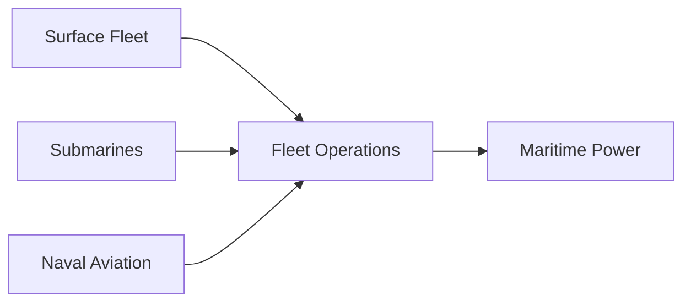
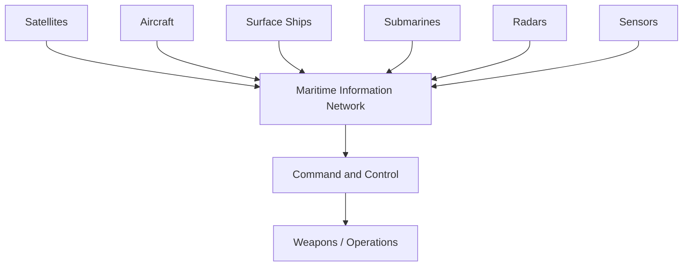
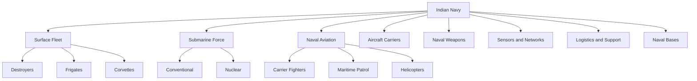
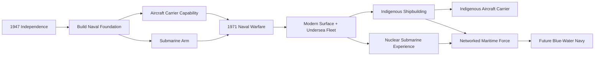

# India Navy Journey

> A chronological story of how the Indian Navy evolved from a relatively small post-independence maritime force into a modern, increasingly indigenous blue-water navy with submarines, naval aviation, aircraft carriers, long-range weapons and a strategic role across the Indian Ocean.

---

## 1. 1947 — India Inherits a Small Navy

When India became independent in 1947, the Royal Indian Navy was relatively small and was primarily structured around coastal defence and maritime security.

India's maritime priorities gradually expanded as the country recognised the importance of:

- A long coastline
- Island territories
- Sea lanes
- Maritime trade
- Offshore resources
- The Indian Ocean
- Protection of national maritime interests

The Navy therefore had to evolve from a mainly coastal force into a force capable of operating farther from India's shores.

---

## 2. 1950 — Royal Indian Navy Becomes Indian Navy

With India becoming a republic on 26 January 1950, the Royal Indian Navy became the **Indian Navy**.

The new Navy began developing its own identity, doctrine and long-term force structure.

The early priorities were:

- Training
- Fleet expansion
- Coastal defence
- Maritime surveillance
- Mine warfare
- Anti-submarine warfare
- Development of naval bases

---

## 3. 1950s — Building the Foundation

During the 1950s, India began expanding its fleet and acquiring more capable warships.

The focus was still primarily regional rather than global.

India needed a Navy capable of protecting:

**Coast → Ports → Islands → Sea approaches**

At the same time, India began developing the organisational and technical foundations required for a larger fleet.

---

## 4. 1960 — INS Vikrant and the Aircraft Carrier Era

India acquired **INS Vikrant**, originally HMS Hercules.

Its entry into Indian service gave India an aircraft-carrier capability.

This was a major strategic step because an aircraft carrier could provide:

- Air power at sea
- Fleet air defence
- Maritime strike
- Reconnaissance
- Support for naval operations far from shore

The carrier became an important element of India's vision for a larger maritime force.

---

## 5. 1961 — Operation Vijay

The Indian Navy participated in **Operation Vijay**, the military operation that ended Portuguese rule in Goa, Daman and Diu.

Naval forces helped establish maritime control and prevent hostile maritime interference.

The operation demonstrated that the Navy was becoming an important part of joint national military operations.

---

## 6. 1962 — The China War and a Strategic Lesson

The 1962 war with China highlighted India's broader military preparedness challenges.

For the Navy, the conflict reinforced the importance of maintaining a capable maritime force even when the immediate conflict was primarily land-based.

India subsequently continued developing naval infrastructure and modernising its fleet.

---

## 7. 1964–1965 — Missile and Modern Naval Warfare

The 1960s saw major changes in naval warfare.

Anti-ship missiles were becoming increasingly important.

India began recognising that relatively small missile-armed ships could pose a serious threat to larger surface combatants.

This thinking later influenced India's fast attack craft and missile boat capability.

---

# 8. 1971 — The Navy Demonstrates Offensive Capability

The **1971 Indo-Pakistan War** became one of the most important milestones in Indian naval history.

The Navy conducted major operations in both the western and eastern theatres.

Two operations became particularly famous:

- **Operation Trident**
- **Operation Python**

---

## Operation Trident

On 4 December 1971, Indian missile boats attacked Karachi harbour.

The operation demonstrated the effectiveness of missile-armed fast attack craft.

It inflicted major damage on Pakistani naval and fuel infrastructure and showed the value of offensive naval operations.

India commemorates 4 December as **Navy Day**.

---

## Operation Python

A second attack on Karachi followed on 8 December 1971.

Operation Python reinforced the earlier success and placed additional pressure on Pakistan's western naval infrastructure.

Together, the operations demonstrated that the Indian Navy could conduct offensive strikes deep against an adversary's maritime infrastructure.

---

## Eastern Theatre

The Navy also contributed to the blockade and isolation of East Pakistan.

Indian naval forces helped prevent reinforcement and maritime movement.

The naval campaign therefore contributed to the wider joint military effort that resulted in the creation of Bangladesh.

---

# 9. After 1971 — From Coastal Defence to Sea Control

The 1971 war changed Indian naval thinking.

India increasingly recognised that the Navy needed:

- Long-range ships
- Better submarines
- Naval aviation
- Missile capability
- Aircraft carriers
- Better maritime surveillance
- Ocean-going logistics
- Indigenous shipbuilding

The goal gradually shifted from simply defending the coastline toward controlling important maritime areas.

---

# 10. 1970s–1980s — Expansion of the Fleet

India expanded several categories of naval platforms:

- Destroyers
- Frigates
- Corvettes
- Submarines
- Patrol vessels
- Fleet support ships
- Naval aircraft

This period also saw the development of India's domestic shipbuilding capability.

Indian shipyards increasingly moved from maintaining foreign-designed ships toward constructing increasingly sophisticated warships.

---

# 11. 1980s — Missile, Submarine and Naval Aviation Growth

The Navy became a more complex combined maritime force.

Three major capabilities grew together:



The Navy was no longer simply a collection of ships.

It was becoming a system of:

**Ships + submarines + aircraft + missiles + sensors + bases + logistics**

---

# 12. 1988 — INS Chakra and Nuclear Submarine Experience

India leased its first nuclear-powered attack submarine, **INS Chakra-I**, from the Soviet Union in 1988.

This was a major development in India's naval history.

The programme gave the Indian Navy practical experience in:

- Nuclear submarine operations
- Reactor safety
- Long-duration submerged operations
- Crew training
- Maintenance
- Nuclear submarine procedures

This experience later supported India's indigenous nuclear submarine programme.

The detailed submarine evolution is covered separately in:

`06-india-submarine-journey.md`

---

# 13. 1980s–1990s — Indigenous Shipbuilding Expands

India increasingly sought to build major naval platforms domestically.

Indian shipyards developed experience with:

- Frigates
- Destroyers
- Corvettes
- Patrol vessels
- Submarines
- Fleet support ships

This created an important long-term transformation:

**Buyer → Builder**

---

# 14. 1990s — The Navy Becomes More Ocean-Oriented

After the Cold War, India's economic and strategic interests expanded.

India's trade became increasingly dependent on maritime routes.

The Navy therefore had to consider:

- Indian Ocean security
- Sea lanes of communication
- Energy imports
- Overseas Indians
- Maritime trade
- Island territories
- Regional stability

The Navy increasingly adopted a broader **blue-water** orientation.

---

# 15. 1998 — Nuclear Weapons and Maritime Strategy

India's 1998 nuclear tests changed the strategic environment.

The Navy became increasingly relevant to the sea-based component of India's nuclear deterrence.

This led to greater importance for:

- Nuclear-powered submarines
- Ballistic missile submarines
- Submarine-launched ballistic missiles
- Strategic command structures

The naval story therefore became connected directly with India's nuclear journey.

---

# 16. 2000s — Modernisation Accelerates

The 2000s saw major growth in India's naval modernisation.

Important areas included:

- New destroyers
- New frigates
- New corvettes
- New submarines
- Naval helicopters
- Maritime patrol aircraft
- Carrier aviation
- Long-range missiles
- Modern radar
- Sonar
- Networked command systems

The Navy increasingly became a technologically integrated force.

---

# 17. 2004 — Indian Ocean Tsunami

The 2004 Indian Ocean tsunami demonstrated another important naval role: **humanitarian assistance and disaster relief**.

The Indian Navy rapidly deployed ships and aircraft to affected areas.

This reinforced the concept that naval power can provide:

**Combat capability + humanitarian capability**

The Navy subsequently became increasingly active in humanitarian assistance and disaster relief operations in the Indian Ocean region.

---

# 18. 2008 — Anti-Piracy Operations

Piracy around the Gulf of Aden became a major international maritime-security problem.

India deployed naval ships to support anti-piracy operations.

The missions demonstrated the Navy's ability to conduct:

- Long-duration deployments
- Escort operations
- Maritime surveillance
- Protection of merchant shipping
- International maritime cooperation

This strengthened India's role as a regional maritime security provider.

---

# 19. 2014 — Operation Rahat

During the Yemen crisis in 2015, India conducted **Operation Rahat** to evacuate Indian citizens and other nationals.

The Navy provided ships and support alongside the Indian Air Force and other agencies.

The operation demonstrated the value of maintaining naval forces capable of operating far from India during crises.

---

# 20. Aircraft Carriers — The Evolution

Aircraft carriers have remained central to India's naval strategy.

The carrier journey evolved through:


---

# 21. INS Viraat

INS Viraat served as India's aircraft carrier for decades.

It provided extensive experience in:

- Carrier operations
- Naval aviation
- Sea-based air power
- Fleet operations
- Carrier battle-group concepts

The experience gained with Vikrant and Viraat helped prepare the Navy for more advanced carrier operations.

---

# 22. INS Vikramaditya

India inducted INS Vikramaditya, a modified Kiev-class carrier acquired from Russia.

It became an important component of India's carrier fleet.

The ship operates fixed-wing aircraft and helicopters and provides sea-based air power.

---

# 23. 2017 — Indigenous Aircraft Carrier Construction

India's indigenous shipbuilding ambition reached a major milestone with the construction of **INS Vikrant**, also known as Indigenous Aircraft Carrier-1.

The ship was built by Cochin Shipyard.

It demonstrated India's growing ability to design and construct a large aircraft carrier domestically.

---

# 24. 2022 — INS Vikrant Commissioned

INS Vikrant was commissioned on 2 September 2022.

This was a landmark moment:

**India designed and built its own aircraft carrier.**

It represented a major step in naval self-reliance.

---

# 25. Destroyers and Frigates

India's surface fleet evolved through multiple generations of indigenous and foreign-derived designs.

The progression broadly moved toward:

**Better sensors → Better missiles → Better air defence → Better stealth → Better networking**

Modern Indian destroyers and frigates are multi-role platforms capable of:

- Air defence
- Anti-ship warfare
- Anti-submarine warfare
- Land attack
- Surveillance
- Fleet escort

---

# 26. Indigenous Destroyer Development

Indian destroyer development progressed through increasingly sophisticated classes.

Major families include:

- Delhi class
- Kolkata class
- Visakhapatnam class

The evolution shows increasing indigenous capability in:

- Hull design
- Propulsion integration
- Radar
- Sonar
- Vertical launch systems
- Combat management
- Missile integration

---

# 27. Frigates and Corvettes

Frigates provide flexible multi-role capability.

Corvettes are generally smaller and can specialise in:

- Coastal operations
- Anti-submarine warfare
- Patrol
- Surface warfare

Indian construction of these platforms has supported the development of a broad domestic naval industrial ecosystem.

---

# 28. Naval Aviation

Naval aviation expanded from carrier aircraft into a broader system.

Important capabilities include:

- Carrier fighters
- Maritime patrol aircraft
- Helicopters
- Anti-submarine aircraft
- AEW systems
- Unmanned systems

The Navy increasingly relies on aircraft to extend its detection and engagement range.

---

# 29. Naval Helicopters

Helicopters are particularly important for:

- Anti-submarine warfare
- Search and rescue
- Maritime surveillance
- Ship-to-ship operations
- Vertical replenishment
- Special operations

They allow a surface ship to search beyond its own sensor horizon.

---

# 30. Maritime Patrol and Surveillance

Long-range maritime patrol aircraft provide wide-area surveillance.

India's maritime surveillance capability includes aircraft such as:

- P-8I
- Dornier 228
- Other naval surveillance platforms

These systems extend the Navy's ability to monitor the Indian Ocean.

---

# 31. Naval Missiles

Missiles transformed the Indian Navy's combat capability.

Major categories include:

- Anti-ship missiles
- Surface-to-air missiles
- Land-attack missiles
- Submarine-launched weapons
- Ballistic missiles for SSBNs

The BrahMos missile became an important example of India's advanced anti-ship and land-attack capability.

---

# 32. Naval Air Defence

A modern fleet must protect itself against:

- Aircraft
- Anti-ship missiles
- Drones
- Cruise missiles

Therefore modern Indian warships increasingly use:

**Radar + electronic warfare + surface-to-air missiles + close-in weapon systems**

This creates layered naval air defence.

---

# 33. Network-Centric Warfare

The modern Navy increasingly operates as a network.



The objective is to connect sensors, commanders and weapons.

---

# 34. Indian Ocean Region

The Indian Ocean is central to India's maritime strategy.

India sits close to important sea routes connecting:

- Middle East
- Africa
- Europe
- South Asia
- Southeast Asia
- East Asia

The Navy therefore has a major role in maintaining maritime awareness and regional security.

---

# 35. Island Territories

India's island territories provide strategic positions in the Indian Ocean.

Important areas include:

- Andaman and Nicobar Islands
- Lakshadweep

The Andaman and Nicobar region is particularly important because it sits close to major maritime routes connecting the Indian Ocean and Southeast Asia.

---

# 36. Andaman and Nicobar Command

India established the **Andaman and Nicobar Command**, its first tri-service command.

It integrates elements of:

- Indian Army
- Indian Navy
- Indian Air Force

The command is strategically important for monitoring India's eastern maritime approaches.

---

# 37. Humanitarian and Evacuation Missions

The Navy has repeatedly supported humanitarian missions.

Examples include:

- Operation Rahat
- Operation Maitri
- Operation Ganga
- Operation Devi Shakti

These operations demonstrate that naval power is not limited to combat.

A large naval ship can function as:

**Transport + Hospital + Command Centre + Helicopter Base + Evacuation Platform**

---

# 38. Indigenous Naval Industry

The Navy's development is closely connected with India's defence industry.

Major organisations and shipyards include:

- Mazagon Dock Shipbuilders
- Garden Reach Shipbuilders & Engineers
- Cochin Shipyard
- Goa Shipyard
- Hindustan Shipyard

The ecosystem supports:

- Ship construction
- Submarine construction
- Repair
- Modernisation
- Sensors
- Weapons
- Electronics
- Propulsion
- Naval aviation support

---

# 39. From Importer to Builder

India's naval-industrial journey can be simplified as:


This transformation is one of the most important stories in India's naval development.

---

# 40. 2015–2020s — Maritime Security Provider

India increasingly took on a wider regional maritime-security role.

Activities included:

- Anti-piracy
- Humanitarian assistance
- Disaster relief
- Maritime surveillance
- Search and rescue
- Protection of merchant shipping
- Regional naval cooperation

The Navy increasingly operated as a security provider beyond India's immediate coastline.

---

# 41. 2020s — Indigenous Naval Power

By the 2020s, India's Navy had become significantly more indigenous.

Important achievements included:

- Indigenous aircraft carrier
- Indigenous destroyers
- Indigenous frigates
- Indigenous corvettes
- Indigenous submarines
- Indigenous nuclear submarines
- Indigenous missiles
- Indigenous sensors
- Indigenous naval electronics

The objective increasingly became:

**Build in India + Design in India + Integrate in India**

---

# 42. Current Naval Capability — Big Picture

India's Navy can be understood as a system of several layers:



---

# 43. The Blue-Water Navy

A blue-water navy is capable of sustained operations far from its home coastline.

This requires more than powerful warships.

It requires:

- Aircraft carriers
- Destroyers and frigates
- Submarines
- Maritime patrol aircraft
- Fleet tankers
- Supply ships
- Overseas access
- Maintenance infrastructure
- Communications
- Satellites
- Intelligence
- Trained personnel

India's naval development increasingly reflects this broader requirement.

---

# 44. Navy and Nuclear Deterrence

The Navy has become a critical component of India's nuclear deterrent.

The strategic submarine force provides:

**Sea-based nuclear deterrence → survivability → second-strike capability**

This connects the Navy directly with India's broader strategic architecture.

---

# 45. Navy and Space

Modern naval operations increasingly depend on space systems.

Satellites support:

- Communication
- Navigation
- Surveillance
- Weather information
- Maritime domain awareness
- Secure networking

Therefore:

**Sea power increasingly depends on space-enabled information.**

---

# 46. Future Direction

India's Navy is moving toward:

```text
Conventional fleet
        ↓
Indigenous warship construction
        ↓
Networked fleet
        ↓
Blue-water capability
        ↓
Indigenous aircraft carriers
        ↓
Advanced submarines
        ↓
Nuclear submarine force
        ↓
Integrated maritime power
```

Future priorities include:

- More indigenous platforms
- Carrier aviation
- Advanced destroyers and frigates
- Submarine expansion
- SSN capability
- SSBN follow-on capability
- Unmanned systems
- Long-range missiles
- Maritime surveillance
- Network-centric warfare
- Stronger Indian Ocean presence

---

# 47. Chronological Timeline

| Year / Period | Development | Importance |
|---|---|---|
| 1947 | India gains independence | Beginning of independent naval development |
| 1950 | Royal Indian Navy becomes Indian Navy | National naval identity |
| 1950s | Fleet and naval infrastructure expand | Foundation building |
| 1960 | INS Vikrant enters Indian service | Carrier capability |
| 1961 | Operation Vijay | First major post-independence joint operation |
| 1967 | Submarine Arm established | Undersea warfare capability begins |
| 1971 | Operation Trident and Operation Python | Major offensive naval success |
| 1971 | Eastern maritime blockade | Naval contribution to Bangladesh campaign |
| 1970s–80s | Destroyer, frigate and submarine expansion | Fleet modernisation |
| 1988 | INS Chakra-I | Nuclear submarine experience |
| 1990s | Indigenous shipbuilding expands | Move toward self-reliance |
| 1998 | Nuclear tests | Greater strategic role for sea-based deterrence |
| 2000s | Modernisation accelerates | Networked and missile-equipped fleet |
| 2004 | Indian Ocean tsunami response | Humanitarian naval role |
| 2008 onward | Anti-piracy operations | Regional maritime security |
| 2012 | INS Chakra-II | Further nuclear submarine experience |
| 2017 | New INS Kalvari commissioned | Project 75 begins operational entry |
| 2021 | Project 75(I) RFP | Future conventional submarine programme |
| 2022 | INS Vikrant commissioned | Indigenous aircraft carrier milestone |
| 2024 | INS Arighaat commissioned | Stronger sea-based nuclear deterrence |
| 2025 | INS Vagsheer commissioned | Project 75 completed |
| 2020s onward | Indigenous and networked naval expansion | Future blue-water capability |

---

# 48. Navy Evolution in One Flow



---

# 49. Navy Story in One Sentence

**India transformed its Navy from a relatively small post-independence coastal force into an increasingly indigenous, networked and blue-water maritime force capable of surface warfare, undersea warfare, carrier aviation, long-range strike, maritime security and strategic nuclear deterrence.**

---

# 50. Connection to Other Defence Files

This file is the **chronological Navy story**.

Detailed information remains in:

| Subject | Detailed File |
|---|---|
| Navy overview | `../navy/indian-navy.md` |
| Aircraft carriers | `../navy/aircraft-carriers.md` |
| Destroyers | `../navy/destroyers.md` |
| Frigates | `../navy/frigates.md` |
| Corvettes | `../navy/corvettes.md` |
| Submarines | `../navy/submarines.md` |
| Naval aviation | `../navy/naval-aviation.md` |
| Naval weapons | `../navy/naval-weapons.md` |
| Naval missiles | `../navy/missiles.md` |
| Radar and sensors | `../navy/radars-and-sensors.md` |
| Submarine journey | `06-india-submarine-journey.md` |
| Nuclear journey | `04-india-nuclear-journey.md` |
| Defence industry journey | `02-india-defence-industry-journey.md` |
| Armed Forces journey | `01-india-armed-forces-journey.md` |

---

# Quick Revision

- **1947** — India becomes independent with a relatively small Navy.
- **1950** — Indian Navy formally emerges as the national Navy.
- **1960** — INS Vikrant establishes carrier capability.
- **1967** — Submarine Arm begins.
- **1971** — Operation Trident and Operation Python demonstrate offensive naval power.
- **1980s** — Surface fleet, submarines and naval aviation expand.
- **1988** — Chakra begins nuclear submarine operating experience.
- **1990s** — Indigenous shipbuilding becomes increasingly important.
- **1998** — Nuclear deterrence gives the Navy a greater strategic role.
- **2000s** — Networked, missile-equipped fleet modernisation accelerates.
- **2004** — Navy demonstrates major humanitarian response capability.
- **2008 onward** — Anti-piracy and regional maritime-security operations expand.
- **2017** — Project 75 submarine programme begins entering service.
- **2022** — INS Vikrant becomes India's first indigenous aircraft carrier.
- **2024** — INS Arighaat strengthens sea-based nuclear deterrence.
- **2025** — INS Vagsheer completes Project 75.
- **Future** — More indigenous platforms, submarines, carrier aviation, unmanned systems and network-centric maritime capability.

---

# Key Takeaway

India's Navy journey is a story of:

**Coastal Defence → Fleet Building → Carrier Power → Submarine Power → Missile Warfare → Indigenous Shipbuilding → Nuclear Deterrence → Blue-Water Capability → Networked Maritime Power**

The major transformation is:

**From protecting India's coastline → to protecting India's maritime interests across the Indian Ocean and supporting India's wider strategic objectives.**
