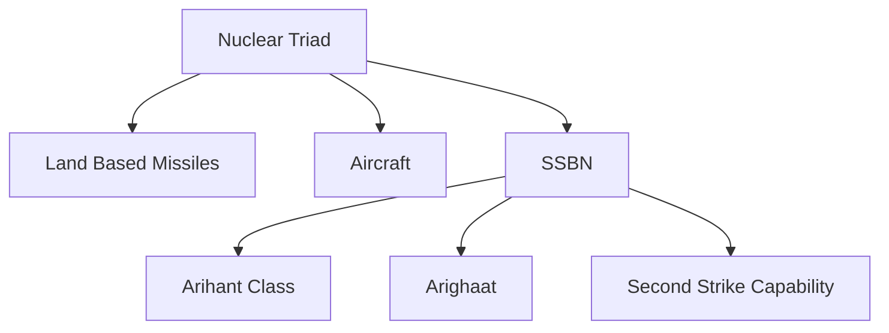
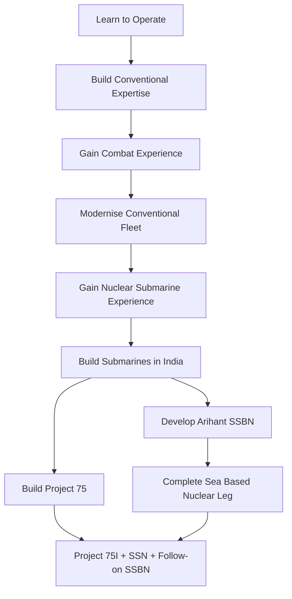

# India Submarine Journey

> The story of how India went from having no operational submarine force after independence to operating conventional submarines, building submarines in India and developing nuclear-powered submarines for strategic deterrence.

---

# 1. Before the Submarine — Why India Needed One

When India became independent in 1947, the Indian Navy was still relatively small.

India had:

- A long coastline
- Important ports
- Island territories
- Growing maritime trade
- A strategically important position in the Indian Ocean

But India did **not** yet have an operational submarine force.

This created a major capability gap.

A submarine could operate secretly underwater and provide capabilities that surface ships could not easily provide:

- Stealth
- Sea denial
- Surveillance
- Anti-surface warfare
- Anti-submarine warfare
- Covert patrols
- Long-duration submerged operations

India therefore needed to learn an entirely new form of naval warfare.

---

# 2. 1962 — India First Learns How to Operate Submarines

This is an important point in the story.

**India did not receive its first submarine in 1962.**

Instead, India first developed the **people and expertise** required to operate submarines.

In 1962, Indian Navy personnel underwent submarine training in the **United Kingdom**, including at HMS Dolphin, the Royal Navy's submarine training establishment.

The logic was simple:

**Before operating a submarine, India needed trained submarine crews.**

They had to learn:

- Underwater navigation
- Submarine tactics
- Torpedo operations
- Crew procedures
- Emergency procedures
- Maintenance
- Safety
- Life underwater

---

## 3. 1967 — India's Submarine Arm Is Born

On 8 December 1967, the Indian Navy formally established its Submarine Arm.

The first submarine was **INS Kalvari**, a Soviet Foxtrot-class submarine.

This was the beginning of India's operational submarine capability.

The first generation established the basic skills required for:

- Underwater navigation
- Torpedo warfare
- Submarine tactics
- Covert patrols
- Maintenance
- Crew training

---

## 4. First Generation — Foxtrot Submarines

The early Foxtrot submarines gave India its first sustained experience in submarine warfare.

They helped establish India's submarine doctrine and operating procedures.

Two of these submarines later participated in the 1971 Indo-Pakistan War.

---

## 5. 1971 — Submarines Enter Wartime Operations

The 1971 war was an important test of India's young Submarine Arm.

Indian submarines were used as part of India's maritime operations.

The experience demonstrated that submarines could contribute to:

- Sea denial
- Surveillance
- Offensive maritime operations
- Protection of naval forces

The war also accelerated India's understanding of the importance of underwater warfare.

---

## 6. 1970s — Expanding the Submarine Force

After the 1971 war, India continued expanding and modernising its submarine capability.

The focus shifted from simply operating submarines to developing a more capable and sustainable submarine fleet.

Important requirements included:

- Better sensors
- Better weapons
- Longer endurance
- Improved training
- Domestic maintenance
- Submarine construction capability

---

## 7. 1980s — Shishumar Class

India introduced the German-designed **Type 209 / Shishumar class**.

This represented a major technological improvement over the earlier Foxtrot generation.

The Shishumar submarines brought improvements in:

- Sensors
- Combat systems
- Stealth
- Underwater endurance
- Submarine handling
- Weapons capability

The class became an important part of India's conventional submarine fleet.

---

## 8. 1980s — Sindhughosh Class

India also began acquiring the Soviet/Russian **Kilo / Sindhughosh class**.

The class provided another major increase in conventional submarine capability.

It became one of the most important submarine families in the Indian Navy.

The Kilo submarines were designed for missions including:

- Anti-surface warfare
- Sea denial
- Surveillance
- Patrol
- Covert operations

---

## 9. 1988 — INS Chakra and Nuclear Submarine Experience

A major strategic leap occurred in 1988 when India inducted **INS Chakra-I**, a nuclear-powered attack submarine leased from the Soviet Union.

This did not immediately give India an indigenous nuclear submarine capability.

Instead, it gave the Indian Navy practical experience in:

- Nuclear submarine operations
- Reactor safety
- Crew management
- Long-duration submerged operations
- Nuclear submarine maintenance
- Underwater tactical operations

This experience became extremely valuable for India's later indigenous nuclear submarine programme.

---

## 10. 1990s — Indigenous Submarine Construction

India increasingly wanted to move from buying submarines to building them domestically.

A major milestone came with **INS Shalki**, the first Indian-built submarine, commissioned in 1992.

This demonstrated that Indian shipbuilding infrastructure could construct modern submarines.

The lesson was important:

**Operating submarines → maintaining submarines → building submarines**

---

## 11. 1990s — The Strategic Requirement Changes

During the 1990s, India's security environment increasingly included nuclear weapons and long-range missiles.

The submarine was no longer viewed only as a conventional naval weapon.

A nuclear-powered ballistic missile submarine could potentially provide:

**Stealth + survivability + nuclear weapons**

That combination became central to India's long-term strategic planning.

---

## 12. 1990s–2000s — Indigenous Nuclear Submarine Programme

India developed the Advanced Technology Vessel programme, commonly associated with the development of indigenous nuclear-powered submarines.

The programme required expertise in:

- Nuclear propulsion
- Reactor engineering
- Submarine design
- Special materials
- Hydrodynamics
- Acoustic stealth
- Missile integration
- Underwater communications
- Safety systems

This was considerably more difficult than building a conventional submarine.

---

## 13. 2009 — INS Arihant Launched

On 26 July 2009, India launched **INS Arihant** at Visakhapatnam.

It was India's first indigenously built nuclear-powered strategic submarine.

This was one of the biggest milestones in India's submarine history.

India had moved from:

**Buying conventional submarines → operating a leased nuclear submarine → building its own nuclear-powered strategic submarine**

---

## 14. Why Arihant Was So Important

Arihant was not simply another submarine.

It was designed as an **SSBN**:

**Ship Submersible Ballistic Nuclear**

Its purpose was to carry submarine-launched ballistic missiles as part of India's nuclear deterrent.

Its strategic value came from survivability.

A submarine hidden at sea is potentially much harder to destroy than a fixed land-based nuclear facility.

---

## 15. 2012 — INS Chakra-II

India leased another Russian nuclear-powered attack submarine, **INS Chakra-II**, in 2012.

Like Chakra-I, the programme provided additional operational experience with nuclear-powered submarines.

This helped India build expertise in:

- Nuclear submarine operations
- Training
- Maintenance
- Reactor management
- Long-duration deployment

The Chakra experience complemented the indigenous Arihant programme.

---

## 16. 2010s — Project 75 and the Scorpene Programme

India also needed to modernise its conventional submarine fleet.

Project 75 was launched to build six Scorpene-class conventional submarines in India.

Mazagon Dock Shipbuilders constructed the submarines with French collaboration.

The programme represented an important transition:

**Foreign design + Indian construction + increasing indigenous capability**

---

## 17. 2017 — INS Kalvari Returns as a New Generation

On 14 December 2017, the new **INS Kalvari** was commissioned.

It was the first of the six Project 75 Scorpene submarines.

The new Kalvari represented a completely different generation from the original Foxtrot submarine that had started India's Submarine Arm in 1967.

This created a remarkable historical continuity:

**INS Kalvari 1967 → INS Kalvari 2017**

The name returned, but the technology had advanced dramatically.

---

## 18. 2019 — INS Khanderi

The second Project 75 submarine, **INS Khanderi**, was commissioned in 2019.

The programme began establishing a modern Indian-built conventional submarine fleet.

---

## 19. 2021 — INS Karanj and INS Vela

Two more Project 75 submarines entered service:

- INS Karanj
- INS Vela

The pace of induction showed increasing maturity in India's submarine construction ecosystem.

---

## 20. 2023 — INS Vagir

The fifth Project 75 submarine, **INS Vagir**, was commissioned in January 2023.

By this point, India had developed significant experience in constructing the Scorpene-class submarines domestically.

---

## 21. 2024 — INS Arighaat

On 29 August 2024, **INS Arighaat**, the second Arihant-class SSBN, was commissioned.

It strengthened India's sea-based nuclear deterrent and nuclear triad.

The Ministry of Defence described the submarine as incorporating significant indigenous design, manufacturing and engineering advances.

---

## 22. 2025 — INS Vagsheer Completes Project 75

The sixth and final Project 75 submarine, **INS Vagsheer**, was commissioned on 15 January 2025.

Its commissioning completed the six-submarine Project 75 programme.

The six submarines are:

| Submarine | Commissioned |
|---|---|
| INS Kalvari | 2017 |
| INS Khanderi | 2019 |
| INS Karanj | 2021 |
| INS Vela | 2021 |
| INS Vagir | 2023 |
| INS Vagsheer | 2025 |

This was an important milestone because all six Project 75 submarines had been delivered and commissioned in India.

---

# The Nuclear Submarine Story

## 23. Conventional Submarines Were Only One Part of the Journey

India's conventional submarine force provided the operational foundation.

But the strategic objective was larger.

India wanted an indigenous nuclear deterrent that could survive a first strike.

That required:


---

## 24. SSBN — The Strategic Submarine

An SSBN is fundamentally different from a conventional attack submarine.

Its central mission is nuclear deterrence.

The basic logic is:

**Hide → Survive → Remain available → Retaliate if required**

This creates a survivable second-strike capability.

---

## 25. Arihant to Arighaat

The indigenous SSBN programme progressed from:

**Arihant → Arighaat → follow-on SSBN capability**

The objective is to create a more credible and survivable sea-based component of India's nuclear triad.

---

# The Conventional Submarine Story

## 26. From Legacy Fleet to Project 75

India's conventional submarine evolution can be simplified as:


Each generation improved some combination of:

- Stealth
- Sensors
- Weapons
- Endurance
- Combat management
- Construction capability
- Indigenous content

---

## 27. Project 75(I)

In 2021, the Ministry of Defence issued the RFP for **six AIP-equipped conventional submarines** under Project 75(I).

The programme is intended to use the Strategic Partnership Model and increase indigenous submarine construction and technology capability.

The planned submarines are expected to include:

- Air Independent Propulsion
- Modern sensors
- Advanced torpedoes
- Modern missiles
- Advanced countermeasures
- Indigenous construction
- Technology transfer

Project 75(I) therefore represents the next major conventional-submarine step after Project 75.

---

## 28. Air Independent Propulsion

AIP allows a conventional submarine to remain submerged for longer without depending entirely on its normal battery endurance.

This can improve:

- Stealth
- Patrol endurance
- Time underwater
- Operational flexibility

India is also developing indigenous AIP technology.

The broader goal is:

**Conventional submarine → longer submerged endurance → greater survivability**

---

# Nuclear Attack Submarine Story

## 29. SSN

An SSN is a nuclear-powered attack submarine.

Its mission is different from an SSBN.

### SSN

- Hunt submarines
- Attack surface ships
- Conduct surveillance
- Escort naval forces
- Operate at long range
- Support carrier and fleet operations

### SSBN

- Remain concealed
- Carry ballistic missiles
- Preserve nuclear second-strike capability

India's Chakra experience helped build nuclear submarine operating expertise, while India's indigenous SSN ambitions represent a future step.

---

# 30. The Submarine Industrial Journey

India's submarine journey is also an industrial story.

It evolved through:


This is why submarine development is closely connected with India's broader defence-industrial journey.

---

# 31. Why Submarine Construction Is Difficult

A submarine is one of the most technically demanding military platforms.

India had to develop capability in:

- Pressure hull construction
- Welding
- Hydrodynamics
- Acoustic stealth
- Sonar
- Propulsion
- Batteries
- Nuclear reactors
- Weapons integration
- Life-support systems
- Navigation
- Combat management
- Special materials

The challenge is not simply building a ship.

It is building a vessel that must operate safely under enormous underwater pressure while remaining difficult to detect.

---

# 32. Submarine Rescue and Safety

Submarine operations also require specialised rescue and safety capability.

A submarine crew operates in an environment where a major failure can become life-threatening very quickly.

Therefore India has developed capabilities around:

- Submarine rescue
- Escape systems
- Diving support
- Safety procedures
- Crew training
- Emergency response

The submarine arm is therefore supported by a larger ecosystem beyond the submarines themselves.

---

# 33. Submarine Sensors

The effectiveness of a submarine depends heavily on what it can detect without being detected.

Important technologies include:

- Sonar
- Passive acoustic sensors
- Active sonar
- Periscopes
- Electronic support systems
- Navigation systems
- Communications

This creates a fundamental underwater principle:

**Detect first without being detected.**

---

# 34. Submarine Weapons

Different Indian submarine classes use different weapon configurations.

Typical submarine weapons include:

- Torpedoes
- Anti-ship missiles
- Mines
- Submarine-launched ballistic missiles on SSBNs

The weapon system must match the submarine's mission.

```text
Attack submarine
    ↓
Torpedoes + anti-ship weapons + stealth

SSBN
    ↓
Ballistic missiles + stealth + survivability
```

---

# 35. Submarines and India's Nuclear Triad

The nuclear triad consists of:

1. Land
2. Air
3. Sea

The submarine provides the sea-based component.



The key advantage is survivability.

---

# 36. Submarines and the Indian Ocean

India's geography makes the Indian Ocean particularly important.

Submarines can contribute to:

- Sea-lane security
- Maritime surveillance
- Sea denial
- Anti-submarine warfare
- Protection of naval forces
- Strategic deterrence

The submarine force therefore supports both conventional maritime security and strategic national security.

---

# 37. What Changed Across the Decades?

| Era | Major Change |
|---|---|
| 1960s | India learns to operate submarines |
| 1970s | Submarines gain wartime experience |
| 1980s | Modern conventional classes enter service |
| 1988 | Nuclear submarine operating experience begins |
| 1990s | Indigenous submarine construction develops |
| 2000s | Indigenous nuclear submarine programme matures |
| 2009 | Arihant launched |
| 2010s | Project 75 and Arihant enter operational phase |
| 2020s | Arighaat and final Project 75 submarines enter service |
| Future | Project 75(I), AIP, SSN and follow-on SSBN capability |

---

# 38. The Complete Evolution


---

# 39. Chronological Timeline

| Year | Event | Why It Matters |
|---|---|---|
| 1962 | Indian officers receive submarine training in UK | Human foundation |
| 1967 | Submarine Arm established; INS Kalvari enters service | Indian submarine capability begins |
| 1971 | Indian submarines participate in war | First major combat experience |
| 1980s | Shishumar and Sindhughosh classes introduced | Modern conventional capability |
| 1988 | INS Chakra-I inducted | Nuclear submarine operating experience |
| 1992 | INS Shalki commissioned | Indigenous submarine construction milestone |
| 2000s | Indigenous nuclear submarine programme advances | Foundation for SSBN capability |
| 2009 | INS Arihant launched | Indigenous nuclear submarine milestone |
| 2012 | INS Chakra-II leased | Further nuclear submarine experience |
| 2017 | INS Kalvari commissioned | Project 75 begins entering service |
| 2019 | INS Khanderi commissioned | Project 75 expands |
| 2021 | INS Karanj and INS Vela commissioned | Project 75 accelerates |
| 2021 | Project 75(I) RFP issued | Next conventional submarine programme |
| 2023 | INS Vagir commissioned | Fifth Project 75 submarine |
| 2024 | INS Arighaat commissioned | Second Arihant-class SSBN |
| 2025 | INS Vagsheer commissioned | Project 75 completed |
| 2025 onward | Project 75(I), AIP, SSN and follow-on SSBN development | Future undersea capability |

---

# 40. Submarine Journey in One Sentence

**India moved from learning to operate a small number of foreign-built conventional submarines to building modern conventional submarines domestically and developing indigenous nuclear-powered submarines for strategic deterrence.**

---

# 41. The Journey in One Flow



---

# 42. Connection to Other Defence Files

This journey is the **chronological story**.

Detailed information remains in:

| Subject | Detailed File |
|---|---|
| Submarine classes and individual boats | `../navy/submarines.md` |
| Navy overview | `../navy/indian-navy.md` |
| Submarine-launched missiles | `../navy/missiles.md` |
| Naval weapons | `../navy/naval-weapons.md` |
| Nuclear triad | `../strategic/nuclear-triad.md` |
| K-series missiles | `../strategic/k-series-missiles.md` |
| Nuclear journey | `04-india-nuclear-journey.md` |
| Defence industry journey | `02-india-defence-industry-journey.md` |

---

# Quick Revision

- **1962** — Indian officers begin submarine training in the UK.
- **1967** — Indian Navy Submarine Arm established with INS Kalvari.
- **1971** — Submarines gain wartime experience.
- **1980s** — Shishumar and Sindhughosh modernise the fleet.
- **1988** — INS Chakra-I provides nuclear submarine experience.
- **1992** — INS Shalki demonstrates Indian submarine construction.
- **2009** — INS Arihant is launched.
- **2012** — INS Chakra-II adds further nuclear submarine experience.
- **2017** — New INS Kalvari enters service.
- **2021** — Project 75(I) programme moves forward.
- **2024** — INS Arighaat strengthens the sea-based nuclear deterrent.
- **2025** — INS Vagsheer completes Project 75.
- **Future** — Project 75(I), indigenous AIP, SSN capability and follow-on SSBN development.

---

# Key Takeaway

India's submarine journey is a story of **learning, modernisation, indigenous construction and strategic independence**:

**Training → Submarine Arm → Combat Experience → Modern Conventional Fleet → Nuclear Experience → Indigenous Construction → Arihant SSBN → Project 75 → Nuclear Triad → Project 75(I) + SSN + Future SSBN Capability**

The ultimate transformation is:

**From a submarine operator → to a submarine builder → to a country capable of operating a survivable nuclear-powered submarine force.**
