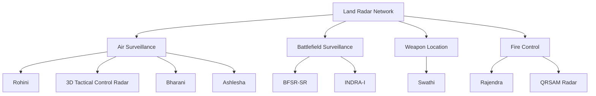

# Indian Land-Based Radars

Radar systems used by the Indian Army and joint-service formations for battlefield surveillance, airspace surveillance, target acquisition, weapon location and fire control.

---

## Major Systems

| System | Type | Primary Role | Status |
|---|---|---|---|
| Swathi | Weapon Locating Radar | Locate hostile artillery | Operational |
| Rajendra | Multifunction phased-array radar | Akash weapon control | Operational |
| 3D Tactical Control Radar | 3D tactical radar | Tactical air surveillance | Operational |
| Rohini | 3D medium-range radar | Airspace surveillance | Operational |
| Bharani Mk-I | 2D low-level radar | Low-level air surveillance | Operational |
| Ashlesha | 3D low-level radar | Low-level air surveillance | Operational |
| BFSR-SR | Battlefield surveillance radar | Ground surveillance | Operational |
| INDRA-I | 2D surveillance radar | Battlefield and air surveillance | Operational |
| QRSAM Battery Surveillance Radar | Battery surveillance radar | QRSAM air-defence surveillance | Development / induction |

---

# Swathi Weapon Locating Radar

## System Profile

| Field | Details |
|---|---|
| Type | Weapon Locating Radar |
| Developer | DRDO / LRDE |
| Manufacturer | BEL |
| Primary User | Indian Army |
| Primary Role | Locate hostile guns, mortars and rocket launchers |
| Status | Operational |
| Quantity | Current operational quantity not publicly disclosed |
| Operational Count | Not publicly disclosed |

## Major Work

Swathi detects incoming artillery projectiles and helps determine the location of hostile artillery systems.

It supports:

- Counter-battery operations
- Artillery response
- Threat identification
- Fire-direction support
- Battlefield surveillance

---

# Rajendra

## System Profile

| Field | Details |
|---|---|
| Type | Multifunction phased-array radar |
| Developer | DRDO / LRDE |
| Primary Role | Akash weapon control |
| Users | Indian Army and Indian Air Force |
| Functions | Target detection, tracking and missile engagement support |
| Status | Operational |
| Quantity | Not publicly disclosed |

## Major Work

Rajendra provides target tracking and weapon-control functions for the Akash air-defence system.

---

# 3D Tactical Control Radar

## System Profile

| Field | Details |
|---|---|
| Type | 3D tactical surveillance radar |
| Developer | DRDO / LRDE |
| Primary Role | Tactical airspace surveillance |
| Functions | Detection, tracking and identification |
| Status | Operational |
| Quantity | Not publicly disclosed |

---

# Rohini

## System Profile

| Field | Details |
|---|---|
| Type | 3D medium-range surveillance radar |
| Developer | DRDO / LRDE |
| Manufacturer | BEL |
| Primary Role | Airspace surveillance |
| Status | Operational |
| Quantity | Not publicly disclosed |
| Operational Count | Not publicly disclosed |

## Major Work

Rohini provides mobile three-dimensional surveillance and supports layered air-defence operations.

---

# Bharani Mk-I

## System Profile

| Field | Details |
|---|---|
| Type | 2D Low-Level Lightweight Radar |
| Developer | DRDO |
| Primary Role | Low-level aerial surveillance |
| Deployment | Mobile |
| Status | Operational |
| Quantity | Not publicly disclosed |

## Major Work

Bharani provides surveillance against low-level aerial targets and supports air-defence operations in difficult terrain.

---

# Ashlesha

## System Profile

| Field | Details |
|---|---|
| Type | 3D Low-Level Lightweight Radar |
| Developer | DRDO |
| Primary Role | Low-level air surveillance |
| Targets | Aircraft, helicopters and UAVs |
| Deployment | Mobile / difficult terrain |
| Status | Operational |
| Quantity | Not publicly disclosed |

---

# BFSR-SR

## System Profile

| Field | Details |
|---|---|
| Full Name | Battlefield Surveillance Radar - Short Range |
| Type | Short-range battlefield surveillance radar |
| Primary Role | Ground surveillance |
| User | Indian Army |
| Status | Operational |
| Quantity | Not publicly disclosed |
| Operational Count | Not publicly disclosed |

## Major Work

BFSR-SR provides short-range surveillance of battlefield sectors and helps detect movement and intrusion.

---

# INDRA-I

## System Profile

| Field | Details |
|---|---|
| Type | 2D surveillance radar |
| Developer | DRDO |
| Primary Role | Battlefield and air surveillance |
| Status | Operational |
| Quantity | Not publicly disclosed |
| Operational Count | Not publicly disclosed |

---

# QRSAM Battery Surveillance Radar

## System Profile

| Field | Details |
|---|---|
| Type | Battery surveillance radar |
| Associated System | QRSAM |
| Primary Role | Air-defence surveillance |
| Status | Development / induction programme |
| Quantity | Not publicly disclosed |

---

## Radar Development Lifecycle

---

## Land Radar Architecture

---

## Radar Roles

| Role | Example Systems |
|---|---|
| Air surveillance | Rohini, 3D Tactical Control Radar |
| Low-level surveillance | Bharani, Ashlesha |
| Battlefield surveillance | BFSR-SR, INDRA-I |
| Weapon location | Swathi |
| Weapon control | Rajendra |
| Air-defence battery surveillance | QRSAM radar |

---

## Fleet-Count Rule

For every radar system, distinguish between:

- **Developed** — programme or technology completed
- **Ordered** — contract quantity
- **Delivered** — systems supplied
- **Inducted** — accepted into service
- **Operational** — currently usable
- **Total inventory** — current fleet
- **Retired** — removed from service

When a reliable current number is not publicly available:

> **Not publicly disclosed**

An old procurement quantity should not automatically be treated as the current operational fleet.

---

## Quick Revision

- **Swathi** — weapon locating radar.
- **Rajendra** — Akash weapon-control radar.
- **Rohini** — 3D medium-range surveillance radar.
- **Bharani** — low-level lightweight radar.
- **Ashlesha** — 3D low-level radar.
- **BFSR-SR** — battlefield surveillance radar.
- **INDRA-I** — surveillance radar.
- **3D Tactical Control Radar** — tactical air surveillance.
- **QRSAM radar** — surveillance component of the QRSAM air-defence system.
