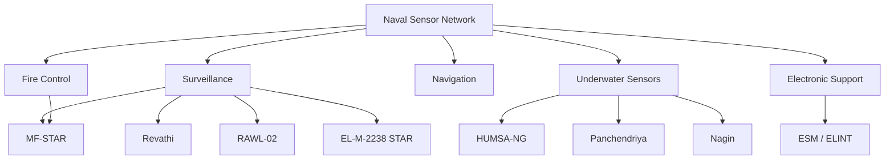
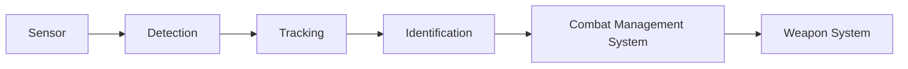

# Indian Naval Radars and Sensors

Radar and sensor systems used by the Indian Navy for maritime surveillance, air defence, navigation, target detection, tracking, weapon control, submarine warfare and electronic support.

The Indian Navy uses sensors across ships, submarines, aircraft and shore-based systems. A modern naval sensor network combines radar, electro-optical systems, sonar, electronic-support measures and combat-management systems.

---

## Major Radar and Sensor Systems

| System | Type | Primary Role | Status |
|---|---|---|---|
| MF-STAR | Multifunction AESA radar | Air and surface surveillance, weapon control | Operational |
| EL/M-2248 MF-STAR | Multifunction AESA radar | Fleet air defence | Operational |
| Revathi | 3D naval surveillance radar | Air and surface surveillance | Operational |
| RAWL-02 | 2D air surveillance radar | Air surveillance | Operational |
| EL/M-2238 STAR | 3D naval radar | Air and surface surveillance | Operational |
| APARNA | 3D naval radar family | Air and surface surveillance | Operational / deployed on selected platforms |
| BEL 3D Surveillance Radar | 3D surveillance radar | Maritime air surveillance | Operational / platform dependent |
| HUMSA-NG | Hull-mounted sonar | Underwater surveillance | Operational |
| Panchendriya | Integrated sonar suite | Submarine underwater surveillance | Operational |
| Nagin | Towed-array / submarine sonar system family | Underwater detection | Operational / platform dependent |
| ESM / ELINT systems | Electronic-support sensors | Detect and identify hostile emissions | Operational |

---

# MF-STAR

## System Profile

| Field | Details |
|---|---|
| Full Name | Multi-Function Surveillance, Track and Guidance Radar |
| Type | Multifunction Active Electronically Scanned Array radar |
| Developer | IAI / ELTA |
| Primary Role | Air and surface surveillance, tracking and weapon guidance |
| Users | Indian Navy |
| Deployment | Major surface combatants |
| Status | Operational |
| Quantity | Platform-dependent; current fleet quantity not treated as a single public radar count |

## Major Work

MF-STAR provides long-range surveillance, target tracking and fire-control support for naval air-defence operations.

It is integrated with the combat-management system of the host warship and can support missile engagement against aerial threats.

---

# Revathi

## System Profile

| Field | Details |
|---|---|
| Type | 3D naval surveillance radar |
| Developer | DRDO / LRDE |
| Manufacturer | BEL |
| Primary Role | Air and surface surveillance |
| Technology | Active phased-array architecture |
| User | Indian Navy |
| Status | Operational |
| Quantity | Current fleet quantity not publicly disclosed |

## Major Work

Revathi provides three-dimensional surveillance of aerial and surface targets and supports naval situational awareness.

It is an indigenous naval radar derived from the Rohini radar family.

---

# RAWL-02

## System Profile

| Field | Details |
|---|---|
| Type | 2D air surveillance radar |
| Primary Role | Air surveillance |
| Deployment | Naval platforms |
| Status | Operational / legacy |
| Quantity | Current operational quantity not publicly disclosed |

## Major Work

RAWL-02 provides air-surveillance capability for naval formations and contributes to early detection of airborne targets.

---

# EL/M-2238 STAR

## System Profile

| Field | Details |
|---|---|
| Type | 3D naval surveillance radar |
| Developer | IAI / ELTA |
| Primary Role | Air and surface surveillance |
| Deployment | Selected Indian Navy warships |
| Status | Operational |
| Quantity | Platform-dependent |

## Major Work

The radar provides three-dimensional detection and tracking for naval air-defence and maritime surveillance.

---

# APARNA

## System Profile

| Field | Details |
|---|---|
| Type | 3D naval radar family |
| Developer | Indian defence industry |
| Primary Role | Air and surface surveillance |
| Deployment | Selected naval platforms |
| Status | Operational / platform dependent |
| Quantity | Not publicly disclosed |

## Major Work

APARNA-class naval radar systems support surveillance and tracking of aerial and surface contacts.

---

# BEL 3D Surveillance Radar

## System Profile

| Field | Details |
|---|---|
| Type | 3D surveillance radar |
| Developer | BEL |
| Primary Role | Maritime air surveillance |
| Deployment | Naval platforms |
| Status | Operational / platform dependent |
| Quantity | Not publicly disclosed |

## Major Work

Three-dimensional surveillance radars provide bearing, range and altitude information for the naval air picture.

---

# Naval Combat Radar Architecture

---

# MF-STAR and Revathi: Different Roles

| Feature | MF-STAR | Revathi |
|---|---|---|
| Origin | Israeli | Indigenous Indian |
| Type | Multifunction AESA | 3D naval surveillance radar |
| Main role | Surveillance, tracking and weapon guidance | Surveillance and tracking |
| Air-defence integration | High | Surveillance support |
| Developer | IAI / ELTA | DRDO / LRDE |
| Manufacturer | ELTA | BEL |
| Status | Operational | Operational |

---

# Naval Underwater Sensors

Naval sensing is not limited to radar.

Radar is primarily useful above and around the water surface. Submarine detection and underwater warfare depend mainly on sonar.

---

# HUMSA-NG

## System Profile

| Field | Details |
|---|---|
| Full Name | Hull Mounted Sonar System - New Generation |
| Type | Hull-mounted sonar |
| Developer | DRDO |
| Primary Role | Underwater surveillance and detection |
| User | Indian Navy |
| Status | Operational |
| Quantity | Platform-dependent |

## Major Work

HUMSA-NG supports detection, classification and tracking of underwater contacts.

---

# Panchendriya

## System Profile

| Field | Details |
|---|---|
| Type | Integrated submarine sonar suite |
| Developer | DRDO / Indian industry |
| Primary Role | Underwater surveillance |
| Deployment | Indian submarines |
| Status | Operational |
| Quantity | Platform-dependent |

## Major Work

Panchendriya integrates multiple sonar functions to provide submarines with an underwater tactical picture.

---

# Nagin

## System Profile

| Field | Details |
|---|---|
| Type | Submarine / towed-array sonar system family |
| Primary Role | Long-range underwater detection |
| Deployment | Selected submarines |
| Status | Platform dependent |
| Quantity | Not publicly disclosed |

## Major Work

Towed-array and related sonar systems can improve passive detection of underwater contacts while reducing the effect of a submarine's own noise.

---

# Electronic Support Measures

## System Profile

| Field | Details |
|---|---|
| Type | Electronic-support sensor systems |
| Primary Role | Detect, identify and analyse electromagnetic emissions |
| Targets | Radar and communication emitters |
| Users | Indian Navy |
| Status | Operational |
| Quantity | Platform-dependent |

## Major Work

Electronic-support systems can detect hostile radar emissions without necessarily transmitting an active radar signal.

They support:

- Threat identification
- Electronic intelligence
- Situational awareness
- Electronic warfare
- Threat warning

---

# Naval Sensor Development Lifecycle

---

# Sensor-to-Engagement Chain

---

# What Each Sensor Does

| Sensor / System | Main Function |
|---|---|
| MF-STAR | Long-range surveillance, tracking and weapon guidance |
| Revathi | 3D air and surface surveillance |
| RAWL-02 | Air surveillance |
| EL/M-2238 STAR | 3D naval surveillance |
| HUMSA-NG | Hull-mounted underwater surveillance |
| Panchendriya | Integrated submarine sonar |
| Nagin | Underwater detection / towed-array capability |
| ESM / ELINT | Detect and analyse electromagnetic emissions |

---

# Important Statistics Rule

For naval sensors, distinguish between:

- **Development started**
- **First prototype**
- **First sea trial**
- **Production started**
- **First induction**
- **Ordered**
- **Delivered**
- **Installed on ships**
- **Installed on submarines**
- **Operational**
- **Retired**

A radar quantity should not be confused with the number of ships carrying that radar.

Where reliable current figures are unavailable:

> **Not publicly disclosed**

---

# Quick Revision

- **MF-STAR** — major multifunction naval AESA radar.
- **Revathi** — indigenous 3D naval surveillance radar.
- **RAWL-02** — 2D air-surveillance radar.
- **EL/M-2238 STAR** — 3D naval surveillance radar.
- **HUMSA-NG** — hull-mounted sonar.
- **Panchendriya** — integrated submarine sonar suite.
- **Nagin** — underwater detection / sonar system family.
- **ESM / ELINT** — detects and analyses electromagnetic emissions.

---

# Key Takeaways

A modern Indian naval sensor network is a combination of several technologies:

1. **Radar** detects and tracks aircraft and surface contacts.
2. **Combat-management systems** combine sensor information.
3. **Sonar** provides underwater detection.
4. **Electronic-support systems** detect hostile electromagnetic emissions.
5. **Electro-optical sensors** can provide visual and infrared identification.
6. The combined sensor picture supports naval weapons and command decisions.

The important distinction is:

> **Radar sees mainly above or on the surface; sonar is the primary sensing technology underwater.**
