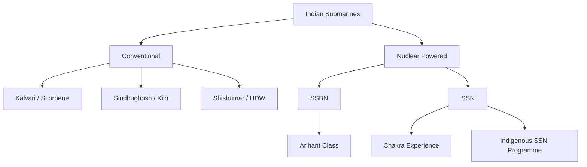
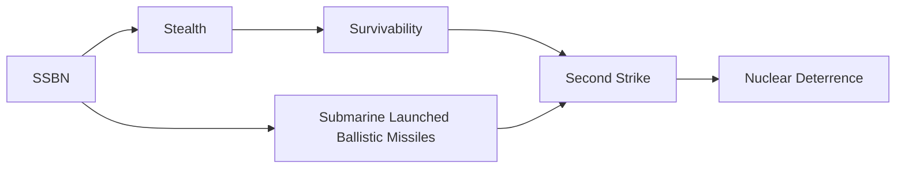
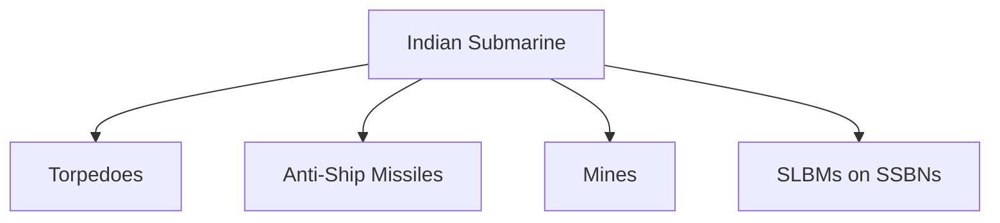
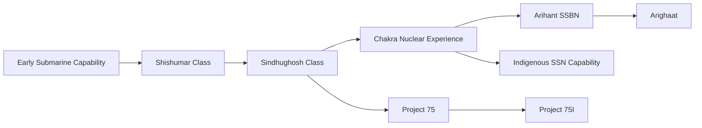
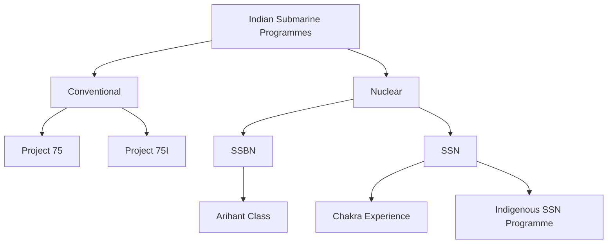
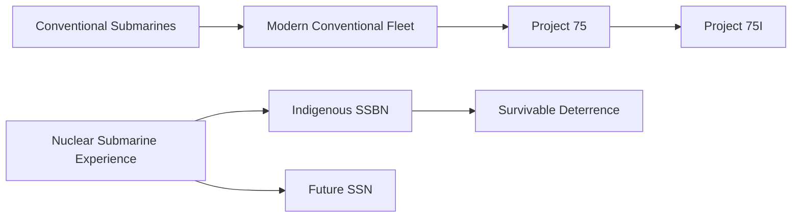

# Indian Submarines

> A complete overview of India's submarine capability: conventional submarines, nuclear submarines, major classes, individual boats, programmes, roles, development history and future direction.

---

## Strategic Importance

Submarines provide India with stealth, sea-denial, surveillance, anti-surface and anti-submarine warfare capability. Nuclear-powered submarines also provide the most survivable component of India's nuclear deterrent.

India's submarine force therefore has two broad dimensions:

- **Conventional submarines** — primarily tactical and maritime warfare.
- **Nuclear submarines** — strategic deterrence and, in the SSN role, high-end undersea warfare.

---

## Quick Facts

| Item | Details |
|---|---|
| Operator | Indian Navy |
| Main roles | Sea denial, surveillance, anti-surface warfare, anti-submarine warfare, strategic deterrence |
| Conventional families | Kalvari, Sindhughosh, Shishumar |
| Nuclear families/programmes | Arihant SSBN, Chakra experience, indigenous SSN programme |
| Major current conventional programme | Project 75 |
| Major future conventional programme | Project 75(I) |
| Strategic submarine programme | Arihant-class SSBN programme |
| Key strategic purpose | Survivable second-strike capability |

---

# 1. Types of Indian Submarines



---

# 2. Conventional Submarines

Conventional submarines use diesel-electric propulsion and are particularly useful for regional maritime operations.

India's major conventional submarine families are:

| Class | Origin / Design | Role | Status |
|---|---|---|---|
| Kalvari | Scorpene design | Attack / sea denial | In service |
| Sindhughosh | Kilo design | Attack / sea denial | Legacy fleet |
| Shishumar | Type 209 / HDW design | Attack / sea denial | Legacy fleet |

---

# 3. Kalvari Class — Project 75

Project 75 produced six Kalvari-class submarines at Mazagon Dock Shipbuilders in collaboration with Naval Group of France.

All six were delivered and commissioned by January 2025. citeturn0search0turn0search8

### Six submarines

| Submarine | Commissioned |
|---|---|
| INS Kalvari | December 2017 |
| INS Khanderi | September 2019 |
| INS Karanj | March 2021 |
| INS Vela | November 2021 |
| INS Vagir | January 2023 |
| INS Vagsheer | January 2025 |

These dates and the six-boat Project 75 completion are reported by the Government of India. citeturn0search8turn0search6

### Major capabilities

- Diesel-electric propulsion
- Stealth
- Torpedo warfare
- Anti-ship missile capability
- Mine-laying capability
- Modern sonar and combat systems

### Indigenous development

India is also developing an indigenous Air Independent Propulsion system through DRDO-NMRL for integration with Project 75 submarines. citeturn0search8

---

# 4. Sindhughosh Class

The Sindhughosh class is based on the Russian Kilo-class submarine design.

These submarines formed a major part of India's conventional submarine force for decades.

### Main role

- Sea denial
- Anti-surface warfare
- Surveillance
- Patrol
- Intelligence gathering

The class is now a legacy component of the fleet as newer submarines enter service.

---

# 5. Shishumar Class

The Shishumar class is based on the German Type 209 design.

These submarines provided India with modern conventional submarine capability before the later Kilo and Scorpene generations.

### Main role

- Coastal and ocean patrol
- Surveillance
- Sea denial
- Anti-surface warfare
- Training and operational experience

The class represents an important stage in the evolution of India's submarine fleet.

---

# 6. Nuclear Submarines

Nuclear-powered submarines are fundamentally different from conventional submarines.

They can remain submerged for much longer periods because propulsion does not depend on repeatedly surfacing or snorkeling to recharge conventional batteries.

India's nuclear submarine capability has two important tracks:

```text
Nuclear Submarines
│
├── SSBN
│   └── Strategic nuclear deterrence
│
└── SSN
    └── Nuclear-powered attack submarine capability
```

---

# 7. Arihant Class — SSBN

The Arihant class is India's indigenous nuclear-powered ballistic missile submarine programme.

An SSBN combines:

**Nuclear propulsion + ballistic missiles + nuclear deterrence**

This provides a sea-based nuclear strike capability.

---

## INS Arihant

INS Arihant is the first operational submarine of the class.

Its importance goes beyond being a submarine: it established an indigenous SSBN capability and became a key part of India's nuclear triad.

---

## INS Arighaat

INS Arighaat, the second Arihant-class submarine, was commissioned on **29 August 2024**. citeturn0search4

The Ministry of Defence described it as strengthening India's nuclear triad and strategic deterrence.

The submarine incorporates significant indigenous systems and represents an advance over the first Arihant-class boat. citeturn0search4

---

# 8. SSBN Role

The main purpose of an SSBN is strategic deterrence.

Its value comes from survivability.

A submarine operating covertly at sea is harder to locate than a fixed land-based missile facility.

Therefore:



---

# 9. INS Chakra Programme

India gained nuclear-powered attack submarine operating experience through the Chakra programme.

The Chakra experience provided valuable knowledge in:

- Nuclear submarine operations
- Crew training
- Reactor operations
- Underwater operations
- Maintenance
- Safety
- Strategic submarine procedures

This experience supported India's later indigenous nuclear submarine programme.

---

# 10. SSN Programme

An **SSN** is a nuclear-powered attack submarine.

Unlike an SSBN, its primary purpose is not strategic ballistic-missile deterrence.

Typical SSN missions include:

- Hunting enemy submarines
- Anti-surface warfare
- Escort
- Intelligence and surveillance
- Long-range undersea operations
- Supporting carrier and fleet operations

India has pursued an indigenous SSN capability in addition to its SSBN programme.

---

# 11. Project 75(I)

Project 75(I) is India's major planned conventional submarine programme.

The programme envisages **six modern conventional submarines with Air Independent Propulsion**.

The Ministry of Defence issued the RFP in July 2021 under the Strategic Partnership Model. citeturn0search2

### Planned capabilities

- AIP
- Modern sonar
- Advanced weapons
- Modern missiles
- Advanced countermeasures
- Indigenous construction
- Technology transfer
- Local industrial ecosystem

The project is intended to strengthen India's domestic submarine design and manufacturing capability. citeturn0search2turn0search3

---

# 12. Project 75 vs Project 75(I)

| Feature | Project 75 | Project 75(I) |
|---|---|---|
| Submarines | 6 | 6 planned |
| Type | Conventional | Conventional |
| Main design | Scorpene | New design / selected foreign technology partner |
| Construction | India | India |
| AIP | Indigenous AIP integration planned | AIP required |
| Industrial objective | Build submarine construction capability | Increase indigenous design and technology capability |
| Status | Completed | Acquisition / programme development |

---

# 13. Submarine Weapons

Indian submarines can employ different categories of weapons depending on class and configuration.



### Important distinction

Conventional attack submarines and strategic SSBNs have different mission sets.

**Attack submarine:**

> Find → Track → Attack → Survive

**SSBN:**

> Hide → Survive → Remain available for strategic deterrence

---

# 14. Sensors and Underwater Systems

Modern submarines depend heavily on acoustic systems.

Important Indian indigenous underwater technologies include:

- USHUS-2
- HUMSA-NG / HUMSA-UG
- ABHAY
- NACS
- AIDSS
- ALTAS

The Government of India has highlighted these systems as part of India's growing indigenous underwater-sensor capability. citeturn0search8

---

# 15. Submarine Development Journey



---

# 16. Submarine Fleet Evolution

India's submarine capability evolved through several generations:

### Generation 1 — Building the force

Acquisition and operation of conventional submarines established basic underwater warfare capability.

### Generation 2 — Modern conventional fleet

Shishumar and Sindhughosh classes expanded India's operational submarine capability.

### Generation 3 — Nuclear experience

The Chakra programme provided experience in nuclear submarine operations.

### Generation 4 — Indigenous strategic submarine

Arihant established India's indigenous SSBN capability.

### Generation 5 — Modern conventional fleet

Project 75 introduced the Kalvari-class submarines.

### Generation 6 — Future expansion

Project 75(I), indigenous AIP, SSN development and follow-on SSBN programmes represent the next stage.

---

# 17. Submarine Fleet at a Glance

| Family / Programme | Type | Boats / Planned | Broad Status |
|---|---|---:|---|
| Kalvari / Project 75 | Conventional | 6 | All commissioned |
| Sindhughosh | Conventional | Legacy fleet | Service / retirement transition |
| Shishumar | Conventional | Legacy fleet | Service / retirement transition |
| Arihant | SSBN | 2 publicly commissioned | Strategic service |
| Chakra | SSN experience | 2 leased boats historically | Historical programme |
| Project 75(I) | Conventional AIP | 6 planned | Programme development |
| Indigenous SSN | SSN | Planned | Development programme |

**Note:** Exact current operational/working counts for individual submarines are not reliably disclosed publicly. Do not interpret class totals as the number simultaneously available for deployment.

---

# 18. What "Operational" Means

For a submarine fleet, these numbers are different:

- **Built** — submarine has been constructed.
- **Commissioned** — formally entered naval service.
- **In service** — remains part of the Navy.
- **Operationally available** — ready for assigned operations.
- **Under refit** — temporarily unavailable.
- **Retired** — removed from service.

Therefore, a public fleet count should not automatically be treated as the number of submarines ready for combat on a particular day.

---

# 19. Major Submarine Programmes



---

# 20. Indigenous Capability

India's submarine programme is increasingly focused on indigenous capability.

Key areas include:

- Submarine construction
- Nuclear propulsion
- AIP
- Sonar
- Sensors
- Combat systems
- Weapons integration
- Special materials
- Shipyard capability
- Skilled workforce

Project 75 and the indigenous nuclear submarine programme have helped develop India's domestic industrial ecosystem. citeturn0search2turn0search4

---

# 21. Why Submarines Matter to India

India has a long coastline and operates in the strategically important Indian Ocean Region.

Submarines help India:

- Protect maritime interests
- Monitor important sea areas
- Track hostile submarines
- Deny access to adversary naval forces
- Protect naval task forces
- Strengthen strategic deterrence
- Maintain a credible second-strike capability

---

# 22. Future Direction

India's submarine capability is moving toward:

```text
Legacy conventional fleet
        ↓
Modern conventional fleet
        ↓
AIP-enabled submarines
        ↓
Indigenous submarine design
        ↓
SSN capability
        ↓
Larger and more survivable SSBN force
```

The long-term objective is not simply to increase submarine numbers.

It is to develop:

**More submarines + better sensors + better weapons + greater endurance + indigenous technology + stronger survivability**

---

# 23. Chronological Timeline

| Period / Year | Development | Importance |
|---|---|---|
| 1960s | India begins submarine capability | Establishes underwater warfare capability |
| 1980s | Shishumar class enters service | Modern conventional submarine capability |
| 1980s–90s | Sindhughosh class expands force | Major conventional submarine fleet |
| 1988 | INS Chakra leased | Nuclear-powered submarine operating experience |
| 1990s–2000s | Indigenous nuclear submarine programme advances | Foundation for SSBN capability |
| 2009 | INS Arihant launched | Major indigenous nuclear submarine milestone |
| 2016 | INS Arihant commissioned | Operational SSBN capability |
| 2017 | INS Kalvari commissioned | Project 75 begins operational entry |
| 2019 | INS Khanderi commissioned | Project 75 expansion |
| 2021 | INS Karanj and INS Vela commissioned | Project 75 accelerates |
| 2023 | INS Vagir commissioned | Fifth Project 75 submarine |
| 2024 | INS Arighaat commissioned | Second Arihant-class SSBN |
| 2025 | INS Vagsheer commissioned | Project 75 completed |
| 2025 onward | Project 75(I), AIP and SSN programmes | Future submarine capability |

Project 75's six submarines were all delivered and commissioned by January 2025. citeturn0search0

---

# 24. Submarine Story in One Flow



---

# 25. Quick Revision

- India operates both **conventional and nuclear-powered submarines**.
- Major conventional families include **Kalvari, Sindhughosh and Shishumar**.
- **Project 75** delivered six Kalvari-class submarines.
- **INS Vagsheer** completed the Project 75 submarine series in 2025.
- **Arihant-class SSBNs** form the sea-based leg of India's nuclear triad.
- **INS Arighaat** was commissioned in August 2024.
- The **Chakra programme** gave India nuclear-powered submarine operating experience.
- **Project 75(I)** plans six advanced conventional AIP submarines.
- India is also pursuing **indigenous SSN capability**.
- Indigenous AIP and underwater sensor technologies are being developed.
- Exact current operational availability of individual submarines is generally not publicly disclosed.

---

# Key Takeaway

India's submarine journey can be understood as:

**Conventional Submarines → Modern Conventional Fleet → Nuclear Submarine Experience → Indigenous SSBN → Project 75 → AIP → Project 75(I) → Indigenous SSN → Stronger Undersea Deterrence**

The ultimate objective is a **balanced, survivable and increasingly indigenous undersea capability** for both conventional maritime warfare and strategic nuclear deterrence.
