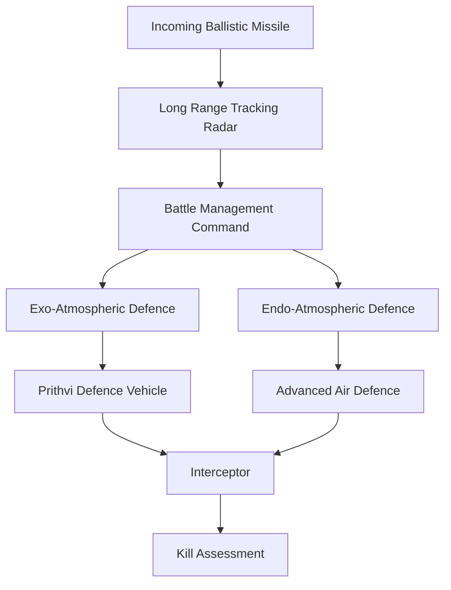
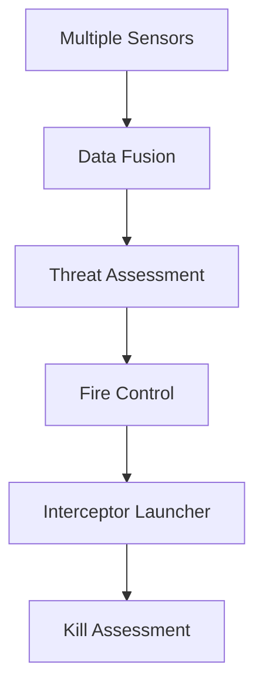
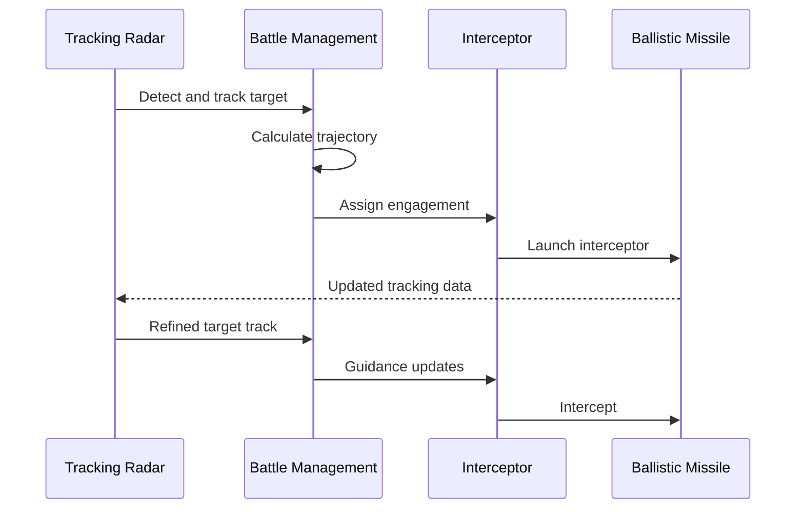
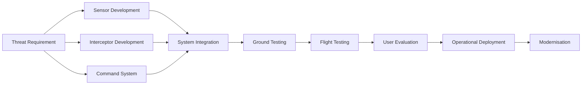
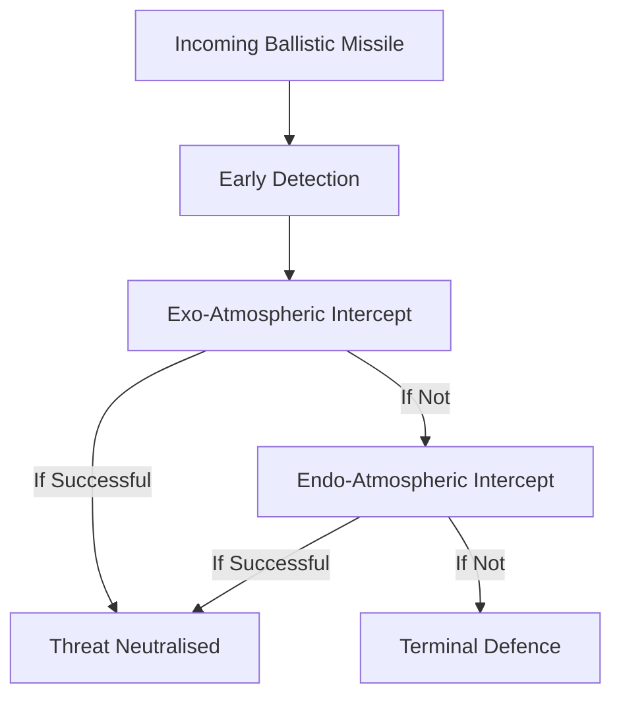
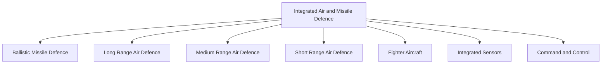

# Indian Ballistic Missile Defence

India's Ballistic Missile Defence (BMD) programme is designed to detect, track and intercept incoming ballistic missiles before they can reach their intended targets.

BMD is different from conventional air defence. Air-defence systems primarily address aircraft, cruise missiles, drones and other aerial threats, while BMD focuses specifically on ballistic missile threats.

---

## Quick Facts

| Field | Details |
|---|---|
| Programme | Indian Ballistic Missile Defence Programme |
| Lead Organisation | DRDO |
| Primary Role | Ballistic missile interception |
| Architecture | Multi-layered |
| Interception Layers | Exo-atmospheric and endo-atmospheric |
| Major Sensors | Long-range tracking radars and fire-control radars |
| Major Interceptors | Prithvi Defence Vehicle family and Advanced Air Defence family |
| Command Network | Battle Management / Command and Control systems |
| First Major Test | 2006 |
| Current Status | Development, testing and operationalisation in stages |
| Operational Inventory | Exact quantity not publicly disclosed |

---

# What Is Ballistic Missile Defence?

A ballistic missile defence system attempts to destroy or disable an incoming ballistic missile before it reaches its target.

A complete BMD system normally requires:

1. Early detection
2. Target tracking
3. Threat classification
4. Trajectory prediction
5. Fire-control solution
6. Interceptor launch
7. Mid-course or terminal interception
8. Battle-damage assessment

---

# Why BMD Is Different From Air Defence

| Feature | Air Defence | Ballistic Missile Defence |
|---|---|---|
| Main Threat | Aircraft, cruise missiles, drones | Ballistic missiles |
| Target Speed | Variable | Often extremely high |
| Flight Profile | Atmospheric | Ballistic trajectory |
| Detection Challenge | Airspace surveillance | Early warning and precise tracking |
| Interception | Usually atmospheric | Exo- and/or endo-atmospheric |
| Main Requirement | Layered air defence | Dedicated missile-tracking and interception architecture |

The two systems can be integrated into a wider national air and missile-defence network.

---

# Indian BMD Architecture

---

# Main Layers

## Exo-Atmospheric Interception

Exo-atmospheric interception takes place outside the dense atmosphere.

The objective is to intercept the incoming ballistic missile during its mid-course phase.

The **Prithvi Defence Vehicle (PDV)** family is associated with this layer.

## Endo-Atmospheric Interception

Endo-atmospheric interception occurs within the atmosphere, closer to the target.

The **Advanced Air Defence (AAD)** interceptor has been associated with this layer.

---

# Prithvi Defence Vehicle

## System Profile

| Field | Details |
|---|---|
| Name | Prithvi Defence Vehicle |
| Type | Exo-atmospheric ballistic missile interceptor |
| Developer | DRDO |
| Primary Role | Ballistic missile interception |
| Interception Layer | Exo-atmospheric |
| Guidance | Advanced guidance and seeker systems |
| First Test | 2017 |
| Status | Development / testing |
| Quantity | Not publicly disclosed |

## Major Role

PDV is designed to intercept ballistic missile targets at high altitude before they re-enter the atmosphere.

---

# PDV Mk-II

## System Profile

| Field | Details |
|---|---|
| Type | Advanced exo-atmospheric interceptor |
| Developer | DRDO |
| Primary Role | High-altitude ballistic missile interception |
| Status | Development / testing |
| Quantity | Not publicly disclosed |

PDV Mk-II represents continued development of India's high-altitude interception capability.

---

# Advanced Air Defence

## System Profile

| Field | Details |
|---|---|
| Name | Advanced Air Defence |
| Type | Endo-atmospheric interceptor |
| Developer | DRDO |
| Primary Role | Ballistic missile interception |
| Interception Layer | Endo-atmospheric |
| First Test | 2007 |
| Status | Development / operationalisation programme |
| Quantity | Not publicly disclosed |

## Major Role

AAD is designed to provide a lower interception layer against incoming ballistic missile targets.

---

# AD-1 and AD-2

India has also developed the **AD-1** and **AD-2** interceptor family under the Phase-II BMD programme.

## AD-1

| Field | Details |
|---|---|
| Type | Phase-II ballistic missile interceptor |
| Primary Role | Medium-to-long range ballistic missile interception |
| First Test | 2 November 2022 |
| Developer | DRDO |
| Status | Development / testing |
| Quantity | Not publicly disclosed |

## AD-2

| Field | Details |
|---|---|
| Type | Phase-II interceptor |
| Primary Role | Longer-range ballistic missile interception |
| Developer | DRDO |
| Status | Development / testing |
| Quantity | Not publicly disclosed |

---

# Long Range Tracking Radar

## System Profile

| Field | Details |
|---|---|
| Name | Swordfish Long Range Tracking Radar |
| Type | Long-range tracking radar |
| Developer | DRDO / Indian defence industry |
| Primary Role | Ballistic missile detection and tracking |
| Technology | AESA-based radar architecture |
| Status | Operational / strategic system |
| Quantity | Not publicly disclosed |

## Major Role

Swordfish provides long-range detection and tracking of ballistic missile targets.

It is a critical sensor in India's BMD architecture.

---

# Swordfish Radar Architecture

---

# Battle Management System

A BMD system cannot rely on the interceptor alone.

The command-and-control network must:

- Receive radar data
- Track the target
- Estimate trajectory
- Determine threat level
- Select an interceptor
- Generate engagement instructions
- Coordinate multiple sensors
- Assess the interception

---

# Hit-to-Kill Concept

Modern missile interceptors can use **hit-to-kill** technology.

Instead of relying primarily on a large explosive warhead, the interceptor can destroy the target through direct high-speed physical collision.

The kinetic energy of the collision can destroy or disable the incoming missile.

---

# BMD Interception Sequence

---

# Phase-I and Phase-II

India's BMD development has progressed through multiple phases.

## Phase-I

The initial architecture focused on demonstrating:

- Long-range detection
- Target tracking
- Exo-atmospheric interception
- Endo-atmospheric interception
- Integrated command and control

## Phase-II

Later development expanded the capability toward:

- Longer interception ranges
- More advanced seekers
- Improved discrimination
- Higher-speed targets
- More capable interceptors
- Improved network integration

---

# Major BMD Timeline

| Year | Milestone |
|---|---|
| 2006 | First major Indian BMD interceptor test |
| 2007 | Advanced Air Defence interceptor test |
| 2012 | Multiple BMD development tests conducted |
| 2014 | Continued exo- and endo-atmospheric interception trials |
| 2017 | PDV interceptor test |
| 2018 | Further high-altitude interception demonstrations |
| 2019 | Continued BMD system testing |
| 2022 | AD-1 Phase-II interceptor first test |
| 2023 | Further Phase-II interceptor testing |
| 2024 onward | Continued development and integration of advanced BMD capabilities |

---

# BMD Development Lifecycle

---

# What Makes BMD Difficult?

Ballistic missile interception is extremely challenging because:

- Targets can travel at very high speeds
- Engagement windows can be short
- The target trajectory changes continuously
- Warheads may separate from boosters
- Decoys can complicate discrimination
- Multiple targets can saturate a defence
- Sensors must provide extremely accurate tracking
- Interceptors must reach the engagement point at the correct time

---

# Target Discrimination

A major BMD challenge is determining what object should actually be intercepted.

A ballistic missile attack can potentially involve:

- Booster stages
- Re-entry vehicles
- Warheads
- Debris
- Decoys

The defence system therefore needs sensors and algorithms capable of distinguishing genuine threats from non-threatening objects.

---

# Layered Defence

No single interceptor should be expected to guarantee interception.

A layered architecture provides multiple opportunities.

This is why BMD is best understood as a **system of systems**.

---

# BMD and Conventional Air Defence

India's wider air and missile defence architecture can combine:

- BMD systems
- Long-range air defence
- Medium-range air defence
- Short-range air defence
- Very-short-range systems
- Fighter aircraft
- Early-warning radars
- Command-and-control networks

---

# Major BMD Components

| Component | Main Function |
|---|---|
| Swordfish LRTR | Long-range target detection and tracking |
| Other Tracking Sensors | Target tracking and data refinement |
| Battle Management | Threat assessment and engagement control |
| PDV Family | High-altitude interception |
| AAD | Lower-altitude interception |
| AD-1 | Phase-II interception |
| AD-2 | More advanced Phase-II interception |
| Communications Network | Connects sensors and weapons |

---

# BMD vs S-400

These systems should not be treated as identical.

| Feature | BMD | S-400 |
|---|---|---|
| Primary Role | Ballistic missile interception | Air defence and limited missile interception |
| Main Threat | Ballistic missiles | Aircraft, cruise missiles and selected missile threats |
| Architecture | Dedicated multi-layer BMD | Integrated long-range SAM system |
| Interceptors | Dedicated BMD interceptors | S-400 missile family |
| Main Function | Strategic missile defence | Long-range air defence |

India's overall defence architecture can use different systems for different threat classes.

---

# BMD vs ASAT

BMD and ASAT use related technologies such as:

- High-speed tracking
- Precision guidance
- Interceptor technology
- Radar systems
- Command and control

But their targets are different.

| Capability | Target |
|---|---|
| BMD | Incoming ballistic missile |
| ASAT | Satellite in orbit |
| Air Defence | Aircraft and other aerial threats |

India's Mission Shakti ASAT demonstration was a separate programme from the BMD system.

---

# Strategic Importance

A BMD capability can help India:

- Protect critical strategic assets
- Defend major population centres
- Improve protection against ballistic missile threats
- Strengthen strategic resilience
- Improve indigenous interceptor technology
- Enhance sensor and command-network capabilities

BMD should not be interpreted as an impenetrable shield. No missile-defence system can guarantee protection against every possible attack.

---

# Statistics and Inventory Rule

For BMD systems, distinguish:

| Statistic | Meaning |
|---|---|
| Development Start | Programme began |
| First Test | First known flight test |
| Successful Test | Successful interception or system test |
| Production | Manufacturing began |
| Induction | Entered service |
| Deployment | Positioned operationally |
| Interceptor Inventory | Total interceptors held |
| Operational Inventory | Currently usable interceptors |
| Radar Count | Installed tracking sensors |
| Operational Radar Count | Currently operational sensors |

For sensitive or unavailable figures:

> **Not publicly disclosed**

Do not infer interceptor inventory from the number of successful tests.

---

# Organisations

| Organisation | Role |
|---|---|
| DRDO | Overall missile-defence research and development |
| DRDL | Missile-system development |
| RCI | Guidance, navigation and avionics |
| LRDE | Radar development |
| BEL | Radar and electronic-system production |
| BDL | Missile production |
| Indian Armed Forces | Operational requirements and user evaluation |

---

# Major Achievements

India's BMD programme has demonstrated:

- Exo-atmospheric interception
- Endo-atmospheric interception
- High-speed target tracking
- Long-range radar development
- Hit-to-kill interceptor technologies
- Integrated command and control
- Phase-II interceptor development

---

# Key Concepts

### What is BMD?

Ballistic Missile Defence is a system designed to detect, track and intercept incoming ballistic missiles.

### What is PDV?

Prithvi Defence Vehicle, an interceptor family associated with India's high-altitude ballistic missile defence layer.

### What is AAD?

Advanced Air Defence, an interceptor associated with the lower / endo-atmospheric BMD layer.

### What is AD-1?

A Phase-II Indian ballistic missile interceptor designed for more advanced and longer-range interception missions.

### What is Swordfish?

India's long-range tracking radar associated with the BMD programme.

### What is hit-to-kill?

Destroying a target primarily through direct high-speed collision rather than relying mainly on an explosive warhead.

### Is BMD the same as air defence?

No. BMD specifically addresses ballistic missile threats, while air defence covers a broader range of aerial threats.

### Is BMD the same as ASAT?

No. BMD targets ballistic missiles; ASAT targets satellites.

---

# Quick Revision

- **BMD** — Ballistic Missile Defence.
- **DRDO** — lead organisation for India's BMD development.
- **Swordfish** — long-range tracking radar.
- **PDV** — high-altitude / exo-atmospheric interceptor family.
- **AAD** — endo-atmospheric interceptor.
- **AD-1 / AD-2** — Phase-II interceptor development.
- **2006** — major early Indian BMD interceptor test.
- **2017** — important PDV test milestone.
- **2022** — AD-1 first test.
- **Layered defence** — multiple interception opportunities.
- **BMD is not an impenetrable shield** — it reduces risk rather than guaranteeing protection.

---

# Key Takeaway

India's BMD capability is a **system of systems**:

**Long-Range Radar → Target Tracking → Battle Management → Exo-Atmospheric Interceptor → Endo-Atmospheric Interceptor → Target Assessment**

Its strategic value comes not from one interceptor, but from integrating **sensors, communications, command systems and multiple interceptor layers** into a coordinated missile-defence architecture.
