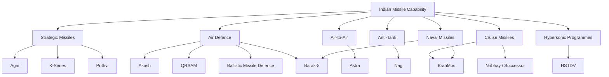
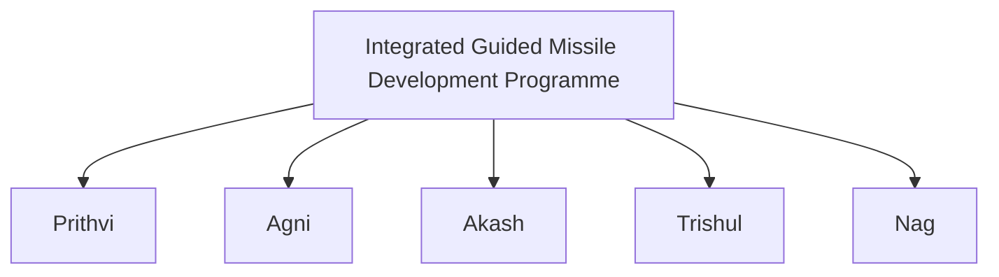
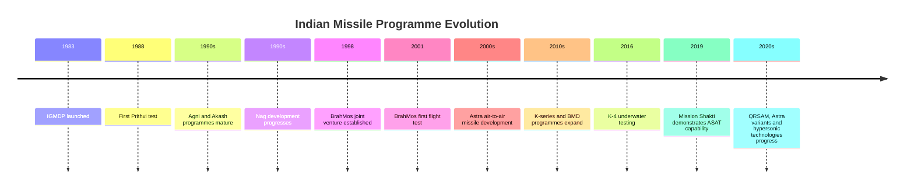
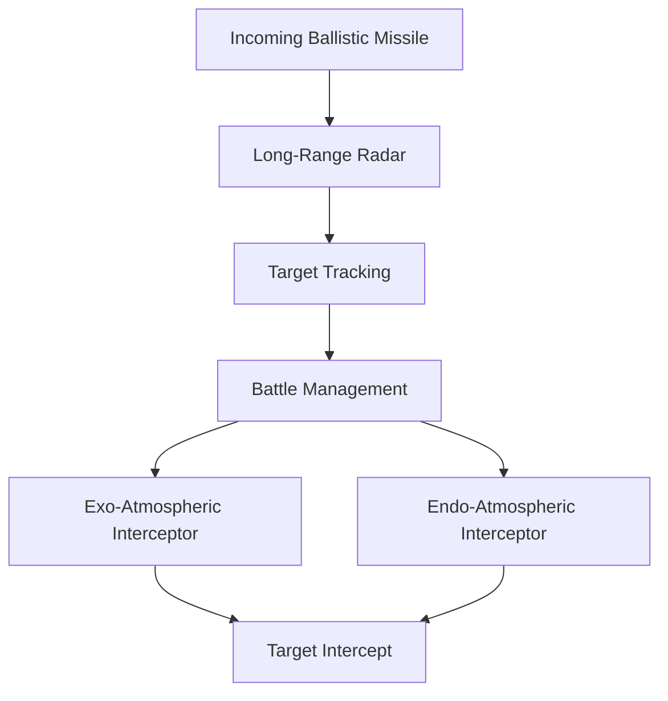
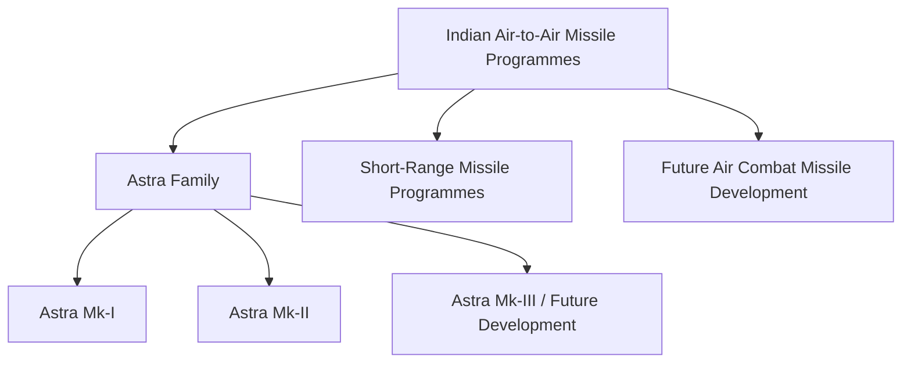
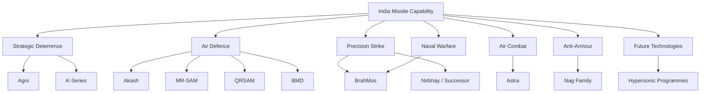

# Indian Missile Programmes Overview

India's missile capability has developed through multiple programmes covering strategic deterrence, air defence, battlefield strike, anti-armour warfare, maritime strike and emerging hypersonic technologies.

The most important early foundation was the **Integrated Guided Missile Development Programme (IGMDP)**, followed by several specialised programmes and joint ventures.

---

## Quick Facts

| Field | Details |
|---|---|
| Primary Defence R&D Organisation | DRDO |
| Major Missile Production Organisation | Bharat Dynamics Limited (BDL) |
| Major Early Programme | Integrated Guided Missile Development Programme (IGMDP) |
| IGMDP Launch | 1983 |
| Core Early Families | Prithvi, Agni, Akash, Trishul, Nag |
| Major Later Programmes | BrahMos, K-series, QRSAM, Astra, Barak-8, Nirbhay / successor programmes |
| Main Domains | Land, Air, Sea, Strategic, Air Defence |
| Inventory Rule | Exact operational quantities are often not publicly disclosed |

---

# What Is a Missile Programme?

A missile programme is a long-term development and acquisition effort covering some or all of:

- Requirement definition
- Technology development
- System design
- Prototype development
- Testing
- Production
- User trials
- Induction
- Operational deployment
- Modernisation

A **missile family** can contain several variants with different ranges, launch platforms or guidance systems.

---

# Indian Missile Programme Architecture

---

# Integrated Guided Missile Development Programme

## IGMDP

The **Integrated Guided Missile Development Programme** was launched in 1983 to develop a broad indigenous missile technology base.

Its original major missile families were:

- Prithvi
- Agni
- Akash
- Trishul
- Nag

---

# Why IGMDP Was Important

IGMDP helped establish indigenous expertise in:

- Propulsion
- Guidance
- Navigation
- Control systems
- Radar integration
- Warhead technologies
- Launch systems
- Command and control
- Missile manufacturing

Its importance therefore goes beyond the individual missiles developed under the programme.

---

# IGMDP Missile Families

| Family | Main Category | Major Role | Broad Outcome |
|---|---|---|---|
| Prithvi | Ballistic missile | Short-range strike | Operational variants developed |
| Agni | Ballistic missile | Strategic deterrence | Major strategic missile family |
| Akash | Surface-to-air missile | Air defence | Operational |
| Trishul | Surface-to-air missile | Short-range air defence | Development programme discontinued |
| Nag | Anti-tank guided missile | Anti-armour warfare | Operational family |

---

# Prithvi Programme

## Role

Prithvi was one of India's earliest indigenous ballistic missile programmes.

| Field | Details |
|---|---|
| Category | Ballistic missile |
| Programme | IGMDP |
| First Test | 1988 |
| Primary Role | Short-range strike |
| Developer | DRDO |
| Status | Different variants have had different service histories |

### Importance

Prithvi established important Indian expertise in ballistic missile design, propulsion, guidance and mobile launch systems.

---

# Agni Programme

Agni became India's principal family of land-based strategic ballistic missiles.

| Variant | Broad Role | Approximate Range Class | Status |
|---|---|---:|---|
| Agni-I | Regional strategic deterrence | 700–900 km | Operational |
| Agni-II | Strategic deterrence | 2,000+ km | Operational |
| Agni-III | Strategic deterrence | 3,000–3,500 km | Operational |
| Agni-IV | Strategic deterrence | 3,500–4,000 km | Operational / inducted |
| Agni-V | Long-range strategic deterrence | 5,000 km class | Operational / inducted |
| Agni-P | New-generation regional strategic missile | 1,000–2,000 km class | Development / induction |

Exact inventory quantities are generally not publicly disclosed.

---

# Akash Programme

Akash is an indigenous surface-to-air missile system.

| Field | Details |
|---|---|
| Category | Surface-to-air missile |
| Programme | IGMDP |
| Developer | DRDO |
| Users | Indian Army and Indian Air Force |
| Primary Role | Air defence |
| Variants | Akash, Akash-1S, Akash-NG |
| Status | Operational family |

Akash is designed to engage aerial threats as part of a layered air-defence network.

---

# Trishul Programme

Trishul was an early short-range surface-to-air missile programme under IGMDP.

| Field | Details |
|---|---|
| Category | Short-range surface-to-air missile |
| Programme | IGMDP |
| Developer | DRDO |
| Primary Role | Short-range air defence |
| Status | Development programme discontinued |

Although Trishul did not become a major operational missile family, its development contributed to India's missile technology base.

---

# Nag Programme

Nag is an indigenous anti-tank guided missile family.

| Field | Details |
|---|---|
| Category | Anti-tank guided missile |
| Programme | IGMDP |
| Developer | DRDO |
| Primary Role | Anti-armour warfare |
| Launch Platforms | Ground vehicles and other platforms depending on variant |
| Status | Operational family |

Major variants include:

- Nag
- HELINA
- Dhruvastra

---

# Missile Programme Evolution

---

# BrahMos Programme

BrahMos is a joint India-Russia supersonic cruise missile programme.

| Field | Details |
|---|---|
| Category | Supersonic cruise missile |
| Organisation | BrahMos Aerospace |
| First Test | 2001 |
| First Induction | 2005 |
| Users | Army, Navy and Air Force |
| Primary Role | Precision conventional strike |
| Platforms | Land, ships and aircraft |
| Status | Operational |

BrahMos is one of India's most prominent conventional precision-strike missile systems.

---

# K-Series Programme

The K-series consists of submarine-launched ballistic missiles associated with India's sea-based nuclear deterrent.

| System | Approximate Range Class | Role | Status |
|---|---:|---|---|
| K-15 | ~700 km | Sea-based deterrence | Operational |
| K-4 | ~3,500 km | Sea-based deterrence | Development / induction |
| Future K-series | Longer-range systems | Sea-based deterrence | Development |

The exact operational inventory is not publicly disclosed.

---

# Ballistic Missile Defence Programme

India has developed a multi-layer ballistic missile defence programme.

The architecture broadly involves:

- Long-range tracking radars
- Fire-control systems
- Exo-atmospheric interception
- Endo-atmospheric interception
- Command and control

---

# Barak-8 / MR-SAM

Barak-8 is a surface-to-air missile family developed through cooperation between India and Israel.

India's land-based Medium Range Surface-to-Air Missile (MR-SAM) system is operated by the Indian Army and Indian Air Force.

| Field | Details |
|---|---|
| Category | Medium-range surface-to-air missile |
| Partners | India and Israel |
| Indian Development Partner | DRDO |
| Israeli Partner | Israel Aerospace Industries |
| Primary Role | Air defence |
| Users | Indian Army and Indian Air Force |
| Status | Operational |

---

# QRSAM

QRSAM means **Quick Reaction Surface-to-Air Missile**.

| Field | Details |
|---|---|
| Category | Short / medium-range mobile air defence |
| Developer | DRDO |
| Primary Role | Battlefield air defence |
| Platform | Mobile |
| Status | Induction programme |
| Quantity | Not publicly disclosed |

QRSAM is designed to provide rapid-response air defence for mobile formations.

---

# Astra

Astra is India's indigenous air-to-air missile family.

## Astra Mk-I

| Field | Details |
|---|---|
| Category | Beyond-visual-range air-to-air missile |
| Developer | DRDO |
| Primary Role | Air-to-air combat |
| Launch Platform | Fighter aircraft |
| Status | Operational / inducted |
| User | Indian Air Force |

Astra represents an important step toward indigenous air-to-air missile capability.

---

# Nirbhay

Nirbhay was an indigenous long-range subsonic cruise missile programme.

| Field | Details |
|---|---|
| Category | Long-range cruise missile |
| Developer | DRDO |
| Approximate Range | 1,000 km class |
| Primary Role | Long-range precision strike |
| First Test | 2013 |
| Status | Programme evolved toward newer systems |

The programme contributed to India's expertise in long-range autonomous cruise missile technology.

---

# Hypersonic Programmes

India is developing hypersonic technologies for future high-speed weapons.

## HSTDV

| Field | Details |
|---|---|
| Full Name | Hypersonic Technology Demonstrator Vehicle |
| Developer | DRDO |
| First Test | 7 September 2020 |
| Technology | Scramjet-powered hypersonic flight |
| Purpose | Technology demonstration |
| Status | Development programme |

HSTDV should not be counted as an operational missile merely because it successfully demonstrated hypersonic technology.

---

# Anti-Tank Missile Programmes

India's anti-armour missile capability includes the Nag family and related systems.

| System | Category | Primary Role | Status |
|---|---|---|---|
| Nag | ATGM | Anti-armour | Operational family |
| HELINA | Air-launched ATGM | Anti-armour | Operational / inducted |
| Dhruvastra | Air-launched ATGM | Anti-armour | Operational / induction |

---

# Air-to-Air Missile Programmes

The Astra family is the principal indigenous air-to-air missile development line.

---

# Missile Categories by Service

| Service | Major Missile Categories |
|---|---|
| Army | Ballistic, cruise, air defence, anti-tank |
| Navy | Anti-ship, surface-to-air, submarine-launched ballistic missiles |
| Air Force | Air-to-air, air-to-ground, cruise and air-defence systems |
| Strategic Forces | Strategic ballistic missile systems |
| Joint / Strategic | Ballistic missile defence and other strategic systems |

---

# Missile Development Organisations

| Organisation | Main Contribution |
|---|---|
| DRDO | Missile research and development |
| DRDL | Missile system design and development |
| RCI | Guidance, navigation and avionics |
| BDL | Missile production |
| BrahMos Aerospace | BrahMos development and production |
| Indian Armed Forces | User requirements, trials and operational deployment |
| Industry partners | Components, subsystems and manufacturing |

---

# Development Lifecycle

---

# Development vs Induction vs Operational

These terms should not be treated as interchangeable.

| Term | Meaning |
|---|---|
| Development | System is being designed and engineered |
| Testing | Technical performance is being evaluated |
| User Trials | Military user is evaluating the system |
| Induction | System enters military service |
| Operational | System is available for operational employment |
| Deployment | System is positioned for a mission or unit |
| Modernisation | Existing system receives upgrades |

---

# Major Missile Programme Timeline

| Year | Event |
|---|---|
| 1983 | IGMDP launched |
| 1988 | Prithvi first test |
| 1999 | Agni-II first test |
| 2001 | BrahMos first test |
| 2002 | Agni-I first test |
| 2005 | BrahMos enters service |
| 2006 | Agni-III first test |
| 2010 | Agni-IV first test |
| 2012 | Agni-V first test |
| 2013 | Nirbhay first test |
| 2016 | K-4 underwater test |
| 2019 | Mission Shakti ASAT demonstration |
| 2020 | HSTDV hypersonic demonstration |
| 2021 | Agni-P first test |

---

# Capability Map

---

# Strategic vs Tactical Missiles

| Strategic | Tactical |
|---|---|
| Long-range strategic effect | Battlefield-level effect |
| Supports national deterrence | Supports military formations |
| May carry strategic payloads | Usually conventional battlefield payload |
| Examples: Agni, K-series | Examples: Nag, QRSAM |
| Strategic command relevance | Service / formation-level relevance |

The distinction is based on role and strategic effect, not simply missile range.

---

# Major Achievements

## Indigenous Missile Technology

India has developed domestic expertise across:

- Solid rocket propulsion
- Liquid propulsion
- Guidance
- Navigation
- Radar seekers
- Imaging seekers
- Command guidance
- Inertial navigation
- Terminal guidance
- Launch systems

## Strategic Deterrence

Agni and K-series programmes provide land- and sea-based strategic missile capabilities.

## Air Defence

Akash, MR-SAM, QRSAM and ballistic missile defence programmes provide multiple layers of air and missile defence.

## Precision Strike

BrahMos provides a mature high-speed conventional precision-strike capability.

## Air Combat

Astra strengthens indigenous air-to-air missile capability.

## Anti-Armour

Nag and its variants provide indigenous anti-tank missile capability.

---

# Quantity and Statistics

Public sources often provide test counts, contracts or deliveries, but these should not automatically be treated as the current operational inventory.

For every missile, distinguish:

| Statistic | Meaning |
|---|---|
| Development Start | Programme began |
| First Test | First known flight test |
| First Successful Test | First successful test, where different |
| First Induction | Entered military service |
| Production | Manufacturing began |
| Ordered | Procurement order |
| Delivered | Units supplied |
| Deployed | Units positioned operationally |
| Operational Count | Currently usable systems |
| Total Inventory | Total holdings |
| Retired | Removed from service |

When reliable public numbers are unavailable:

> **Not publicly disclosed**

---

# Missile Programme Status Summary

| Programme | Category | Current Broad Status |
|---|---|---|
| Prithvi | Ballistic | Service history varies by variant |
| Agni | Strategic ballistic | Operational family |
| Akash | Surface-to-air | Operational family |
| Trishul | Surface-to-air | Discontinued |
| Nag | Anti-tank | Operational family |
| BrahMos | Cruise | Operational |
| K-series | SLBM | Operational / developing newer variants |
| BMD | Ballistic missile defence | Operational / expanding capability |
| MR-SAM / Barak-8 | Air defence | Operational |
| QRSAM | Air defence | Induction programme |
| Astra | Air-to-air | Operational family / variants developing |
| Nirbhay | Cruise | Programme evolved toward newer systems |
| HSTDV | Hypersonic technology | Development |

---

# Why India's Missile Capability Matters

Missile systems contribute to:

- National deterrence
- Military readiness
- Airspace protection
- Maritime security
- Precision strike
- Anti-armour warfare
- Strategic stability
- Defence self-reliance

Missile capability also drives development of technologies useful in other defence systems, particularly propulsion, sensors, guidance, navigation and control.

---

# Key Concepts

### What was IGMDP?

The Integrated Guided Missile Development Programme launched in 1983 to build India's indigenous missile technology base.

### Which missiles came from IGMDP?

Prithvi, Agni, Akash, Trishul and Nag were the major original families.

### Which is India's main strategic ballistic missile family?

Agni.

### Which missile provides sea-based ballistic missile capability?

The K-series.

### Which missile is India's major supersonic cruise missile?

BrahMos.

### Which missile family provides indigenous air-to-air capability?

Astra.

### Which missile family provides anti-tank capability?

Nag and its variants.

### What is QRSAM?

Quick Reaction Surface-to-Air Missile, intended for mobile battlefield air defence.

### What is BMD?

Ballistic Missile Defence — a system designed to detect, track and intercept ballistic missiles.

### What is HSTDV?

Hypersonic Technology Demonstrator Vehicle, developed to demonstrate technologies for future hypersonic systems.

---

# Quick Revision

- **1983** — IGMDP launched.
- **Prithvi** — early indigenous ballistic missile family.
- **Agni** — strategic ballistic missile family.
- **Akash** — indigenous surface-to-air missile.
- **Nag** — anti-tank guided missile family.
- **Trishul** — early SAM programme, discontinued.
- **K-series** — submarine-launched ballistic missiles.
- **BrahMos** — supersonic cruise missile.
- **Astra** — air-to-air missile family.
- **QRSAM** — quick-reaction mobile air defence.
- **BMD** — ballistic missile defence.
- **Nirbhay** — long-range cruise missile programme.
- **HSTDV** — hypersonic technology demonstrator.
- **DRDO** — principal Indian defence R&D organisation for these programmes.
- **BDL** — major missile manufacturing organisation.
- **Exact operational inventories** — often not publicly disclosed.

---

# Key Takeaway

India's missile capability has evolved from a foundational indigenous programme into a broad ecosystem covering:

**Strategic Deterrence → Air Defence → Precision Strike → Air Combat → Anti-Armour Warfare → Naval Warfare → Hypersonic Technology**

The most important lesson is that India's missile capability is not a single programme. It is a collection of specialised systems developed for different ranges, platforms, targets and strategic roles.
