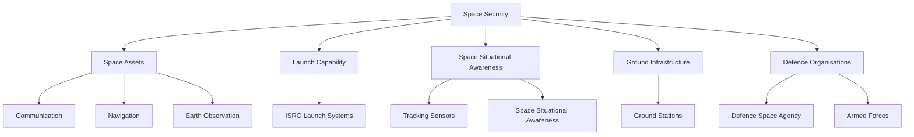
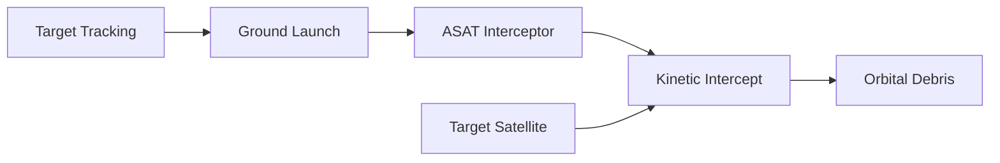
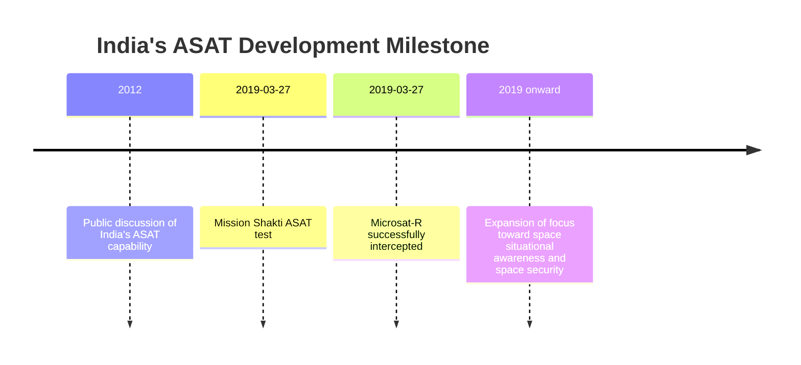
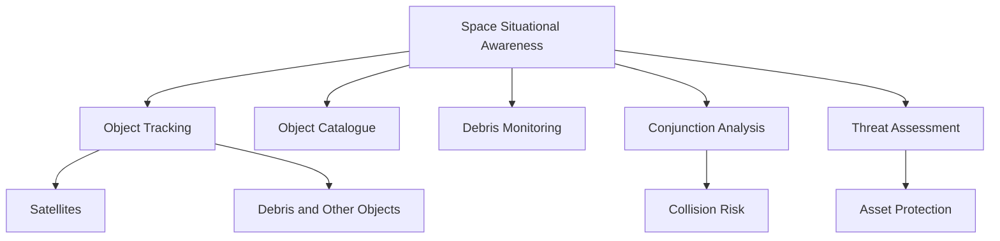
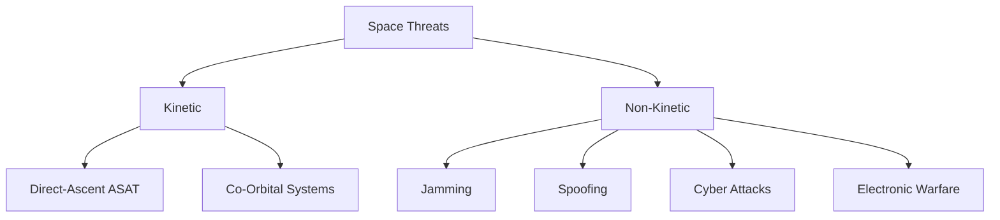
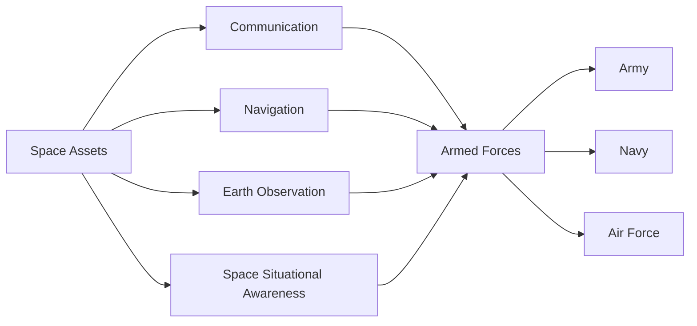

# Indian Space and ASAT Capability

India's space capability has an important role in national security, communications, surveillance, navigation, missile warning, disaster response and strategic operations.

India's anti-satellite (ASAT) capability was publicly demonstrated through **Mission Shakti** in 2019.

Space security is broader than ASAT. It includes satellites, launch systems, space-based surveillance, secure communications, navigation, tracking, space situational awareness and protection of space assets.

---

## Quick Facts

| Field | Details |
|---|---|
| Domain | Space and Strategic Defence |
| Civil Space Agency | ISRO |
| Defence Space Organisation | Defence Space Agency (DSA) |
| ASAT Test | Mission Shakti |
| ASAT Test Date | 27 March 2019 |
| Target | Indian Microsatellite-C (Microsat-R) |
| Test Type | Direct-ascent kinetic ASAT |
| Test Result | Target successfully intercepted |
| Test Altitude | Approximately 283 km |
| Strategic Purpose | Demonstrate capability to engage a satellite in low Earth orbit |
| Current ASAT Inventory | Not publicly disclosed |

---

# What Is Space Security?

Space security means protecting and using space-based capabilities that support national security.

These capabilities include:

- Communication satellites
- Earth-observation satellites
- Navigation satellites
- Missile-warning support
- Intelligence and surveillance
- Secure military communications
- Space situational awareness
- Satellite tracking
- Protection of space assets

A modern military therefore depends on space even when its forces are operating on land, at sea or in the air.

---

# India's Space-Defence Ecosystem

---

# Mission Shakti

## What Was Mission Shakti?

Mission Shakti was India's first publicly acknowledged anti-satellite weapon test.

The test demonstrated India's ability to intercept and destroy a satellite in low Earth orbit using a ground-launched interceptor.

---

## Mission Shakti Profile

| Field | Details |
|---|---|
| Test Name | Mission Shakti |
| Date | 27 March 2019 |
| Target | Microsat-R |
| Target Type | Indian imaging satellite used as the test target |
| Interceptor | Ground-launched kinetic interceptor |
| Target Orbit | Low Earth orbit |
| Interception Altitude | Approximately 283 km |
| Result | Successful interception |
| Organisation | DRDO-led programme |
| Announcement | Government of India |
| Significance | Demonstrated India's direct-ascent ASAT capability |

---

# How a Direct-Ascent ASAT Works

A direct-ascent ASAT does not normally place an interceptor into orbit first.

Instead:

1. A ground-based launcher fires an interceptor.
2. The interceptor climbs toward the target's orbital altitude.
3. Sensors track the target satellite.
4. The interceptor is guided toward the target.
5. The target is physically destroyed or disabled through kinetic impact.

---

# Mission Shakti Timeline

---

# Why Mission Shakti Was Important

Mission Shakti demonstrated that India had the technical capability to:

- Detect and track a satellite
- Calculate an interception solution
- Guide an interceptor toward an orbital target
- Conduct a high-speed kinetic interception
- Demonstrate anti-satellite technology

It also demonstrated capabilities relevant to missile guidance, tracking, command and control and high-precision interception.

---

# What Mission Shakti Did Not Mean

An ASAT test does **not** mean that every satellite can automatically be destroyed.

Actual satellite engagement depends on factors such as:

- Target orbit
- Target position
- Tracking accuracy
- Sensor coverage
- Interceptor performance
- Timing
- Command and control
- Rules of engagement
- Political and strategic considerations

Therefore, ASAT capability should be understood as a strategic capability rather than a guarantee against every possible space threat.

---

# Microsat-R

## System Profile

| Field | Details |
|---|---|
| Name | Microsat-R |
| Type | Earth-observation / imaging satellite |
| Role in Mission Shakti | Target satellite |
| Launch | January 2019 |
| Test | Mission Shakti |
| Interception | 27 March 2019 |
| Orbit at interception | Approximately 283 km |

Microsat-R was selected as the target for Mission Shakti because its orbit enabled the test to demonstrate interception while limiting the long-term orbital lifetime of debris compared with a much higher-altitude interception.

---

# Organisations Involved

## DRDO

The Defence Research and Development Organisation led the development of the ASAT interceptor and associated defence technologies used for Mission Shakti.

## ISRO

ISRO provides India's wider space infrastructure, including launch vehicles, satellites, tracking infrastructure and space science and engineering capabilities.

Mission Shakti itself was a defence-led demonstration rather than an ISRO satellite mission.

## Defence Space Agency

The Defence Space Agency coordinates India's military space activities and supports the integration of space capabilities across the armed forces.

---

# Space Situational Awareness

Space Situational Awareness (SSA) means knowing what is happening in space.

This includes:

- Tracking satellites
- Tracking orbital debris
- Identifying objects
- Predicting orbital conjunctions
- Monitoring potentially threatening objects
- Maintaining an orbital catalogue
- Supporting protection of Indian space assets

---

# India's SSA Development

India has been expanding its ability to monitor objects in space.

This includes:

- Ground-based tracking sensors
- Radar observations
- Optical telescopes
- Satellite tracking
- Data processing
- Orbital analysis
- International data cooperation

The objective is not simply to track India's own satellites, but to understand the wider orbital environment.

---

# Space-Based Military Capabilities

Space systems support all three armed services.

| Capability | Military Use |
|---|---|
| Communication satellites | Secure communications |
| Earth observation | Surveillance and reconnaissance |
| Navigation | Positioning, navigation and timing |
| Weather satellites | Operational planning |
| Space situational awareness | Satellite and debris tracking |
| Secure data links | Networked operations |
| Remote sensing | Intelligence and monitoring |

---

# Navigation

India's **NavIC** system provides regional satellite navigation capability.

Military navigation can support:

- Position determination
- Navigation
- Timing
- Precision operations
- Network synchronization

NavIC is a civilian and strategic navigation capability; it should not be described as an ASAT system.

---

# Communication Satellites

Military operations increasingly depend on reliable communications.

Space-based communications can support:

- Ships at sea
- Aircraft
- Remote military formations
- Command headquarters
- Strategic communications
- Network-centric operations

---

# Earth Observation

Earth-observation satellites can support:

- Border monitoring
- Maritime surveillance
- Infrastructure monitoring
- Disaster assessment
- Strategic intelligence
- Operational planning

The exact military tasking and current satellite availability are not always publicly disclosed.

---

# Space-Based Threats

India's space assets can face several categories of threats.

## Kinetic

Physical attack against a satellite.

Examples include:

- Direct-ascent ASAT
- Co-orbital attack concepts

## Non-Kinetic

Attacks that do not physically destroy the satellite.

Examples include:

- Jamming
- Spoofing
- Cyber attacks
- Directed-energy concepts
- Electronic interference

---

# Protection of Space Assets

Space defence is not only about attacking satellites.

Protection can include:

- Redundancy
- Hardened systems
- Secure communications
- Cybersecurity
- Electronic protection
- Manoeuvrable satellites
- Distributed satellite architectures
- Improved space situational awareness
- Rapid replacement capability

---

# India's Strategic Space Architecture

---

# ASAT Capability vs Missile Defence

These are related but different capabilities.

| Capability | Main Purpose |
|---|---|
| ASAT | Engage a satellite in space |
| Ballistic Missile Defence | Intercept an incoming missile |
| Air Defence | Defend against aircraft and other aerial threats |
| Space Situational Awareness | Detect and track objects in space |

A technology used for one area can contribute to another, especially in tracking, guidance and high-speed interception, but the missions are different.

---

# ASAT and Orbital Debris

A kinetic ASAT interception can create debris.

This is an important strategic and environmental issue because debris can remain in orbit and threaten other spacecraft.

The risk depends heavily on the altitude and geometry of the interception.

Mission Shakti was conducted at a relatively low altitude specifically to reduce the long-term persistence of debris.

---

# International Context

India became the fourth country to publicly demonstrate a successful ASAT capability, after:

1. United States
2. Soviet Union / Russia
3. China
4. India

India's 2019 test therefore represented a major strategic milestone.

---

# India's Space Defence Timeline

| Year | Milestone |
|---|---|
| 1975 | India launches its first satellite, Aryabhata |
| 1980 | India successfully places Rohini satellite into orbit using an indigenous launch vehicle |
| 1984 | Rakesh Sharma becomes the first Indian citizen in space |
| 2008 | Chandrayaan-1 demonstrates India's growing deep-space capability |
| 2013 | Mangalyaan / Mars Orbiter Mission launched |
| 2017 | South Asia Satellite launched |
| 2019 | Mission Shakti demonstrates ASAT capability |
| 2019 | Defence Space Agency established |
| 2020s | Expansion of military space, SSA and secure satellite capabilities |

---

# Major Achievements

## Mission Shakti

Demonstrated India's direct-ascent ASAT capability.

## Indigenous Space Infrastructure

India has developed launch vehicles, satellites, ground stations and space applications domestically.

## Navigation

NavIC provides an independent regional satellite navigation capability.

## Earth Observation

India operates a large Earth-observation capability supporting civilian and strategic applications.

## Space Situational Awareness

India continues to develop stronger capabilities for tracking satellites and orbital debris.

---

# Important Statistics Rule

For space systems, distinguish between:

- **Programme announced**
- **Development started**
- **First test**
- **First launch**
- **Operationalisation**
- **Satellites launched**
- **Current satellites in service**
- **Ground systems deployed**
- **Operational availability**
- **Retired / decommissioned**

For classified or non-public capabilities:

> **Not publicly disclosed**

Do not convert an announced programme quantity into an operational inventory number.

---

# Key Concepts

### What is ASAT?

Anti-satellite capability designed to interfere with, disable or destroy a satellite.

### What was Mission Shakti?

India's 2019 successful direct-ascent ASAT demonstration.

### What was the target?

Microsat-R.

### When was the test conducted?

27 March 2019.

### At what altitude?

Approximately 283 km.

### Which organisation led the ASAT development?

DRDO.

### What is SSA?

Space Situational Awareness — the ability to detect, track and understand objects and activities in space.

### Is ASAT the same as missile defence?

No. ASAT targets objects in space; missile defence targets incoming missiles.

### Why is orbital debris important?

Destroyed satellites can produce debris that may threaten other spacecraft.

---

# Quick Revision

- **Mission Shakti** — India's 2019 ASAT test.
- **Date** — 27 March 2019.
- **Target** — Microsat-R.
- **Method** — Direct-ascent kinetic interception.
- **Altitude** — approximately 283 km.
- **Lead organisation** — DRDO.
- **ASAT purpose** — demonstrate the ability to engage a satellite in orbit.
- **SSA** — monitor and understand objects in space.
- **DSA** — coordinates India's military space activities.
- **NavIC** — India's regional satellite navigation system.
- **Space defence** — broader than ASAT and includes protection, communications, navigation, surveillance and SSA.

---

# Key Takeaway

India's space-defence capability should be viewed as a complete ecosystem:

**Satellites → Launch → Tracking → Communications → Navigation → Surveillance → Space Situational Awareness → Defence Space Operations**

Mission Shakti demonstrated one part of this ecosystem — **the ability to conduct a direct-ascent ASAT interception**.

The broader strategic objective is to ensure that India's armed forces can continue to operate effectively even when space becomes a contested domain.
