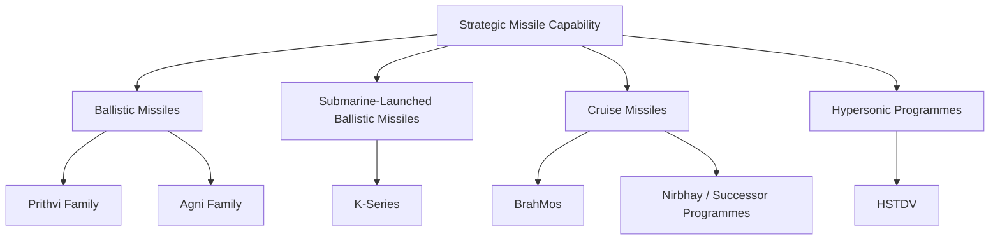
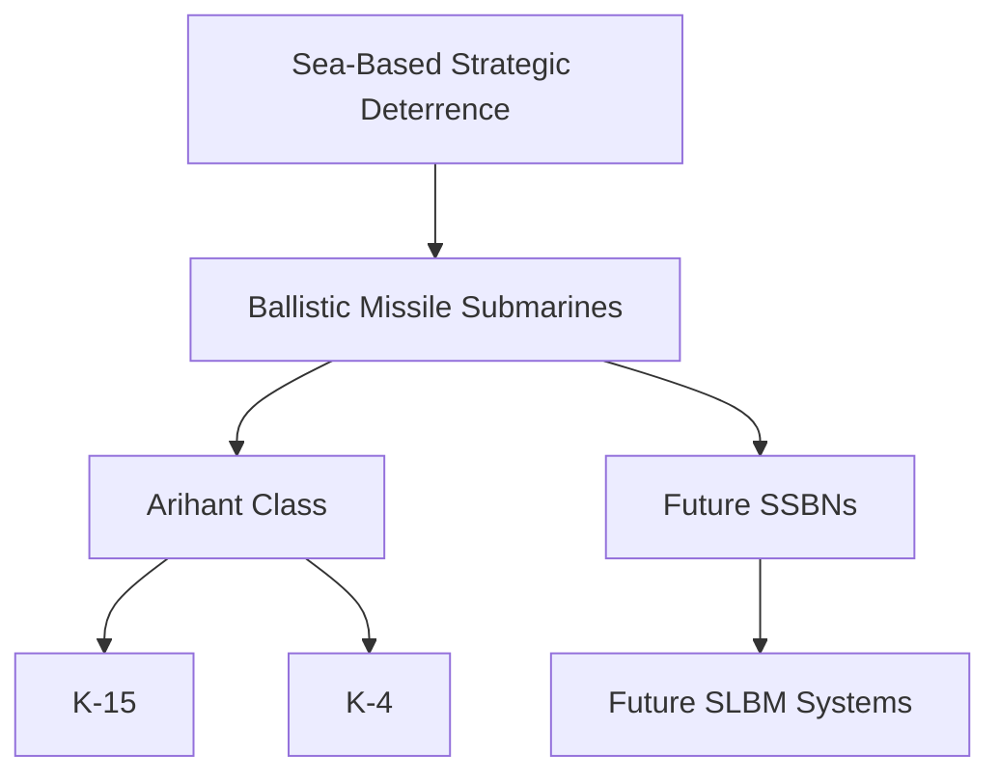
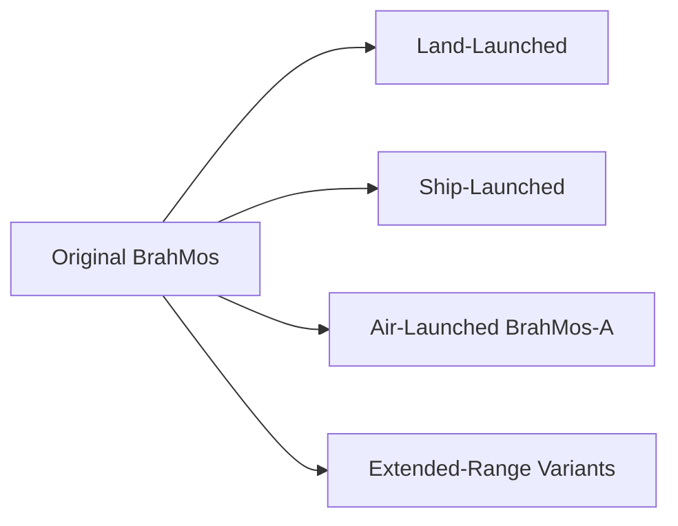
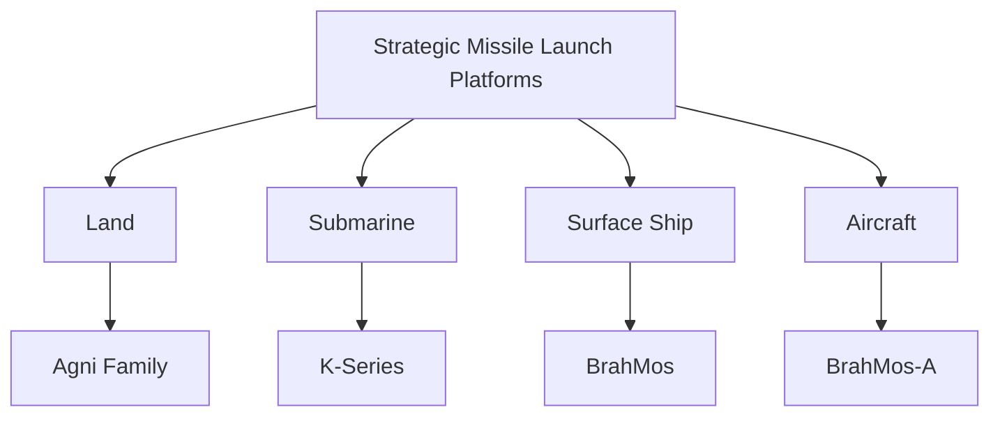
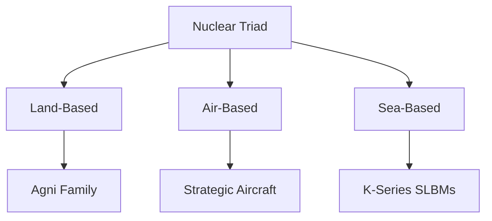

# India's Strategic Missile Systems

Strategic missiles are long-range or strategically important missile systems designed to support national deterrence, strategic strike capability, nuclear forces, or high-value conventional missions.

India's strategic missile capability includes ballistic missiles, submarine-launched ballistic missiles, cruise missiles and emerging hypersonic systems.

---

## Quick Facts

| Field | Details |
|---|---|
| Primary Organisation | DRDO |
| Major Industrial Partner | Bharat Dynamics Limited (BDL) and other Indian defence industries |
| Strategic Roles | Deterrence, long-range strike, nuclear delivery, precision conventional strike |
| Major Missile Families | Agni, K-series, BrahMos, Prithvi, Nirbhay / long-range cruise missile programmes |
| Nuclear Delivery Systems | Agni family, K-series and other designated strategic systems |
| Launch Platforms | Land, aircraft, surface ships and submarines |
| Strategic Principle | Credible minimum deterrence |
| Current Inventory | Exact operational quantities are generally not publicly disclosed |

---

# What Is a Strategic Missile?

A strategic missile is a missile whose range, payload, role or target set gives it major strategic significance.

Strategic missiles can be used for:

- Nuclear deterrence
- Long-range conventional strike
- Strategic counter-force or counter-value missions
- Anti-ship operations
- Deep strike
- Deterrence against major military threats

Not every long-range missile is necessarily a nuclear missile, and not every strategic missile is designed only for nuclear use.

---

# Strategic Missile Categories

| Category | Typical Role | Examples from India |
|---|---|---|
| Short-range ballistic missile | Regional strike | Prithvi family |
| Intermediate-range ballistic missile | Strategic regional deterrence | Agni-II / Agni-III |
| Intermediate-to-long-range ballistic missile | Strategic deterrence | Agni-IV |
| Intercontinental-range ballistic missile | Long-range strategic deterrence | Agni-V |
| Submarine-launched ballistic missile | Sea-based nuclear deterrence | K-series |
| Supersonic cruise missile | Precision conventional strike | BrahMos |
| Long-range cruise missile | Deep precision strike | Nirbhay / successor programmes |
| Hypersonic weapon | Very high-speed strike | Hypersonic Technology Demonstrator Vehicle and related programmes |

---

# Strategic Missile Architecture

---

# Ballistic vs Cruise Missiles

## Ballistic Missile

A ballistic missile follows a trajectory in which a significant part of its flight is outside the atmosphere or follows a ballistic path after powered ascent.

Typical characteristics:

- Very high speed
- Long range
- High-altitude trajectory
- Strategic deterrence role
- Difficult interception challenge

## Cruise Missile

A cruise missile generally remains within the atmosphere and uses sustained aerodynamic flight.

Typical characteristics:

- Lower-altitude flight
- Continuous propulsion
- Terrain-following or sea-skimming capability in suitable systems
- High precision
- Conventional strike applications

---

# Agni Family

The Agni family is India's principal land-based strategic ballistic missile family.

---

# Agni-I

## System Profile

| Field | Details |
|---|---|
| Type | Short-range ballistic missile |
| Propulsion | Solid fuel |
| Approximate Range | 700–900 km |
| Role | Regional strategic strike |
| Developer | DRDO |
| First Test | 25 January 2002 |
| First Induction | 2004 |
| Status | Operational |
| Quantity | Exact operational inventory not publicly disclosed |

## Major Work

Agni-I provided India with a mobile solid-fuel ballistic missile capability for regional deterrence.

---

# Agni-II

## System Profile

| Field | Details |
|---|---|
| Type | Medium-range ballistic missile |
| Propulsion | Solid fuel, two-stage |
| Approximate Range | 2,000+ km |
| Role | Strategic deterrence |
| Developer | DRDO |
| First Test | 11 April 1999 |
| Status | Operational |
| Quantity | Not publicly disclosed |

## Major Work

Agni-II extended India's land-based ballistic missile reach and strengthened regional strategic deterrence.

---

# Agni-III

## System Profile

| Field | Details |
|---|---|
| Type | Intermediate-range ballistic missile |
| Propulsion | Solid fuel, two-stage |
| Approximate Range | 3,000–3,500 km |
| Role | Strategic deterrence |
| Developer | DRDO |
| First Test | 9 July 2006 |
| Status | Operational |
| Quantity | Not publicly disclosed |

## Major Work

Agni-III increased India's ability to hold more distant strategic targets at risk.

---

# Agni-IV

## System Profile

| Field | Details |
|---|---|
| Type | Intermediate-range ballistic missile |
| Propulsion | Solid fuel |
| Approximate Range | 3,500–4,000 km |
| Role | Strategic deterrence |
| Developer | DRDO |
| First Test | 10 December 2010 |
| Status | Operational / inducted |
| Quantity | Not publicly disclosed |

## Major Work

Agni-IV introduced improved guidance, mobility and accuracy compared with earlier Agni generations.

---

# Agni-V

## System Profile

| Field | Details |
|---|---|
| Type | Long-range ballistic missile |
| Propulsion | Solid fuel, three-stage |
| Approximate Range | 5,000 km class |
| Role | Strategic deterrence |
| Developer | DRDO |
| First Test | 19 April 2012 |
| Status | Operational / inducted |
| Quantity | Not publicly disclosed |

## Major Work

Agni-V significantly expanded India's strategic reach.

It is designed around a road-mobile launcher and modern guidance and navigation systems.

---

# Agni-P

## System Profile

| Field | Details |
|---|---|
| Type | New-generation ballistic missile |
| Propulsion | Solid fuel |
| Approximate Range | 1,000–2,000 km class |
| Role | Regional strategic strike |
| Developer | DRDO |
| First Test | 28 June 2021 |
| Status | Development / induction programme |
| Quantity | Not publicly disclosed |

## Major Work

Agni-P incorporates newer technologies intended to improve mobility, accuracy, survivability and operational flexibility.

---

# Agni Family Development Pattern

The progression broadly reflects increasing range, mobility, accuracy, survivability and technology maturity.

---

# K-Series Submarine-Launched Ballistic Missiles

The K-series provides the sea-based component of India's nuclear deterrent.

These missiles are associated with India's nuclear-powered ballistic-missile submarine fleet.

---

# K-15 / Sagarika

## System Profile

| Field | Details |
|---|---|
| Type | Submarine-launched ballistic missile |
| Approximate Range | Around 700 km |
| Propulsion | Solid fuel |
| Platform | Arihant-class submarines |
| Developer | DRDO |
| First Test | 2004 |
| Status | Operational |
| Quantity | Not publicly disclosed |

## Major Work

K-15 provides a submarine-launched strategic strike capability for India's sea-based deterrent.

---

# K-4

## System Profile

| Field | Details |
|---|---|
| Type | Submarine-launched ballistic missile |
| Approximate Range | 3,500 km class |
| Propulsion | Solid fuel |
| Platform | Nuclear-powered ballistic-missile submarines |
| Developer | DRDO |
| First Underwater Test | 2016 |
| Status | Development / induction programme |
| Quantity | Not publicly disclosed |

## Major Work

K-4 is designed to provide substantially greater range than K-15 and strengthen India's sea-based deterrence.

---

# K-Series Architecture

---

# Prithvi Family

The Prithvi family was one of India's earliest indigenous ballistic missile programmes.

## System Profile

| Field | Details |
|---|---|
| Type | Short-range ballistic missile family |
| Developer | DRDO |
| Programme | Integrated Guided Missile Development Programme |
| First Test | 1988 |
| Major Role | Short-range strike |
| Status | Different variants have had different service histories |
| Quantity | Not publicly disclosed |

Prithvi was important in establishing India's indigenous missile-development capability.

---

# BrahMos

## System Profile

| Field | Details |
|---|---|
| Type | Supersonic cruise missile |
| Propulsion | Ramjet-based |
| Approximate Speed | Mach 2.8–3 |
| Role | Precision conventional strike |
| Developer | BrahMos Aerospace |
| Partners | India and Russia |
| First Test | 12 June 2001 |
| First Induction | 2005 |
| Users | Indian Army, Indian Navy, Indian Air Force |
| Status | Operational |
| Nuclear Role | Not classified as India's primary nuclear deterrent missile |
| Quantity | Exact inventory not publicly disclosed |

## Major Work

BrahMos provides high-speed precision strike capability against land and maritime targets.

It is deployed in land-, sea- and air-launched configurations.

---

# BrahMos Development

---

# Nirbhay and Long-Range Cruise Missile Programmes

Nirbhay was developed as an indigenous long-range subsonic cruise missile programme.

## System Profile

| Field | Details |
|---|---|
| Type | Long-range subsonic cruise missile |
| Developer | DRDO |
| Approximate Range | 1,000 km class |
| Primary Role | Long-range precision strike |
| First Test | 12 March 2013 |
| Status | Development programme evolved toward newer systems |
| Quantity | Not publicly disclosed |

## Major Work

The programme helped India develop technologies for long-range autonomous cruise missiles, including navigation, guidance and low-altitude flight.

---

# Hypersonic Programmes

India is developing technologies for very-high-speed flight and hypersonic weapons.

## HSTDV

| Field | Details |
|---|---|
| Full Name | Hypersonic Technology Demonstrator Vehicle |
| Type | Hypersonic technology demonstrator |
| Developer | DRDO |
| First Test | 7 September 2020 |
| Technology | Scramjet-powered hypersonic flight technology |
| Purpose | Demonstrate technologies for future hypersonic systems |
| Status | Technology-development programme |

The HSTDV is a technology demonstrator rather than an operational strategic missile.

---

# Strategic Missile Launch Platforms

Strategic missiles can be deployed from multiple platforms.

---

# India's Nuclear Triad

India's nuclear deterrent is designed around three delivery modes:

1. Land-based missiles
2. Aircraft
3. Sea-based missiles

Strategic missiles are especially important to the land and sea components.

---

# Strategic Missile Development Lifecycle

---

# Strategic Missile Development Timeline

| Year | Milestone |
|---|---|
| 1983 | Integrated Guided Missile Development Programme launched |
| 1988 | First Prithvi test |
| 1999 | Agni-II first test |
| 2001 | BrahMos first test |
| 2002 | Agni-I first test |
| 2004 | K-15 development testing begins / first reported test period |
| 2005 | BrahMos enters service |
| 2006 | Agni-III first test |
| 2010 | Agni-IV first test |
| 2012 | Agni-V first test |
| 2013 | Nirbhay first test |
| 2016 | K-4 underwater test |
| 2020 | HSTDV hypersonic technology demonstration |
| 2021 | Agni-P first test |

---

# Strategic Missile Comparison

| System | Type | Approx. Range | Main Role | Status |
|---|---|---:|---|---|
| Prithvi | Ballistic | Short range | Regional strike | Service history varies by variant |
| Agni-I | Ballistic | 700–900 km | Strategic / regional deterrence | Operational |
| Agni-II | Ballistic | 2,000+ km | Strategic deterrence | Operational |
| Agni-III | Ballistic | 3,000–3,500 km | Strategic deterrence | Operational |
| Agni-IV | Ballistic | 3,500–4,000 km | Strategic deterrence | Operational / inducted |
| Agni-V | Ballistic | 5,000 km class | Long-range strategic deterrence | Operational / inducted |
| Agni-P | Ballistic | 1,000–2,000 km class | Regional strategic strike | Development / induction |
| K-15 | SLBM | ~700 km | Sea-based deterrence | Operational |
| K-4 | SLBM | 3,500 km class | Sea-based deterrence | Development / induction |
| BrahMos | Cruise | 300+ km and extended-range variants | Precision conventional strike | Operational |
| Nirbhay | Cruise | 1,000 km class | Long-range precision strike | Programme evolved |
| HSTDV | Hypersonic demonstrator | Technology demonstrator | Hypersonic technology | Development |

---

# Strategic Importance

Strategic missiles provide India with:

- Credible deterrence
- Long-range strike capability
- Survivable delivery options
- Regional strategic reach
- Sea-based deterrence
- Precision conventional strike
- Technological self-reliance

---

# Survivability

A strategic missile force is valuable not only because of range.

Survivability is also important.

Factors include:

- Mobile launchers
- Hardened infrastructure
- Concealment
- Dispersal
- Submarine deployment
- Secure communications
- Multiple launch locations
- Reliable command and control

A survivable force strengthens deterrence because an adversary cannot assume that all strategic systems can be destroyed before they can respond.

---

# Quantity and Operational Status

Exact missile inventories are generally sensitive and are not consistently published.

Therefore, use these distinctions:

| Term | Meaning |
|---|---|
| Developed | Technology/system has been created |
| Tested | Missile has undergone flight testing |
| Inducted | Entered military service |
| Operational | Available for operational use |
| Ordered | Procurement order exists |
| Delivered | Units delivered to the user |
| Deployed | Positioned for operational use |
| Inventory | Total holdings; often not public |
| Operational Count | Currently usable units; often not public |

For unavailable figures:

> **Not publicly disclosed**

Do not infer total inventory from the number of tests or publicly announced production contracts.

---

# Strategic Missile Organisations

| Organisation | Role |
|---|---|
| DRDO | Research and development |
| DRDL | Missile design and development |
| RCI | Guidance, navigation and avionics |
| BDL | Major missile manufacturing organisation |
| BrahMos Aerospace | BrahMos development and production |
| Indian Armed Forces | User, trials and operational employment |
| ISRO | Space launch and satellite capabilities; not the primary organisation for India's strategic missile programmes |

---

# Key Concepts

### What is a strategic missile?

A missile with sufficient range, payload or strategic role to contribute significantly to national deterrence or long-range strike capability.

### What is the Agni family?

India's principal land-based strategic ballistic missile family.

### What is the K-series?

A family of submarine-launched ballistic missiles associated with India's sea-based nuclear deterrent.

### What is BrahMos?

A supersonic cruise missile developed jointly by India and Russia for precision conventional strike.

### What is an SLBM?

A Submarine-Launched Ballistic Missile.

### What is the difference between Agni and BrahMos?

Agni is primarily a ballistic missile family supporting strategic deterrence; BrahMos is a supersonic cruise missile primarily used for conventional precision strike.

### Why are submarines important for strategic missiles?

Submarines can provide a highly survivable second-strike capability because they are difficult for an adversary to locate and destroy.

---

# Quick Revision

- **Prithvi** — early indigenous ballistic missile family.
- **Agni-I to Agni-V** — progressively more capable strategic ballistic missile systems.
- **Agni-P** — newer-generation ballistic missile programme.
- **K-15** — submarine-launched ballistic missile.
- **K-4** — longer-range submarine-launched ballistic missile.
- **BrahMos** — supersonic conventional cruise missile.
- **Nirbhay** — indigenous long-range cruise missile programme.
- **HSTDV** — hypersonic technology demonstrator.
- **DRDO** — primary defence R&D organisation for these missile programmes.
- **BDL** — major Indian missile production organisation.
- **Exact strategic missile inventories** — generally not publicly disclosed.

---

# Key Takeaway

India's strategic missile capability is not one missile or one programme.

It is an ecosystem:

**Land-Based Ballistic Missiles → Sea-Based Ballistic Missiles → Cruise Missiles → Hypersonic Technology → Secure Command and Control**

Together, these capabilities support India's broader objectives of **credible deterrence, strategic stability, long-range strike capability and defence self-reliance**.
