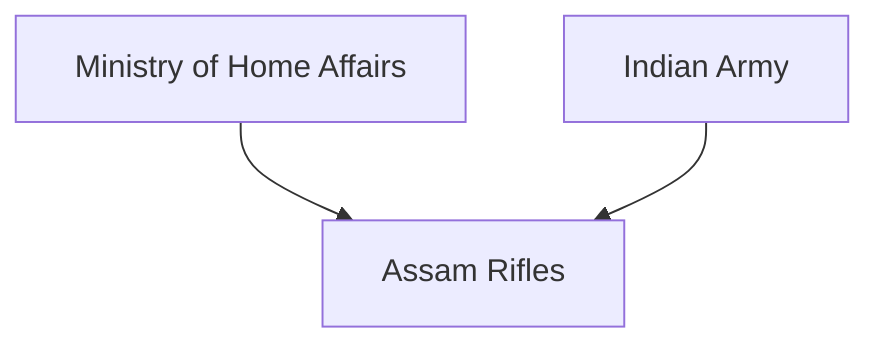
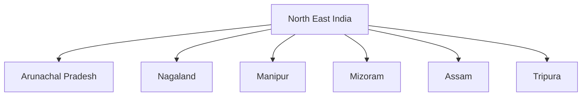

# Assam Rifles

## National Importance

Assam Rifles is India's oldest paramilitary force and plays a critical role in maintaining security in the North Eastern region of the country.

Often called the 'Sentinels of the North East', the force is responsible for border security, counter-insurgency operations, internal security and support to civil administration.

Its unique dual-control structure and extensive operational experience make it one of the most important security forces in India.

---

## Quick Facts

| Item | Details |
|----------|----------|
| Name | Assam Rifles |
| Established | 1835 |
| Ministry | Ministry of Home Affairs |
| Operational Control | Indian Army |
| Headquarters | Shillong, Meghalaya |
| Primary Role | Border Security and Counter-Insurgency |
| Nickname | Sentinels of the North East |

---

## Historical Evolution

Assam Rifles traces its origins to the Cachar Levy formed in 1835 during British rule.

---

## Organisation Structure

Assam Rifles operates under a unique dual-control model:

- Administrative control: Ministry of Home Affairs
- Operational control: Indian Army

---

## Primary Responsibilities

- Border security along the India–Myanmar border
- Counter-insurgency operations
- Internal security duties
- Area domination operations
- Intelligence support
- Assistance during disasters and emergencies

---

## Operational Areas

The force is primarily deployed across the North Eastern states.

---

## Border Management Role

Assam Rifles is responsible for guarding large portions of the India–Myanmar border.

Its responsibilities include:

- Preventing illegal infiltration
- Combating smuggling
- Countering insurgent movement
- Supporting border management

---

## Counter-Insurgency Operations

The force has extensive experience in:

- Counter-insurgency operations
- Area domination patrols
- Intelligence-based operations
- Joint operations with the Army

It has been one of the key security forces in maintaining stability in the North East.

---

## Humanitarian and Civic Action Role

Apart from security duties, Assam Rifles contributes through:

- Medical camps
- Education support
- Infrastructure assistance
- Disaster relief operations
- Community outreach programmes

---

## Strategic Importance

Assam Rifles helps India:

- Secure the North East
- Protect international borders
- Support national integration
- Counter insurgency threats
- Strengthen border management

---

## Challenges

- Difficult terrain
- Dense forests and mountains
- Cross-border insurgent activity
- Smuggling networks
- Infrastructure limitations in remote areas

---

## Future Roadmap

- Enhanced surveillance capability
- Better border-management systems
- Modern equipment and technology
- Improved mobility and logistics
- Stronger integration with national security architecture

---

## Quick Revision

- Assam Rifles is India's oldest paramilitary force.
- Established in 1835.
- Known as the Sentinels of the North East.
- Guards the India–Myanmar border.
- Conducts counter-insurgency operations.
- Operates under MHA administrative control and Army operational control.

---

## Key Concepts

### What is Assam Rifles?

India's oldest paramilitary force responsible for border security and counter-insurgency operations in the North East.

### Why is Assam Rifles important?

It plays a major role in border security, internal security and regional stability.

### Which border does Assam Rifles guard?

Large portions of the India–Myanmar border.

### Why is it called the Sentinels of the North East?

Because of its long-standing role in securing the North Eastern region.

### What makes Assam Rifles unique?

Its dual-control structure involving both the Ministry of Home Affairs and the Indian Army.
