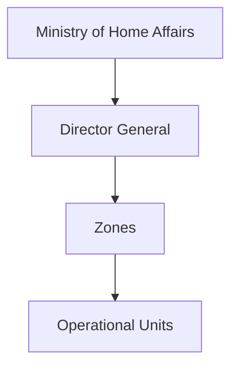
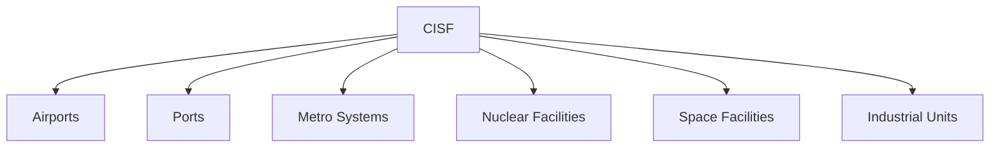

# Central Industrial Security Force (CISF)

## National Importance

The Central Industrial Security Force (CISF) is India's premier infrastructure-protection force responsible for securing critical national assets.

It protects airports, seaports, metro systems, nuclear facilities, government installations, space facilities and major public-sector enterprises. As India's economy and critical infrastructure continue to expand, the role of CISF has become increasingly important for national security.

---

## Quick Facts

| Item | Details |
|----------|----------|
| Name | Central Industrial Security Force (CISF) |
| Established | 1969 |
| Ministry | Ministry of Home Affairs |
| Headquarters | New Delhi |
| Primary Role | Critical Infrastructure Security |
| Type | Central Armed Police Force |
| Motto | Protection and Security |

---

## Historical Background

The CISF was established in 1969 to provide dedicated security to major public-sector industrial facilities.

Over time, its responsibilities expanded to include airports, metro networks, strategic installations and other critical infrastructure.

---

## Organisation Structure

---

## Primary Responsibilities

- Airport security
- Industrial security
- Metro security
- Nuclear facility security
- Space facility security
- Government installation security
- Disaster response support
- VIP security in specific assignments

---

## Critical Infrastructure Protection

---

## Airport Security Role

CISF is responsible for security at many major airports across India.

Responsibilities include:

- Passenger screening
- Access control
- Anti-sabotage checks
- Aviation security
- Emergency response

---

## Industrial Security Role

The force protects:

- Power plants
- Refineries
- Steel plants
- Strategic industries
- Public-sector enterprises

---

## Security of Strategic Facilities

CISF secures several nationally important installations associated with:

- Nuclear energy
- Space research
- Defence production
- Strategic infrastructure

---

## Disaster Management Role

Apart from security duties, CISF supports:

- Disaster response
- Emergency evacuation
- Fire and rescue assistance
- Crisis management operations

---

## Strategic Importance

CISF helps India:

- Protect critical infrastructure
- Ensure economic security
- Support national resilience
- Strengthen internal security
- Safeguard strategic assets

---

## Challenges

- Growing infrastructure network
- Cyber-physical threats
- Drone-based threats
- Terrorist attacks on infrastructure
- Technology integration requirements

---

## Future Roadmap

- Smart-security systems
- AI-assisted surveillance
- Counter-drone capability
- Advanced screening technologies
- Integrated security management systems

---

## Quick Revision

- CISF was established in 1969.
- It protects critical infrastructure.
- Operates under the Ministry of Home Affairs.
- Responsible for airport security across India.
- Protects nuclear, industrial and strategic facilities.
- Plays a key role in economic and national security.

---

## Key Concepts

### What is CISF?

India's primary force for protecting critical infrastructure and strategic installations.

### Why was CISF established?

To provide dedicated security to important industrial and strategic facilities.

### Which ministry controls CISF?

The Ministry of Home Affairs.

### Why is CISF important?

It protects critical infrastructure essential to national security and economic stability.

### What makes CISF unique?

Its specialized focus on infrastructure, aviation and industrial security.
