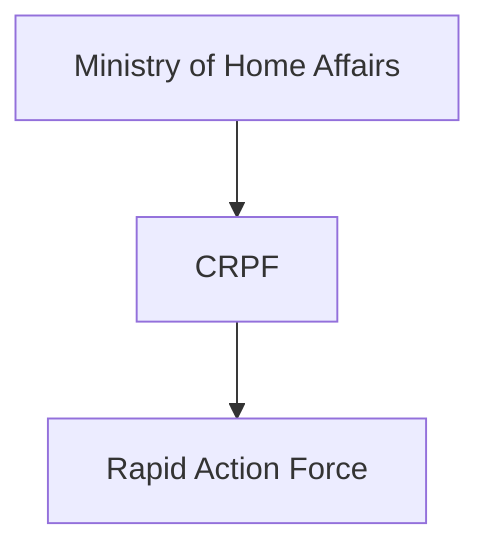
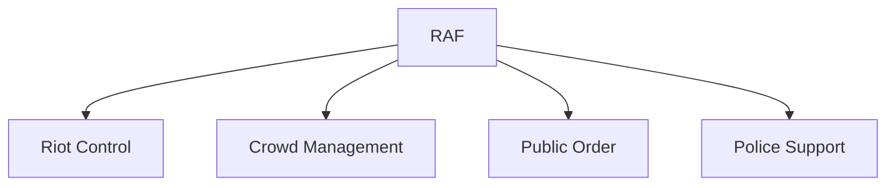
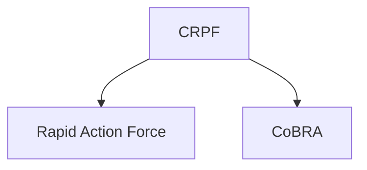

# Rapid Action Force (RAF)

## National Importance

The Rapid Action Force (RAF) is a specialized unit of the Central Reserve Police Force (CRPF) created to respond quickly to riots, communal disturbances, public-order situations and large-scale civil unrest.

RAF is recognized for its rapid deployment capability, crowd-control expertise and non-lethal response approach. It plays an important role in maintaining public order and supporting internal security across India.

---

## Quick Facts

| Item | Details |
|----------|----------|
| Name | Rapid Action Force (RAF) |
| Established | 1992 |
| Parent Force | CRPF |
| Ministry | Ministry of Home Affairs |
| Headquarters | New Delhi |
| Primary Role | Riot Control and Public Order |
| Type | Specialized Internal Security Force |

---

## Historical Background

RAF was established in 1992 as a specialized wing of the CRPF to deal with riots, communal disturbances and public-order emergencies requiring rapid deployment.

Its creation reflected the need for a professionally trained force capable of responding quickly to sensitive law-and-order situations.

---

## Organisation Structure

---

## Primary Responsibilities

- Riot control
- Crowd management
- Public-order operations
- Communal disturbance response
- Security support during major events
- Assistance to state police forces
- Disaster-response support

---

## Operational Role

RAF units are trained to respond rapidly to situations that threaten public peace and stability.

---

## Riot Control Operations

RAF specializes in:

- Riot prevention
- Riot control
- Area stabilization
- Conflict management
- Restoration of public order

The force emphasizes minimum-force and non-lethal methods wherever possible.

---

## Crowd Management

RAF is regularly deployed during:

- Religious gatherings
- Political events
- Large public assemblies
- Sensitive law-and-order situations

Its training focuses on disciplined crowd-control techniques.

---

## Support During Emergencies

RAF also assists during:

- Natural disasters
- Rescue operations
- Humanitarian assistance missions
- Emergency response situations

---

## Relationship with CRPF

RAF functions as a specialized component of the CRPF focused on public-order management.

---

## Strategic Importance

RAF helps India:

- Maintain public order
- Prevent escalation of unrest
- Support civil administration
- Improve rapid-response capability
- Strengthen internal security

---

## Challenges

- Large-scale unrest situations
- Rapid urbanization
- Social tensions
- Complex crowd-management environments
- Evolving public-security challenges

---

## Future Roadmap

- Enhanced non-lethal technologies
- Better surveillance support
- Advanced crowd-management systems
- Improved mobility and communications
- Continued modernization and training

---

## Quick Revision

- RAF was established in 1992.
- It is a specialized unit of the CRPF.
- Responsible for riot control and crowd management.
- Operates under the Ministry of Home Affairs.
- Supports public-order operations across India.
- Uses rapid deployment and specialized training.

---

## Key Concepts

### What is RAF?

A specialized CRPF unit focused on riot control and public-order management.

### Why was RAF created?

To provide a rapid-response force for communal disturbances and public-order situations.

### Which organization controls RAF?

RAF operates under the CRPF and Ministry of Home Affairs.

### What is RAF's primary role?

Riot control, crowd management and restoration of public order.

### Why is RAF important?

It helps maintain stability during sensitive law-and-order situations.
