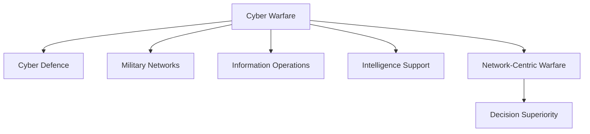

# Cyber Warfare

## Strategic Importance

Cyber warfare has become a critical domain of modern conflict alongside land, sea, air, and space.

Military networks, satellites, command systems, communication infrastructure, and critical national assets are increasingly targeted through cyber attacks.

Understanding cyber warfare is essential for analysing modern national security, military modernization, cyber defence, and future warfare.

---

## Learning Objectives

After completing this section, you should understand:

- Fundamentals of cyber warfare
- Military cyber operations
- Defence cyber security
- Information operations
- Network-centric warfare
- India's cyber defence ecosystem

---

## Repository Structure

```text
cyber-warfare
├── README.md
├── cyber-warfare.md
├── cyber-security-in-defence.md
├── network-centric-warfare.md
└── information-operations.md
```

---

## Learning Path


---

## Topic Overview

### Cyber Warfare

Introduces military cyber operations, offensive and defensive cyber capabilities, and cyber conflict in modern warfare.

### Cyber Security in Defence

Explains protection of military networks, command systems, defence infrastructure, and cyber resilience.

### Network-Centric Warfare

Covers digitally connected military operations, information superiority, command networks, and joint warfare.

### Information Operations

Explains how information, intelligence, communication, cyber capabilities, and influence activities support military objectives.

---

## Cyber Warfare Ecosystem



---

## Indian Cyber Defence Ecosystem

Key organizations include:

- Defence Cyber Agency (DCA)
- Ministry of Defence
- Armed Forces Cyber Units
- Intelligence Agencies
- National Critical Information Infrastructure Protection Centre (NCIIPC)
- Indian Computer Emergency Response Team (CERT-In)

---

## How This Section Connects to Other Domains

| Domain | Relationship |
| -------- | -------- |
| Intelligence | Cyber intelligence and threat monitoring |
| Electronic Warfare | Integrated information and spectrum operations |
| Armed Forces | Military cyber capabilities |
| Space Security | Protection of satellite and space networks |
| National Security | Protection of critical infrastructure |

---

## Quick Revision

- Cyber warfare is a major domain of modern conflict.
- Defence cyber security protects military systems and networks.
- Network-centric warfare relies on secure digital connectivity.
- Information operations support decision advantage.
- Cyber capabilities increasingly influence national security outcomes.

---

## Key Concepts

### Easy

1. What is cyber warfare?
2. What is the role of the Defence Cyber Agency?
3. Why is cyber security important in defence?
4. What is network-centric warfare?

### Intermediate

1. How does cyber warfare differ from traditional warfare?
2. Explain the relationship between cyber warfare and information operations.
3. How does network-centric warfare improve military effectiveness?
4. What are the major cyber threats to military organizations?

### Advanced

1. Analyse the role of cyber warfare in modern military doctrine.
2. Evaluate India's cyber defence preparedness.
3. Explain how cyber warfare supports multi-domain operations.
