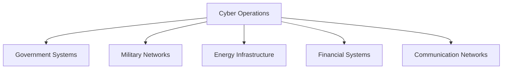

# Cyber Warfare

## Strategic Importance

Cyber warfare has emerged as a major domain of conflict alongside land, sea, air and space.

Modern governments, militaries, financial systems, power grids, communications networks and critical infrastructure depend heavily on digital systems.

As a result, cyber attacks can create strategic, economic and national-security consequences without conventional military action.

---

## Quick Facts

| Item | Details |
|----------|----------|
| Domain | Cyber Security and National Security |
| Operational Area | Cyberspace |
| Importance | Protection of Critical Infrastructure |
| Key Stakeholders | Government, Military and Intelligence Agencies |
| Threats | Espionage, Sabotage, Disruption and Cyber Attacks |

---

## What is Cyber Warfare?

Cyber warfare refers to the use of digital technologies and cyber operations to disrupt, damage, manipulate or gain access to information systems, networks and critical infrastructure.

It may be conducted by states, intelligence agencies, military organizations or hostile non-state actors.

---

## Evolution of Warfare

---

## Major Objectives

### Cyber Espionage

Used for:

- Intelligence gathering
- Strategic information collection
- Monitoring adversaries
- Data theft

### Cyber Sabotage

Targets:

- Critical infrastructure
- Defence systems
- Government networks
- Communication systems

### Information Operations

Includes:

- Influence operations
- Information manipulation
- Disinformation campaigns
- Narrative shaping

---

## Common Targets

---

## Cyber Warfare and National Security

Cyber capability supports:

- Strategic awareness
- National resilience
- Intelligence operations
- Military readiness
- Infrastructure protection

---

## India's Cyber Security Architecture

Key organisations include:

- Defence Cyber Agency
- National Technical Research Organisation (NTRO)
- Intelligence agencies
- National cyber-security institutions

---

## Challenges

- Rapid technological change
- Attribution difficulties
- Sophisticated cyber threats
- Dependence on digital infrastructure
- Protection of critical assets

---

## Future Roadmap

- Stronger cyber resilience
- Improved cyber-defence capability
- Better threat intelligence
- Enhanced military cyber capability
- Greater integration with national-security planning

---

## Quick Revision

- Cyber warfare is a major modern warfare domain.
- Cyber operations can target critical infrastructure.
- Cyber espionage focuses on intelligence gathering.
- Cyber attacks can affect national security without conventional warfare.
- Critical infrastructure protection is a major priority.
- Cyber capability is increasingly important for defence preparedness.

---

## Key Concepts

### What is cyber warfare?

The use of cyber operations to achieve strategic, military or intelligence objectives.

### Why is cyber warfare important?

Modern societies depend heavily on digital infrastructure and networks.

### What is cyber espionage?

The collection of information through cyber means.

### What are common cyber warfare targets?

Government networks, military systems, infrastructure and communication networks.

### Why is cyber security a national-security issue?

Because disruption of critical systems can have strategic consequences.
