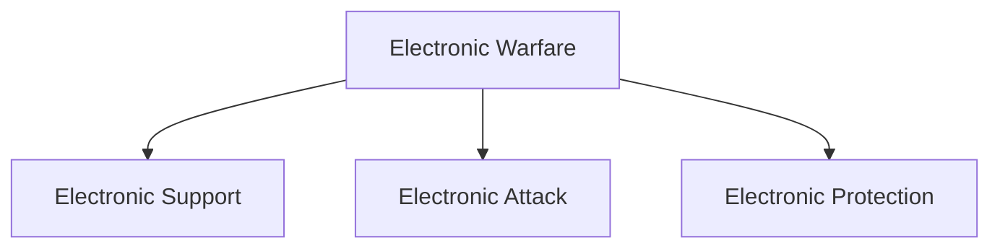

# Electronic Warfare (EW)

## Strategic Importance

Modern military forces depend heavily on radar systems, communications networks, sensors and electronic equipment.

Electronic Warfare (EW) focuses on controlling and exploiting the electromagnetic spectrum while denying its effective use to adversaries.

It has become a critical component of modern military operations across land, sea, air, space and cyber domains.

---

## Quick Facts

| Item | Details |
|----------|----------|
| Domain | Intelligence and Military Operations |
| Operational Area | Electromagnetic Spectrum |
| Purpose | Gain Information Advantage |
| Importance | Battlefield Awareness and Force Protection |
| Users | Armed Forces and Intelligence Agencies |
| Strategic Value | Information Superiority |

---

## What is Electronic Warfare?

Electronic Warfare refers to military activities that use electromagnetic energy to detect, exploit, deceive, disrupt or protect electronic systems.

It helps friendly forces maintain operational effectiveness while reducing the effectiveness of hostile systems.

---

## Components of Electronic Warfare

---

## Electronic Support (ES)

Used for:

- Signal detection
- Threat identification
- Radar monitoring
- Intelligence collection
- Situational awareness

## Electronic Attack (EA)

Used for:

- Radar jamming
- Communication disruption
- Deception operations
- Electronic interference
- Denial of information

## Electronic Protection (EP)

Used for:

- Protecting friendly systems
- Signal security
- Anti-jamming measures
- Communications resilience
- Operational continuity

---

## Electronic Warfare on the Battlefield

---

## Military Applications

Electronic warfare supports:

- Air-defence operations
- Naval operations
- Battlefield surveillance
- Intelligence gathering
- Missile guidance support
- Force protection

---

## Electronic Warfare and Intelligence

EW contributes to:

- Signals collection
- Threat assessment
- Situational awareness
- Target identification
- Operational planning

---

## Strategic Importance

Electronic warfare helps:

- Improve battlefield awareness
- Protect military networks
- Reduce enemy effectiveness
- Enhance operational success
- Strengthen information superiority

---

## Challenges

- Rapid technological evolution
- Advanced enemy systems
- Spectrum congestion
- Electronic countermeasures
- Increasing dependence on electronics

---

## Future Roadmap

- AI-assisted electronic warfare
- Advanced spectrum monitoring
- Improved anti-jamming technologies
- Greater integration with cyber operations
- Enhanced battlefield awareness systems

---

## Quick Revision

- Electronic warfare operates in the electromagnetic spectrum.
- EW consists of Electronic Support, Attack and Protection.
- Jamming is a major electronic attack technique.
- EW supports intelligence gathering and military operations.
- Electronic protection secures friendly systems.
- Information superiority is a key objective of EW.

---

## Key Concepts

### What is Electronic Warfare?

Military use of the electromagnetic spectrum to gain operational advantage.

### What are the three components of EW?

Electronic Support, Electronic Attack and Electronic Protection.

### What is jamming?

The disruption of enemy communications or radar systems.

### Why is EW important?

Modern military systems depend heavily on electronics and communications.

### How does EW support intelligence?

By detecting, monitoring and analysing electronic signals and emissions.
