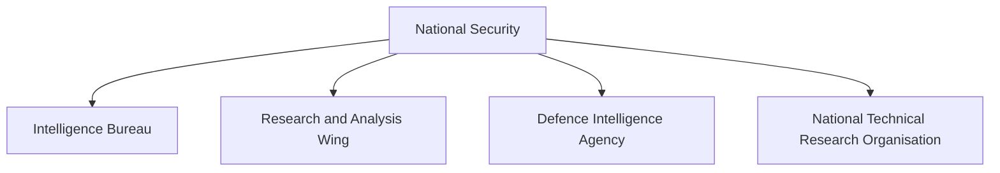
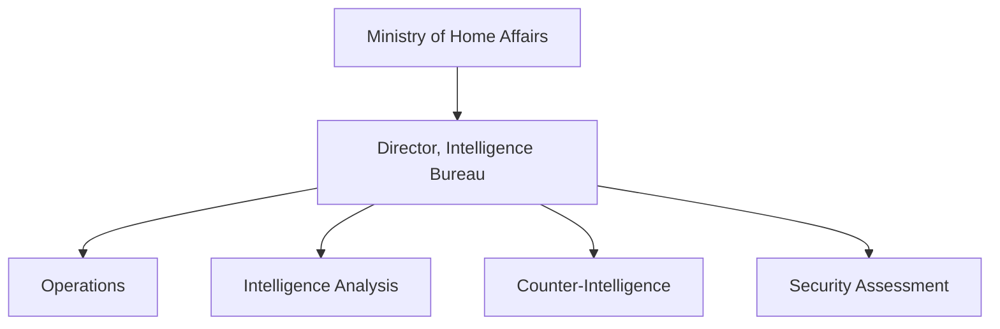
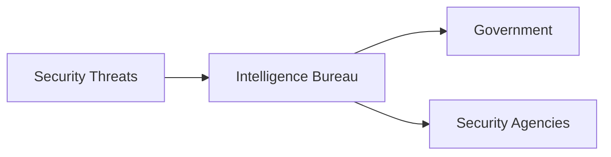

# Intelligence Bureau (IB)

## Strategic Importance

The Intelligence Bureau (IB) is India's oldest intelligence organization and the country's primary internal intelligence and domestic security agency.

It plays a crucial role in protecting India from internal security threats, terrorism, espionage, insurgency, extremism and threats to national stability.

---

## Quick Facts

| Item | Details |
|----------|----------|
| Full Name | Intelligence Bureau |
| Abbreviation | IB |
| Established | 1887 |
| Reports To | Ministry of Home Affairs |
| Domain | Internal Intelligence |
| Headquarters | New Delhi |

---

## What Is the Intelligence Bureau?

The Intelligence Bureau is India's primary domestic intelligence agency responsible for gathering, analyzing and sharing intelligence related to internal security.

Unlike RAW, which focuses on external intelligence, the IB focuses on threats within India.

---

## Intelligence Ecosystem

---

## Historical Background

### Colonial Origins

The Intelligence Bureau was established in 1887 during British rule.

Its original purpose was to monitor security threats across British India.

### Post-Independence Role

After independence, the organization evolved into India's principal domestic intelligence agency.

Its responsibilities expanded to include:

- Internal security
- Counter-terrorism
- Counter-intelligence
- National security assessments

---

## Primary Responsibilities

### Internal Intelligence

- Monitor internal security threats
- Track extremist activities
- Assess domestic security risks
- Provide intelligence assessments

### Counter-Terrorism

- Monitor terrorist networks
- Identify potential threats
- Support security operations
- Share intelligence with law-enforcement agencies

### Counter-Intelligence

- Detect espionage activities
- Monitor foreign intelligence operations
- Protect sensitive national information

### Security Assessment

- Assess emerging threats
- Support national-security planning
- Advise government agencies

---

## Organizational Structure

---

## Areas of Focus

The Intelligence Bureau monitors:

- Terrorism
- Extremism
- Insurgency
- Espionage
- Organized crime
- Internal security threats
- Strategic security developments

---

## Relationship with Other Agencies

| Agency | Primary Responsibility |
|----------|----------|
| IB | Internal Intelligence |
| RAW | External Intelligence |
| DIA | Military Intelligence |
| NTRO | Technical Intelligence |
| NIA | Terrorism Investigation |

---

## IB vs RAW

| Feature | IB | RAW |
|----------|----------|----------|
| Focus | Internal Security | External Intelligence |
| Reporting Ministry | Home Affairs | Cabinet Secretariat |
| Primary Domain | Domestic Threats | Foreign Threats |
| Major Role | Internal Intelligence | External Intelligence Collection |

---

## Role in National Security

---

## Major Functions During Crises

During national-security situations, IB helps:

- Identify threats
- Monitor extremist activities
- Coordinate intelligence sharing
- Support security planning
- Assist counter-terror operations

---

## Challenges

- Evolving terrorism threats
- Cyber-enabled threats
- Radicalization risks
- Large-scale intelligence requirements
- Technological modernization needs

---

## Future Roadmap

- Greater intelligence integration
- Enhanced cyber-intelligence capability
- AI-assisted threat analysis
- Advanced surveillance systems
- Improved inter-agency coordination
- Stronger data-analysis capabilities

---

## Quick Revision

- IB is India's primary internal intelligence agency.
- It was established in 1887.
- It reports to the Ministry of Home Affairs.
- It focuses on domestic security threats.
- It supports counter-terrorism and counter-intelligence operations.
- It works alongside RAW, DIA and NTRO.

---

## Key Concepts

### What is the Intelligence Bureau?

India's primary domestic intelligence agency.

### What is the main responsibility of IB?

Internal intelligence and domestic security.

### Which ministry oversees IB?

The Ministry of Home Affairs.

### How is IB different from RAW?

IB focuses on domestic intelligence, while RAW focuses on foreign intelligence.

### Why is IB important?

It helps protect India from internal security threats and supports national security decision-making.
