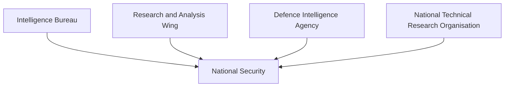

# Research and Analysis Wing (RAW)

## Strategic Importance

The Research and Analysis Wing (RAW) is India's primary external intelligence agency. It is responsible for collecting and analyzing intelligence related to foreign countries, external security threats, strategic developments and matters affecting India's national interests abroad.

RAW plays a critical role in supporting national security, foreign policy, counter-terrorism efforts and strategic decision-making.

---

## Quick Facts

| Item | Details |
|----------|----------|
| Full Name | Research and Analysis Wing |
| Abbreviation | RAW |
| Established | 1968 |
| Reports To | Cabinet Secretariat |
| Domain | External Intelligence |
| Primary Role | Foreign Intelligence Collection |

---

## What Is RAW?

RAW is India's foreign intelligence agency responsible for gathering, analyzing and assessing intelligence from outside India's borders.

Unlike the Intelligence Bureau (IB), which focuses on domestic security, RAW focuses on external threats, strategic developments and foreign intelligence.

---

## Intelligence Ecosystem

---

## Historical Background

### Why RAW Was Created

Before 1968, external intelligence responsibilities were largely handled by the Intelligence Bureau.

Security challenges highlighted the need for a dedicated foreign intelligence agency.

RAW was established in 1968 to strengthen India's external intelligence capability.

---

## Primary Responsibilities

### External Intelligence

- Monitor foreign developments
- Assess strategic threats
- Support national-security planning
- Provide intelligence assessments

### Strategic Intelligence

- Track geopolitical developments
- Monitor military modernization in neighbouring countries
- Assess regional security trends

### Counter-Terrorism Support

- Monitor external terrorist networks
- Track cross-border threats
- Support national counter-terror efforts

### Strategic Warning

- Identify emerging threats
- Provide early-warning assessments
- Support government decision-making

---

## Areas of Focus

RAW monitors:

- Regional security developments
- Foreign military activities
- Terrorist organizations
- Strategic infrastructure developments
- Geopolitical changes
- Cross-border security threats

---

## Intelligence Cycle

---

## RAW vs IB

| Feature | RAW | IB |
|----------|----------|----------|
| Focus | External Intelligence | Internal Intelligence |
| Domain | Foreign Threats | Domestic Threats |
| Reporting Authority | Cabinet Secretariat | Ministry of Home Affairs |
| Primary Responsibility | Foreign Intelligence Collection | Internal Security Intelligence |

---

## Relationship with Other Agencies

| Agency | Primary Responsibility |
|----------|----------|
| RAW | External Intelligence |
| IB | Internal Intelligence |
| DIA | Military Intelligence |
| NTRO | Technical Intelligence |
| NIA | Terrorism Investigation |

---

## Role in National Security

---

## Strategic Importance

RAW helps India:

- Understand external threats
- Support foreign policy objectives
- Strengthen strategic awareness
- Improve national-security planning
- Monitor regional developments
- Enhance deterrence and preparedness

---

## Challenges

- Rapid geopolitical changes
- Evolving terrorism threats
- Cyber-enabled security risks
- Technological competition
- Complex regional security environment

---

## Future Roadmap

- Greater intelligence integration
- Advanced analytical capabilities
- AI-assisted intelligence assessment
- Stronger technical intelligence support
- Enhanced regional monitoring capability
- Better inter-agency coordination

---

## Quick Revision

- RAW is India's primary external intelligence agency.
- It was established in 1968.
- It reports through the Cabinet Secretariat.
- It focuses on foreign intelligence and external threats.
- It supports national-security and foreign-policy decision-making.
- RAW works alongside IB, DIA and NTRO.

---

## Key Concepts

### What is RAW?

India's primary external intelligence agency.

### Why was RAW created?

To provide dedicated foreign intelligence capability.

### How is RAW different from IB?

RAW focuses on external intelligence, while IB focuses on domestic intelligence.

### What is RAW's primary responsibility?

Collecting and analyzing foreign intelligence.

### Why is RAW important?

It helps India identify external threats and supports strategic decision-making.
