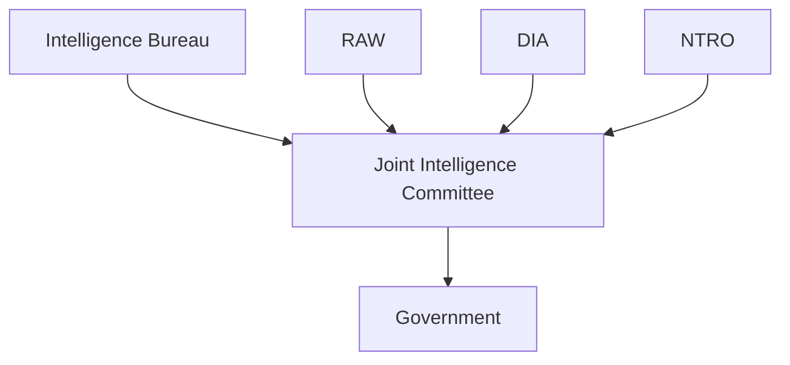
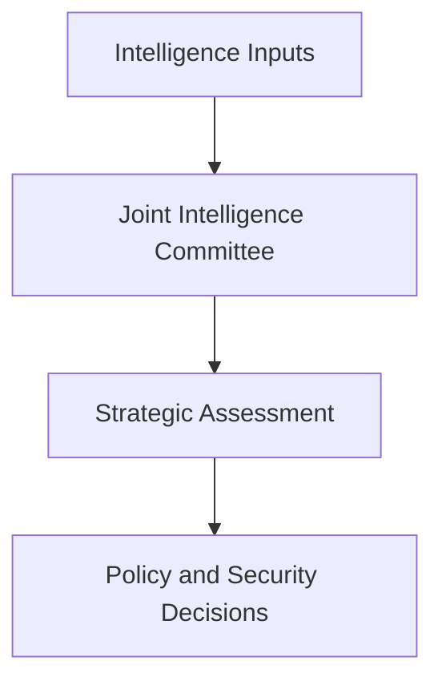

# Joint Intelligence Committee (JIC)

## Strategic Importance

The Joint Intelligence Committee (JIC) is one of India's most important intelligence assessment bodies. While intelligence agencies collect information, the JIC evaluates, analyzes and synthesizes intelligence from multiple sources to support national-security decision-making.

It helps transform raw intelligence into strategic assessments that can be used by policymakers and security institutions.

---

## Quick Facts

| Item | Details |
|----------|----------|
| Full Name | Joint Intelligence Committee |
| Abbreviation | JIC |
| Domain | Intelligence Assessment |
| Reports Through | National Security Framework |
| Primary Role | Strategic Intelligence Analysis |
| Importance | Intelligence-Based Decision Support |

---

## What Is the Joint Intelligence Committee?

The Joint Intelligence Committee is responsible for assessing intelligence received from various agencies and producing coordinated intelligence assessments.

Unlike agencies that collect intelligence, the JIC focuses on analysis, interpretation and strategic evaluation.

---

## Intelligence Assessment Architecture

---

## Why JIC Is Important

- Combines intelligence from multiple agencies
- Produces strategic assessments
- Supports national-security planning
- Reduces intelligence gaps
- Improves policy formulation
- Strengthens threat awareness

---

## Primary Responsibilities

### Intelligence Assessment

- Analyze intelligence inputs
- Evaluate threat information
- Produce coordinated assessments
- Support strategic planning

### Strategic Analysis

- Monitor long-term security trends
- Assess geopolitical developments
- Evaluate emerging risks
- Support national-security strategy

### Decision Support

- Provide assessments to policymakers
- Assist government decision-making
- Improve security planning

---

## Intelligence Flow

---

## Relationship with Other Institutions

| Institution | Primary Responsibility |
|----------|----------|
| IB | Internal Intelligence |
| RAW | External Intelligence |
| DIA | Military Intelligence |
| NTRO | Technical Intelligence |
| MAC | Intelligence Sharing |
| JIC | Intelligence Assessment |

---

## JIC vs MAC

| Feature | JIC | MAC |
|----------|----------|----------|
| Main Function | Intelligence Assessment | Intelligence Sharing |
| Focus | Strategic Analysis | Information Exchange |
| Role | Evaluation and Interpretation | Coordination and Dissemination |
| Output | Threat Assessments | Shared Intelligence Inputs |

---

## Areas of Analysis

The JIC evaluates:

- National-security threats
- Regional security developments
- Terrorism trends
- Military developments
- Strategic competition
- Emerging security risks

---

## Role During Security Crises

During crises, JIC helps:

- Analyze intelligence inputs
- Produce threat assessments
- Support government decisions
- Improve situational awareness
- Assist strategic planning

---

## Strategic Importance

---

## Challenges

- Large intelligence volumes
- Complex threat environment
- Rapid geopolitical changes
- Information overload
- Need for timely assessments

---

## Future Roadmap

- Advanced intelligence analysis tools
- AI-assisted assessment capability
- Better inter-agency integration
- Improved strategic forecasting
- Faster intelligence evaluation processes

---

## Quick Revision

- JIC is India's primary intelligence assessment body.
- It analyzes intelligence from multiple agencies.
- It supports government decision-making.
- JIC focuses on assessment, not collection.
- MAC shares intelligence; JIC evaluates intelligence.
- JIC strengthens national-security planning.

---

## Key Concepts

### What is the Joint Intelligence Committee?

An institution responsible for strategic intelligence assessment and analysis.

### What is JIC's primary role?

To evaluate intelligence and provide strategic assessments.

### How is JIC different from MAC?

MAC shares intelligence, while JIC analyzes and assesses it.

### Which agencies provide inputs to JIC?

IB, RAW, DIA, NTRO and other intelligence organizations.

### Why is JIC important?

It helps convert intelligence into actionable assessments for national-security decision-making.
