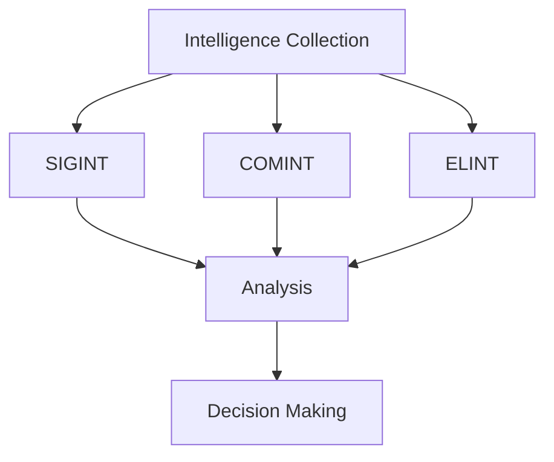

# Modern Intelligence Domains

## Strategic Importance

Modern intelligence operations rely on specialized methods of collecting, analyzing, and disseminating information.

Military and national security organizations use multiple intelligence disciplines to monitor threats, support decision-making, and provide strategic advantage during peace and conflict.

Understanding modern intelligence domains is essential for studying contemporary intelligence operations, military planning, and national security.

---

## Learning Objectives

After completing this section, you should understand:

- Signals Intelligence (SIGINT)
- Communications Intelligence (COMINT)
- Electronic Intelligence (ELINT)
- Intelligence collection methods
- Intelligence analysis and dissemination
- Military decision support systems

---

## Repository Structure

```text
modern-intelligence-domains
├── README.md
├── signals-intelligence.md
├── communications-intelligence.md
└── electronic-intelligence.md
```

---

## Intelligence Collection Ecosystem



---

## Intelligence Domains

### Signals Intelligence (SIGINT)

Collection and analysis of signals emitted by communication systems and electronic devices.

SIGINT is one of the most important intelligence disciplines in modern warfare.

### Communications Intelligence (COMINT)

Focuses on interception and analysis of communication signals.

Examples include:

- Radio communications
- Military communications
- Communication networks
- Voice and data transmissions

### Electronic Intelligence (ELINT)

Focuses on non-communication electronic emissions.

Examples include:

- Radar systems
- Missile guidance systems
- Electronic sensors
- Air defence networks

---

## Intelligence Lifecycle


---

## Military Applications

- Early warning systems
- Battlefield awareness
- Air defence monitoring
- Strategic intelligence
- Electronic order of battle analysis
- Threat assessment

---

## Relationship with Other Domains

| Domain | Relationship |
| -------- | -------- |
| Cyber Warfare | Intelligence supports cyber operations |
| Electronic Warfare | Intelligence supports spectrum operations |
| Armed Forces | Intelligence supports military planning |
| Space Security | Satellite systems support intelligence collection |
| National Security | Intelligence informs strategic decisions |

---

## Challenges

- Encryption technologies
- Large data volumes
- Emerging communication systems
- Cyber threats
- Electronic deception measures

---

## Future Roadmap

- AI-assisted intelligence analysis
- Advanced signal processing
- Improved multi-domain intelligence fusion
- Better real-time intelligence sharing
- Enhanced surveillance and monitoring capabilities

---

## Quick Revision

- SIGINT collects information from signals.
- COMINT focuses on communication signals.
- ELINT focuses on non-communication electronic emissions.
- Intelligence supports military and national security decisions.
- Modern warfare depends heavily on intelligence superiority.

---

## Key Concepts

### Easy

1. What is SIGINT?
2. What is COMINT?
3. What is ELINT?
4. Why is intelligence important?

### Intermediate

1. How does SIGINT support military operations?
2. What is the difference between COMINT and ELINT?
3. Explain the intelligence lifecycle.
4. What challenges affect intelligence collection?

### Advanced

1. Analyse the role of intelligence superiority in modern warfare.
2. Evaluate the importance of SIGINT in national security.
3. Explain how intelligence supports multi-domain military operations.
