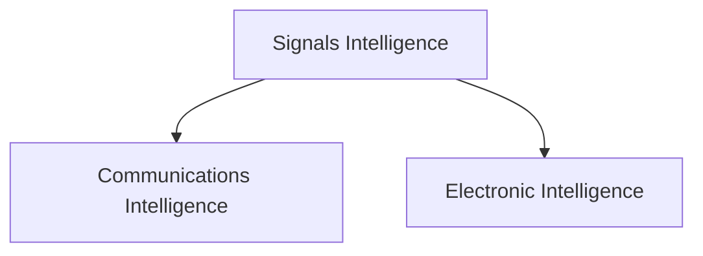
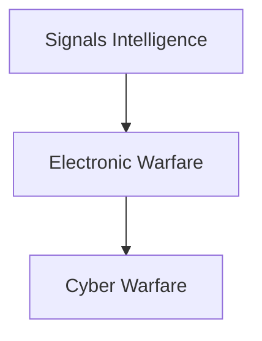

# Signals Intelligence (SIGINT)

## Strategic Importance

Signals Intelligence (SIGINT) is one of the most important sources of modern intelligence collection.

Governments, militaries and intelligence agencies rely on intercepted communications and electronic signals to understand adversaries, identify threats and support national-security decision-making.

SIGINT provides valuable information without requiring direct physical access to targets.

---

## Quick Facts

| Item | Details |
|----------|----------|
| Name | Signals Intelligence (SIGINT) |
| Domain | Intelligence Collection |
| Sources | Communications and Electronic Signals |
| Users | Intelligence Agencies and Armed Forces |
| Purpose | Intelligence Gathering and Threat Assessment |
| Strategic Value | Situational Awareness and Early Warning |

---

## What is Signals Intelligence?

Signals Intelligence refers to the collection, interception, processing and analysis of signals for intelligence purposes.

These signals may come from communications systems, radar systems, military equipment and other electronic sources.

---

## Major Components of SIGINT

---

## Communications Intelligence (COMINT)

Focuses on:

- Voice communications
- Radio transmissions
- Data communications
- Military communications
- Strategic communications

COMINT helps understand intentions, plans and activities.

---

## Electronic Intelligence (ELINT)

Focuses on:

- Radar emissions
- Weapons-system signals
- Electronic signatures
- Air-defence systems
- Military sensors

ELINT helps identify capabilities and operational patterns.

---

## SIGINT Collection Process

---

## Military Applications

SIGINT supports:

- Battlefield awareness
- Threat monitoring
- Strategic warning
- Target identification
- Mission planning
- Force protection

---

## Relationship with Electronic Warfare

SIGINT provides information that supports electronic-warfare and cyber operations.

---

## Strategic Importance

SIGINT helps:

- Improve intelligence collection
- Support military operations
- Detect threats early
- Enhance situational awareness
- Strengthen national-security planning

---

## Challenges

- Encrypted communications
- Massive data volumes
- Advanced electronic systems
- Rapid technological change
- Signal identification complexity

---

## Future Roadmap

- AI-assisted signal analysis
- Advanced interception technologies
- Better data processing systems
- Greater integration with cyber intelligence
- Enhanced real-time intelligence capability

---

## Quick Revision

- SIGINT means Signals Intelligence.
- SIGINT includes COMINT and ELINT.
- COMINT focuses on communications.
- ELINT focuses on electronic emissions.
- SIGINT supports intelligence and military operations.
- Early warning and situational awareness are major objectives.

---

## Key Concepts

### What is SIGINT?

The collection and analysis of communications and electronic signals for intelligence purposes.

### What is COMINT?

Communications Intelligence collected from communication systems.

### What is ELINT?

Electronic Intelligence collected from non-communication electronic signals.

### Why is SIGINT important?

It provides critical information about threats, capabilities and intentions.

### How does SIGINT support national security?

By improving intelligence collection, threat awareness and decision-making.
