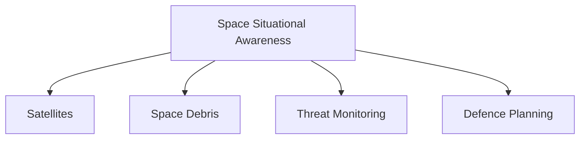

# Space Situational Awareness (SSA)

## Strategic Importance

Space Situational Awareness (SSA) is the ability to detect, track, identify and monitor objects and activities in space.

As satellites become increasingly important for communications, navigation, surveillance and national security, countries require accurate awareness of the space environment.

SSA helps protect critical space assets and supports military and strategic decision-making.

---

## Quick Facts

| Item | Details |
|----------|----------|
| Name | Space Situational Awareness (SSA) |
| Domain | Space Security |
| Purpose | Monitoring Objects and Activities in Space |
| Importance | Protection of Space Assets |
| Users | Defence, Space and National Security Organisations |
| Strategic Value | Early Warning and Space Security |

---

## What is Space Situational Awareness?

SSA refers to the continuous observation and analysis of the space environment.

It helps identify potential threats, monitor satellites, track space debris and support safe operation of space assets.

---

## Why SSA Is Important

Without accurate awareness, satellites and other space assets become vulnerable to collisions, interference and hostile actions.

---

## What Does SSA Monitor?

### Satellites

Tracks:

- Friendly satellites
- Foreign satellites
- Military satellites
- Commercial satellites

### Space Debris

Tracks:

- Defunct satellites
- Rocket fragments
- Orbital debris
- Collision risks

### Potential Threats

Monitors:

- Anti-satellite activities
- Suspicious manoeuvres
- Space interference
- Emerging security threats

---

## SSA Ecosystem

---

## Connection with National Security

SSA supports:

- Protection of space infrastructure
- Military planning
- Strategic warning systems
- Space-security operations
- National decision-making

---

## Relationship with Space Security

SSA provides the awareness necessary for effective space-security planning.

---

## Strategic Importance

SSA helps India:

- Protect critical satellites
- Improve threat awareness
- Reduce collision risks
- Strengthen space security
- Support military operations
- Enhance strategic preparedness

---

## Challenges

- Growing number of satellites
- Increasing space debris
- Counter-space threats
- Data-processing complexity
- Rapidly evolving space environment

---

## Future Roadmap

- Better tracking capabilities
- Enhanced monitoring networks
- Improved threat analysis
- Greater military integration
- Advanced space-domain awareness systems

---

## Quick Revision

- SSA means Space Situational Awareness.
- It tracks objects and activities in space.
- SSA supports space security and national security.
- It helps protect satellites and space infrastructure.
- SSA improves threat detection and preparedness.
- Modern military operations increasingly depend on SSA.

---

## Key Concepts

### What is Space Situational Awareness?

The ability to monitor and understand the space environment.

### Why is SSA important?

It protects satellites and improves awareness of potential threats.

### What does SSA track?

Satellites, debris and activities occurring in space.

### How does SSA support defence?

It provides information needed for security planning and decision-making.

### Why is SSA becoming more important?

Because modern societies and military forces increasingly depend on space-based infrastructure.
