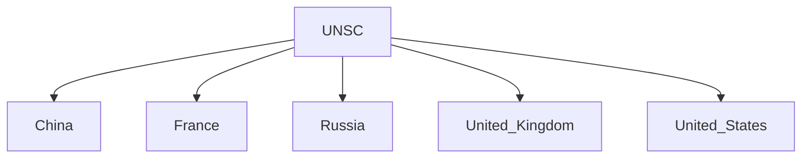

# Veto Power

## Overview

Veto Power is the authority to reject, block, or prevent a decision, resolution, or legislation from taking effect.

The term is most commonly associated with the permanent members of the United Nations Security Council (UNSC), who can block substantive resolutions even if a majority of members support them.

Veto power is one of the most debated features of the contemporary international system.

## Meaning

The word "veto" originates from Latin and means:

- "I forbid"

A veto allows an authorized entity to stop a proposal from being adopted.

## Veto Power in the United Nations

### United Nations Security Council (UNSC)

The veto power exists in the United Nations Security Council.

The Security Council is responsible for:

- International peace and security
- Conflict resolution
- Sanctions
- Peacekeeping operations

## Permanent Members with Veto Power

The five permanent members (P5) are:

- China
- France
- Russia
- United Kingdom
- United States

These countries possess veto power.

## How the Veto Works

For substantive resolutions:

- At least 9 votes are required
- No permanent member should vote against the proposal

A negative vote by any permanent member blocks the resolution.

### Abstention

An abstention by a permanent member does not count as a veto.

Therefore, a resolution may still pass if other voting requirements are satisfied.

## Historical Background

The veto system was established during the creation of the United Nations in 1945.

The major Allied powers insisted on special powers as a condition for joining and supporting the organization.

## Rationale Behind the Veto

Supporters argue that the veto:

- Prevents direct confrontation among major powers
- Maintains great-power participation in the UN system
- Promotes international stability
- Encourages consensus among major states

## Criticism of the Veto

Major criticisms include:

- Creates inequality among member states
- Allows blockage of humanitarian action
- Can paralyze Security Council decision-making
- Reflects the power structure of 1945 rather than today's world

## India's Position

India has consistently advocated reform of the UN Security Council.

India argues that:

- The Security Council should better reflect current global realities
- Developing countries deserve greater representation
- Expansion of permanent membership is necessary

India supports comprehensive UNSC reforms.

## UNSC Reform Debate

Common reform proposals include:

- Expansion of permanent membership
- Expansion of non-permanent membership
- Restrictions on veto use
- Complete abolition of veto power

No major reform has yet been adopted.

## Importance in International Relations

Veto power influences:

- Global diplomacy
- Peacekeeping decisions
- International sanctions
- Military interventions
- UN reforms

It remains one of the most significant powers in global governance.

## Quick Revision

| Topic | Details |
|----------|----------|
| Meaning | Power to Block Decisions |
| Organization | UN Security Council |
| Permanent Members | China, France, Russia, UK, USA |
| Established | 1945 |
| Votes Needed for Resolution | At Least 9 |
| Main Debate | UNSC Reform |

## Think & Recall

1. What is veto power?
2. Which countries possess veto power in the UNSC?
3. Does abstention count as a veto?
4. Why was veto power introduced in 1945?
5. Why does India support UNSC reform?
